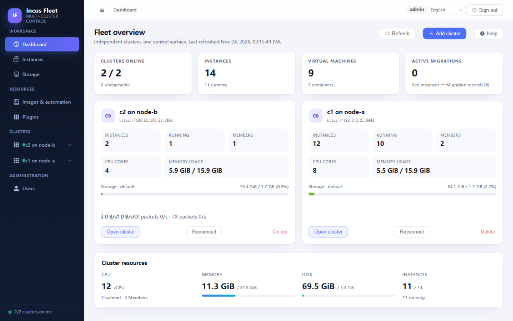
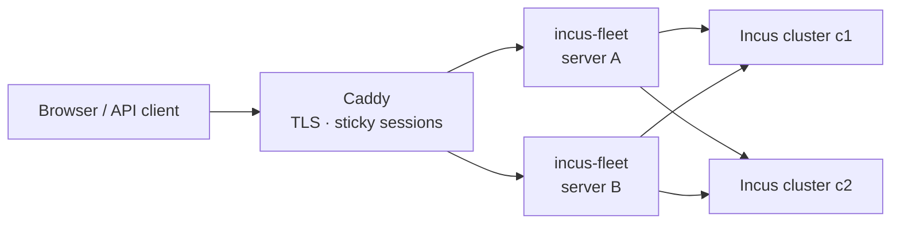
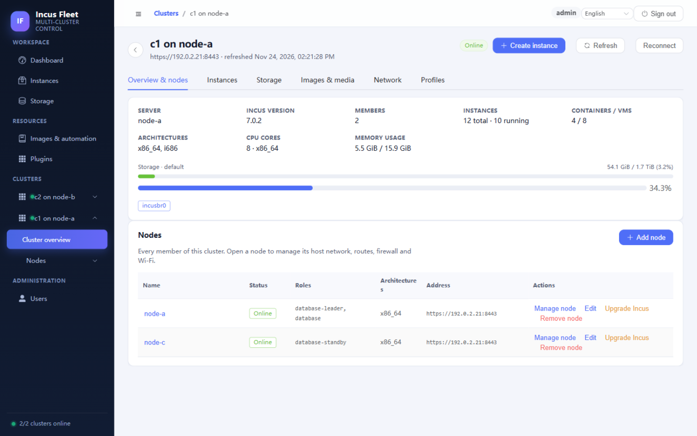
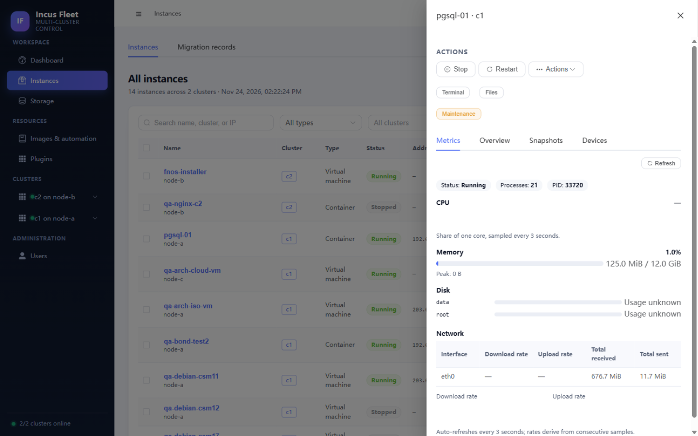

# Incus Fleet

**English** | [简体中文](docs/zh/README.zh-CN.md)

Self-hosted control plane for managing multiple independent [Incus](https://linuxcontainers.org/incus/)
clusters from one UI and API. Instances can be copied or moved between clusters with one click,
including live migration for stateful virtual machines.



*Dashboard in the Simplified Chinese UI; the interface is bilingual and English is available
from the language switcher.*

## Features

- Fleet dashboard with per-cluster health, membership, storage, host CPU/memory, and instance counts
- Container and VM inventory with detail drawers and live resource monitoring
- Cross-cluster `move` and `copy` migrations, with optional snapshots
- Live migration for running VMs with `migration.stateful=true`
- Automatic source restart when a migration fails or is interrupted
- Image import, one-click distribution to other clusters, and cached-image refresh
- ISO installer upload and blank-VM launch for manual OS installation
- Browser-based exec terminals, serial consoles, and SPICE remote desktops
- Guest file management, device mounting, snapshots, clone, rebuild, and password/key injection
- Shared SSH key and script library with batch execution across clusters
- SQLite by default; PostgreSQL selectable at initialization
- Single Go binary with the Vue UI embedded
- Admin-token login with HttpOnly sessions; bearer tokens for automation
- Cluster connections pinned to per-deployment client certificates
- Optional Rust host agent (alpha): one-time enrollment, mTLS WebSocket, facts/heartbeats, and
  allowlisted host network changes and signed Incus bootstrap through a short-lived privileged
  helper
- Agent host and cgroup v2 instance metrics, optional eBPF counters, a one-hour center buffer,
  JSON/Prometheus/CSV export, Prometheus/VictoriaMetrics remote write and query proxy, HTTP SD,
  database task leases, certificate rotation/revocation, signed agent upgrade, audit export,
  native netlink writes, agent-backed node network routing, agent-first onboarding with a
  one-command installer, an HA task dispatcher with an optional Raft center mesh, automatic
  certificate renewal, and direct agent metrics scraping

> Live migration preserves guest network state. When clusters use different subnets,
> renew DHCP inside the guest after the move (or use matching subnets).

## Architecture at a glance



The two app instances are independent. Each one connects to both Incus clusters over the
network and drives migrations through the Incus API. There is no application-level cluster
membership, shared database, or mutual backup relationship between `c1` and `c2`.

See [docs/en/architecture.md](docs/en/architecture.md) for components, migration flow, and failure
semantics.

## Requirements

- Go 1.27 or newer
- Bun 1.4 or newer (frontend)
- Rust 1.99 or newer (optional host agent)
- Two or more Incus clusters reachable over HTTPS
- A client certificate trusted by each cluster
- SQLite (default) or PostgreSQL

## Quick start

```bash
make deps
make build
./bin/incus-fleet -version
```

Generate a client certificate, trust it on every cluster, and write a config:

```bash
scripts/gen-client-cert.sh incus-fleet ~/.config/incus-fleet/certs
incus config trust add-certificate ~/.config/incus-fleet/certs/incus-fleet.crt --name incus-fleet
install -m 600 deploy/examples/config.sqlite.yaml config.local.yaml
$EDITOR config.local.yaml
INCUS_FLEET_AUTH_TOKEN="$(openssl rand -hex 32)" ./bin/incus-fleet -config config.local.yaml -check
INCUS_FLEET_AUTH_TOKEN="..." ./bin/incus-fleet -config config.local.yaml
```

Open `http://127.0.0.1:8080` and sign in with the admin token.

The config reference and full deployment steps are in [docs/en/deployment.md](docs/en/deployment.md).
The HTTP API is documented in [docs/en/api.md](docs/en/api.md). End-user workflows are covered in the
[user guide](docs/en/user-guide.md).

## Screenshots

Cluster detail shows host capacity, storage pools, and instance state:



The instance drawer monitors CPU, memory, disk, and network every 3 seconds:



## Documentation

| Document | English | 简体中文 |
| --- | --- | --- |
| User guide | [docs/en/user-guide.md](docs/en/user-guide.md) | [docs/zh/user-guide.md](docs/zh/user-guide.md) |
| Architecture | [docs/en/architecture.md](docs/en/architecture.md) | [docs/zh/architecture.md](docs/zh/architecture.md) |
| Deployment | [docs/en/deployment.md](docs/en/deployment.md) | [docs/zh/deployment.md](docs/zh/deployment.md) |
| HTTP API | [docs/en/api.md](docs/en/api.md) | [docs/zh/api.md](docs/zh/api.md) |
| Roadmap | [docs/en/roadmap.md](docs/en/roadmap.md) | [docs/zh/roadmap.md](docs/zh/roadmap.md) |
| Engineering standards | [docs/en/standards.md](docs/en/standards.md) | [docs/zh/standards.md](docs/zh/standards.md) |
| Contributing | [CONTRIBUTING.md](CONTRIBUTING.md) | [docs/zh/CONTRIBUTING.zh-CN.md](docs/zh/CONTRIBUTING.zh-CN.md) |
| Security policy | [SECURITY.md](SECURITY.md) | [docs/zh/SECURITY.zh-CN.md](docs/zh/SECURITY.zh-CN.md) |
| Code of conduct | [CODE_OF_CONDUCT.md](CODE_OF_CONDUCT.md) | [docs/zh/CODE_OF_CONDUCT.zh-CN.md](docs/zh/CODE_OF_CONDUCT.zh-CN.md) |
| Changelog | [CHANGELOG.md](CHANGELOG.md) | [docs/zh/CHANGELOG.zh-CN.md](docs/zh/CHANGELOG.zh-CN.md) |

The English files are canonical. Chinese files mirror them and should be updated in the same
change whenever behavior or instructions change.

## Development

```bash
make test        # Go + frontend tests
make coverage    # Go >= 90% gate, frontend 90/90/90/85 thresholds
make lint        # go vet, golangci-lint, ESLint
make check       # format check, vet, lint, tests
```

Frontend development runs Vite with an API proxy to `127.0.0.1:8080`:

```bash
cd web && bun run dev
```

Coding conventions and the TDD contract are in [docs/en/standards.md](docs/en/standards.md).

## Repository layout

```
cmd/incus-fleet        process entry point
internal/app           service wiring and HTTP lifecycle
internal/assets        shared SSH key/script library and batch operations
internal/auth          admin token and in-memory sessions
internal/clusters      Incus connection manager and summaries
internal/config        YAML config loading and validation
internal/httpapi       REST API and embedded SPA handler
internal/instances     instance inventory, operations, images, ISO, SPICE
internal/migrations    migration orchestration and rollback
internal/store         SQLite/PostgreSQL persistence
internal/testutil      test doubles for the Incus API
deploy/                systemd, Caddy, and example configs
docs/
  en/                  English docs + images/ (canonical)
  zh/                  Simplified Chinese docs + images/ + zh-CN mirrors
  local/               local-only, gitignored (real IPs, credentials, notes)
web/                   Vue 3 + TypeScript + Vite + Element Plus UI
```

## Security

- Treat the admin token, client private keys, and database credentials as secrets.
- The example configuration files contain placeholders only.
- Cluster endpoints must use HTTPS and pinned client certificates; trust tokens are not used.
- The UI stores no token in browser storage. Login exchanges the token for an HttpOnly cookie.
- SPICE listens on cluster member interfaces without ticket authentication. Restrict the
  allocated port range (5910-5989) with a firewall.
- Report vulnerabilities privately as described in [SECURITY.md](SECURITY.md).

## Contributing

Issues and pull requests are welcome. Read [CONTRIBUTING.md](CONTRIBUTING.md) and
[docs/en/standards.md](docs/en/standards.md) before you start. All participants must follow the
[Code of Conduct](CODE_OF_CONDUCT.md).

## License

Copyright (C) 2026 mickeyzzc and contributors.

This project is licensed under the **GNU Affero General Public License v3.0** (AGPL-3.0). See
[LICENSE](LICENSE) for the full text.

AGPL-3.0 is a strong copyleft license: if you modify Incus Fleet and make it available to
users over a network, you must offer those users the corresponding source code. This keeps
the project open while preventing closed-source hosted derivatives.
