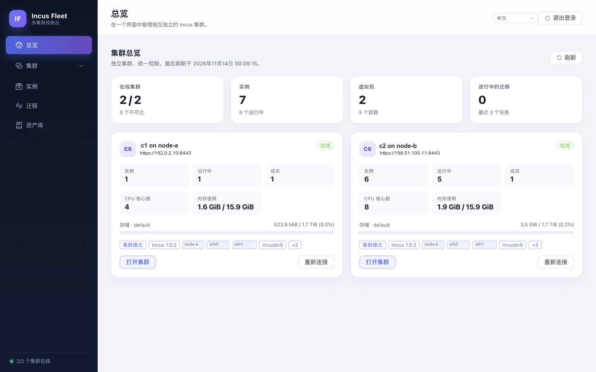
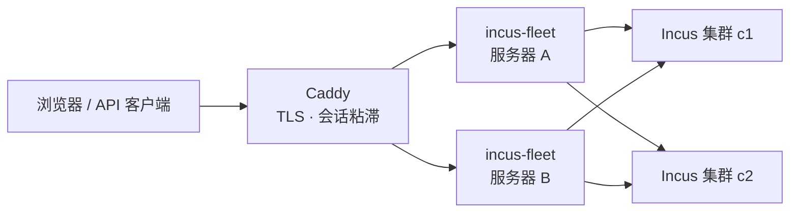
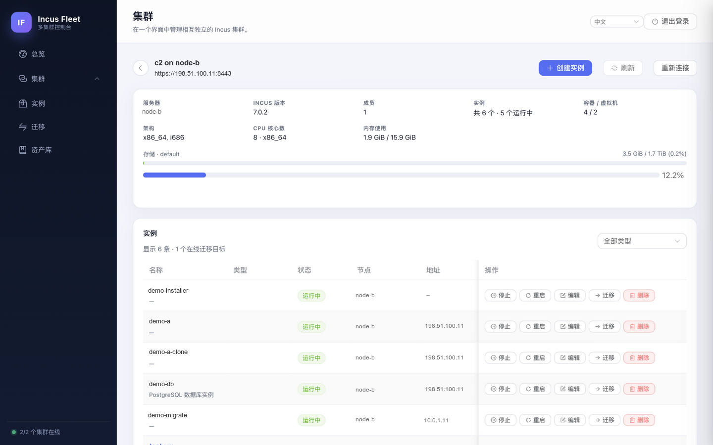
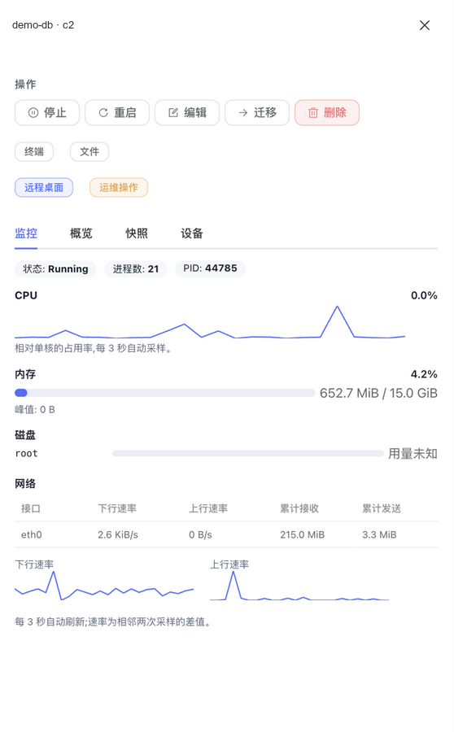

# Incus Fleet

[English](README.md) | **简体中文**

自托管的控制平面：用一个 UI 和一套 API 管理多个相互独立的
[Incus](https://linuxcontainers.org/incus/) 集群。实例可在集群之间一键复制或迁移，
有状态虚拟机支持在线迁移。



*截图为简体中文界面；界面支持中英双语，可在语言切换器中切换。*

## 功能

- 集群总览：在线状态、成员、存储、宿主机 CPU/内存与实例数量
- 容器与虚拟机清单，详情抽屉与实时资源监控
- 跨集群 `move` / `copy` 迁移，可选携带快照
- 运行中虚拟机在线迁移（要求 `migration.stateful=true`）
- 迁移失败或中断时自动恢复源实例运行
- 镜像导入、一键分发到其他集群、缓存镜像刷新
- ISO 安装镜像上传与空白虚拟机启动，用于手动安装系统
- 浏览器内的 Exec 终端、串行控制台与 SPICE 远程桌面
- 客户机文件管理、设备挂载、快照、克隆、重建、密码/密钥注入
- 共享 SSH 公钥与脚本库，支持跨集群批量执行
- 默认 SQLite；初始化时可选 PostgreSQL
- 单个 Go 二进制，内嵌 Vue UI
- 管理员 token 登录，HttpOnly 会话；自动化可用 Bearer token
- 每个部署使用独立客户端证书连接集群
- 可选 Rust 主机 agent（alpha）：一次性注册、mTLS WebSocket、facts/心跳，并可通过短生命周期特权 helper 执行允许列表内的主机网络变更和签名 Incus 引导
- Agent 主机与 cgroup v2 实例指标、可选 eBPF 计数器、中心 1 小时缓冲、JSON/Prometheus/CSV 导出、Prometheus/VictoriaMetrics remote write 与查询代理、HTTP SD、数据库任务 lease、证书轮换/吊销、签名 agent 升级、审计导出、原生 netlink 写入、
agent 后端节点网络路由、HA 任务 dispatcher、证书自动续期和 agent 指标直连抓取

> 在线迁移会保留客户机网络状态。若两个集群使用不同网段，迁移后需在客户机内
> 重新获取 DHCP（或让两个集群使用相同网段）。

## 架构概览



两个应用实例彼此独立。每个实例都通过网络连接两个 Incus 集群，并通过 Incus API
驱动迁移。`c1` 与 `c2` 之间不存在应用层集群成员关系、共享数据库或互为备份关系。

组件、迁移流程和失败语义见 [docs/zh-CN/architecture.md](docs/zh-CN/architecture.md)。

## 环境要求

- Go 1.27 或更新版本
- Bun 1.4 或更新版本（前端）
- Rust 1.99 或更新版本（可选主机 agent）
- 两个或更多可通过 HTTPS 访问的 Incus 集群
- 被每个集群信任的客户端证书
- SQLite（默认）或 PostgreSQL

## 快速开始

```bash
make deps
make build
./bin/incus-fleet -version
```

生成客户端证书，在每个集群上信任它，然后写入配置：

```bash
scripts/gen-client-cert.sh incus-fleet ./certs
incus config trust add-certificate ./certs/incus-fleet.crt --name incus-fleet
install -m 600 deploy/examples/config.sqlite.yaml config.local.yaml
$EDITOR config.local.yaml
INCUS_FLEET_AUTH_TOKEN="$(openssl rand -hex 32)" ./bin/incus-fleet -config config.local.yaml -check
INCUS_FLEET_AUTH_TOKEN="..." ./bin/incus-fleet -config config.local.yaml
```

打开 `http://127.0.0.1:8080`，用管理员 token 登录。

配置参考与完整部署步骤见 [docs/zh-CN/deployment.md](docs/zh-CN/deployment.md)。
HTTP API 见 [docs/zh-CN/api.md](docs/zh-CN/api.md)，日常操作见
[用户手册](docs/zh-CN/user-guide.md)。

## 界面截图

集群详情展示宿主机容量、存储池与实例状态:



实例抽屉每 3 秒刷新一次 CPU、内存、磁盘与网络监控:



## 文档

| 文档 | English | 简体中文 |
| --- | --- | --- |
| 用户手册 | [docs/user-guide.md](docs/user-guide.md) | [docs/zh-CN/user-guide.md](docs/zh-CN/user-guide.md) |
| 架构 | [docs/architecture.md](docs/architecture.md) | [docs/zh-CN/architecture.md](docs/zh-CN/architecture.md) |
| 部署 | [docs/deployment.md](docs/deployment.md) | [docs/zh-CN/deployment.md](docs/zh-CN/deployment.md) |
| HTTP API | [docs/api.md](docs/api.md) | [docs/zh-CN/api.md](docs/zh-CN/api.md) |
| 工程规范 | [docs/standards.md](docs/standards.md) | [docs/zh-CN/standards.md](docs/zh-CN/standards.md) |
| 贡献指南 | [CONTRIBUTING.md](CONTRIBUTING.md) | [CONTRIBUTING.zh-CN.md](CONTRIBUTING.zh-CN.md) |
| 安全策略 | [SECURITY.md](SECURITY.md) | [SECURITY.zh-CN.md](SECURITY.zh-CN.md) |
| 行为准则 | [CODE_OF_CONDUCT.md](CODE_OF_CONDUCT.md) | [CODE_OF_CONDUCT.zh-CN.md](CODE_OF_CONDUCT.zh-CN.md) |
| 变更日志 | [CHANGELOG.md](CHANGELOG.md) | [CHANGELOG.zh-CN.md](CHANGELOG.zh-CN.md) |

英文文档为基准版本。中文文档与其镜像对应；行为或操作说明变化时，应在同一次
变更中同步更新两种语言。

## 开发

```bash
make test        # Go + 前端测试
make coverage    # Go >= 90% 门槛，前端 90/90/90/85 门槛
make lint        # go vet、golangci-lint、ESLint
make check       # 格式检查、vet、lint、测试
```

前端开发使用 Vite，API 代理到 `127.0.0.1:8080`：

```bash
cd web && bun run dev
```

编码规范与 TDD 约定见 [docs/zh-CN/standards.md](docs/zh-CN/standards.md)。

## 仓库结构

```
cmd/incus-fleet        进程入口
internal/app           服务装配与 HTTP 生命周期
internal/assets        共享公钥/脚本库与批量操作
internal/auth          管理员 token 与内存会话
internal/clusters      Incus 连接管理与集群摘要
internal/config        YAML 配置加载与校验
internal/httpapi       REST API 与内嵌 SPA 处理
internal/instances     实例清单、运维、镜像、ISO、SPICE
internal/migrations    迁移编排与回滚
internal/store         SQLite/PostgreSQL 持久化
internal/testutil      Incus API 测试替身
deploy/                systemd、Caddy 与示例配置
docs/                  架构、API、规范、部署、用户手册
web/                   Vue 3 + TypeScript + Vite + Element Plus UI
```

## 安全

- 管理员 token、客户端私钥和数据库凭据都应按机密信息保管。
- 示例配置只包含占位符。
- 集群地址必须使用 HTTPS 和固定客户端证书；不使用信任 token。
- UI 不在浏览器存储中保存 token，登录时换取 HttpOnly Cookie。
- SPICE 在集群成员网卡上监听且无票据认证，请用防火墙限制分配的端口范围
  （5910-5989）。
- 漏洞请按 [SECURITY.zh-CN.md](SECURITY.zh-CN.md) 私下报告。

## 贡献

欢迎提交 Issue 和 Pull Request。开始前请阅读
[CONTRIBUTING.zh-CN.md](CONTRIBUTING.zh-CN.md) 与
[docs/zh-CN/standards.md](docs/zh-CN/standards.md)。所有参与者必须遵守
[行为准则](CODE_OF_CONDUCT.zh-CN.md)。

## 许可证

Copyright (C) 2026 mickeyzzc 及贡献者。

本项目采用 **GNU Affero 通用公共许可证第 3 版**（AGPL-3.0），完整文本见
[LICENSE](LICENSE)。

AGPL-3.0 是强著佐权许可证：如果你修改了 Incus Fleet 并通过网络向用户提供服务，
必须向这些用户提供对应的源代码。这样既保持项目开源，也避免闭源的托管衍生版本。
