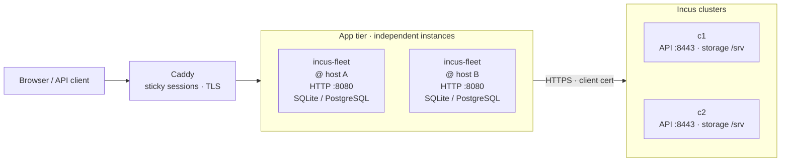
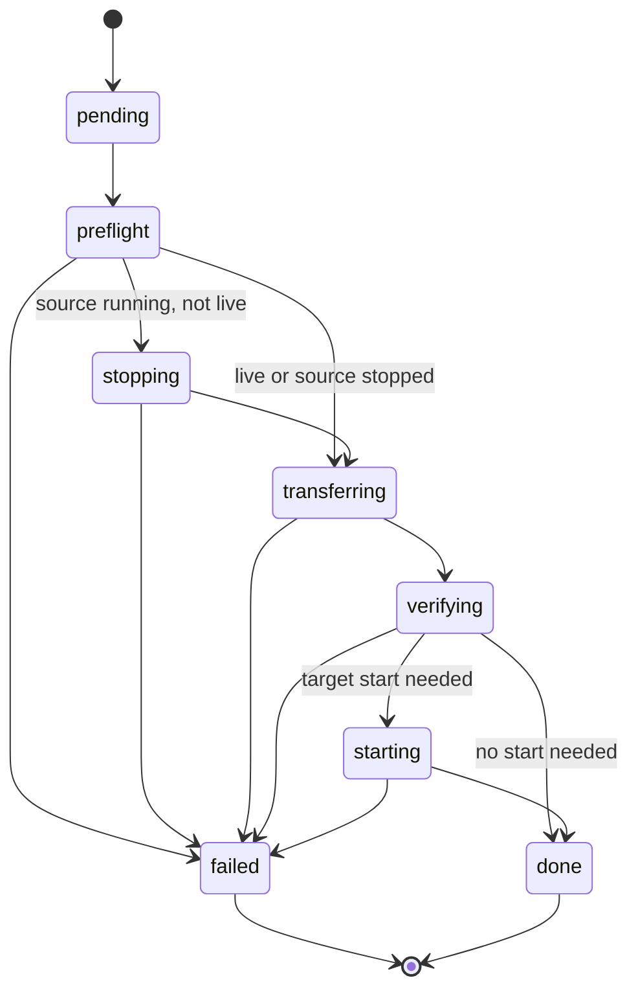

# Architecture

**English** | [简体中文](zh-CN/architecture.md)

Incus Fleet is a stateless-ish control plane that sits in front of two or more independent
Incus clusters. It provides inventory, health, lifecycle operations, shared operational assets,
resource monitoring, and single-click cross-cluster migration behind one UI and API.

## Goals

- Operate independent Incus clusters without joining them into one Incus cluster.
- Give operators one UI/API for inventory, health, lifecycle operations, and migration.
- Manage images and ISO installers across clusters, including one-click distribution.
- Keep reusable SSH keys and scripts in one place and apply them in batches.
- Move or copy containers and VMs between clusters, with rollback on failure.
- Keep each deployment a single Go binary plus a small SQLite database.
- Allow clusters to be added over time without redesigning the control plane.

## Non-goals

- Incus cluster membership across sites.
- Replication, mutual backup, or automatic failover between clusters.
- Container live migration. Containers are stopped while their filesystem is copied.
- A shared control-plane database across app instances. Each app instance is independent.

## Runtime topology



Each app instance connects to **both** Incus clusters. The app instances do not talk to each
other. Caddy load-balances browsers and pins each browser to one app instance (see
[Sticky sessions](#sticky-sessions)).

## Components

| Package | Responsibility |
| --- | --- |
| `cmd/incus-fleet` | Flags, config loading, structured logging, signal handling |
| `internal/config` | YAML parsing, environment overrides, defaults, validation, cert file checks |
| `internal/clusters` | Dials Incus endpoints, holds pinned-cert clients, builds health summaries, reconnect |
| `internal/bootstrap` | Signed Incus bootstrap spec and signature verification |
| `internal/incusbootstrap` | Join/init Incus preseed rendering |
| `internal/hostops` | Typed host operation interface and backend selection |
| `internal/nodeaccess` | Resolves the local or SSH host operator for a cluster member |
| `internal/nodejoin` | SSH-based Incus installation and cluster join for new members |
| `internal/instances` | Inventory, lifecycle, images, ISO, SPICE, files, snapshots, and guest operations |
| `internal/assets` | Shared SSH key/script library and per-instance batch execution |
| `internal/migrations` | Validates migration requests, persists tasks, runs copy/move, rollback |
| `internal/store` | SQLite/PostgreSQL schema for migrations, keys, and scripts |
| `internal/auth` | Constant-time admin token check and in-memory session table |
| `internal/httpapi` | REST routes, auth middleware, error mapping, security headers, SPA fallback |
| `internal/app` | Dependency wiring, HTTP server timeouts, graceful shutdown |
| `web` | Embedded Vue 3 SPA |

## Startup sequence

1. Parse CLI flags (`-config`, `-version`, `-check`).
2. Load YAML, apply `INCUS_FLEET_*` environment overrides and defaults, validate.
3. Verify referenced certificate files exist.
4. Open the database and create the `migrations`, `keystones`, and `scripts` schemas/indexes
   if needed.
5. Mark any tasks left in a non-final state as failed (`MarkInterrupted`). A previous process
   may have been killed during a transfer.
6. Dial every configured Incus endpoint with its pinned client certificate.
7. Build the HTTP handler and serve the embedded SPA and API.
8. On `SIGINT`/`SIGTERM`, stop accepting requests, shut down the HTTP server, and close the
   database. In-flight migration goroutines are allowed to finish or time out.

## Cluster connections

- Every cluster has its own `tls_cert` + `tls_key` client certificate and an optional
  `tls_server_cert` for server verification.
- Trust tokens are never used by the running service. The certificate is added to the Incus
  trust store ahead of time (`incus config trust add-certificate`).
- Endpoints must be `https://` URLs; trailing slashes are normalized.
- A dial failure does not stop the process. The cluster is marked offline with an error, and
  `POST /api/v1/clusters/{name}/reconnect` re-dials it.
- The manager exposes a narrow client interface to callers and retains the full Incus client
  internally for operations that need it (notably `CopyInstance`).

## Inventory

`instances.List` calls `GetInstancesFull` for one cluster and converts each record into a
summary. `ListAll` iterates configured clusters, so one offline cluster currently fails the
whole request (the cluster dashboard still shows per-cluster health).

Summaries include status, type, node, project, addresses, memory, process count, timestamps,
storage pool, and whether the instance supports stateful/live migration. Detail requests add
guest OS information, selected configuration, devices, and live state, while avoiding
unbounded or sensitive config maps.

## Lifecycle operations

All lifecycle work is synchronous from the HTTP caller's perspective and bounded by timeouts:

- **State changes**: start, stop, and restart through the Incus state API. Stop/restart accept
  a force flag.
- **Create/clone/rebuild**: create from a local image with optional CPU, memory, root disk,
  network, and static addresses; clone within a cluster; rebuild a stopped instance's root
  disk from another image. Rebuild leaves data volumes untouched.
- **Snapshots**: create (optionally stateful), restore, and delete.
- **Devices**: attach disks (custom volume or host path) and NICs; detach by device name.
- **Files**: list, download, upload, create directories, and delete files inside the guest.
- **Guest actions**: run a script, set a password, or inject an SSH key. Payloads travel over
  stdin, never as process arguments.
- **Images**: import a local tarball, distribute it to another cluster with a direct Incus
  transfer, refresh a cached image, and delete images.
- **ISO installers**: upload ISO files as custom volumes, launch a blank VM from one, and
  delete the volume.
- **Consoles**: exec and serial terminals, the Incus VGA console, and a per-channel SPICE
  websocket bridge. SPICE uses unauthenticated TCP listeners on cluster members, so the port
  range must be firewalled.

## Resource monitoring

Host CPU, memory, storage, and instance counts come from the Incus cluster resources API.
Per-instance metrics come from the live instance state API: CPU time, memory usage and peak,
per-mountpoint disk usage, and per-interface network counters. The frontend samples instances every
3 seconds and derives rates from counter deltas.

The optional host agent adds host telemetry every 10 seconds. The center stores it in a bounded
in-memory ring buffer (360 points, one hour) with center-injected `cluster`, `member`, and
`agent_id` labels. `GET /api/v1/metrics/query|snapshot|export` exposes JSON, Prometheus text, and
CSV; metrics are not written to the control-plane database.

The agent collects cgroup v2 metrics for containers (and host-side cgroup metrics for VMs) without
extra privileges. Optional eBPF adds host TCP retransmit/OOM counters, cgroup-attributed retransmit
and OOM counters, and a per-cgroup block-latency histogram. Cgroup ids are resolved through each
cgroup directory's kernel file handle, including nested systemd cgroups. When the object, BTF, or
capabilities are missing it logs the reason and falls back to procfs/cgroup.

When external metrics are enabled, the center also forwards normalized series to a Prometheus or
VictoriaMetrics remote-write endpoint through a bounded retry queue, and proxies PromQL range
queries for the UI. `GET /api/v1/sd/agents` provides HTTP service discovery using a separate token;
in this release Prometheus scrapes a center-proxied endpoint for each online agent. Direct agent
listeners are a later phase.

## Host operations

Host network and node provisioning operations go through a typed
`hostops.Operator` selected by a resolver. `node_access.mode` is `auto` (default), `agent`, `ssh`,
or `local`. The fleet app host is always local; remote members use an online agent when available,
otherwise SSH when configured. Reads may fall back to SSH; mutating operations fall back only when
`node_access.ssh_write_fallback` is true (the default for deployments that predate the agent).

On Linux the helper applies link state, static addresses, and fleet routes through native netlink;
the command backend remains for non-Linux development/tests, and persistence still goes through
the detected manager. The resolver prefers an online agent for remote members, so the node network
page uses the agent automatically and falls back to SSH only when configured.

Every mutation is persisted as a `host_task` with state transitions and a `host_audit` entry
containing actor, source IP, backend, action, plan hash, result, and timestamps. `unknown` means
the executor disconnected while the operation may have completed; it is not treated as a failure.
Wi-Fi passwords, SSH/sudo passwords, Incus join tokens, and private keys are never stored. The
current implementation executes synchronously and records the task; the agent phase adds queued,
dispatched, and leased tasks.

`GET /api/v1/tasks`, `GET /api/v1/tasks/{id}`, and `GET /api/v1/audit` expose the records.

## Host agent

The optional Rust agent is a typed host actuator, not an Incus proxy. It enrolls with a one-time
token, receives a client certificate from the center CA, and opens an outbound mTLS WebSocket to
the separate agent gateway (`agent.listen`, default `:8444`). The browser API creates enrollment
tokens and dispatches read-only `nodenet.snapshot` tasks through `GET /api/v1/agents/{id}/snapshot`.

The protocol is protobuf `incusfleet.agent.v1` (`api/agent/v1/agent.proto`), with generated Go and
Rust types. The agent sends Hello, Facts, and Heartbeat frames; the center sends task dispatches
and heartbeat acknowledgements. The agent reports facts and `ip -j` based network snapshots, and
can apply allowlisted link/address/route/firewall/Wi-Fi changes through a short-lived privileged
helper. The helper validates the JSON contract, records a rollback snapshot keyed by task ID, and
persists addresses through the detected manager (ifupdown, systemd-networkd, netplan, wicked, or
NetworkManager). Incus provisioning is a signed declarative spec: the center builds a join or init
preseed and signs it with the agent CA key; the helper verifies the signature, installs through the
host package manager when requested, runs `incus admin init --preseed`, waits for the local API,
and records idempotent steps under `/var/lib/incus-fleet-helper`. Telemetry and eBPF remain later
phases.

## High availability and lifecycle

Host tasks carry `lease_owner`/`lease_until` and can be claimed by a worker with PostgreSQL
`FOR UPDATE SKIP LOCKED` or a SQLite transaction. This is the coordination primitive for multiple
center instances; the current synchronous HTTP path does not yet run a background dispatcher.

Agent certificates are issued by the center CA. Admins can sign a replacement certificate for an
existing agent public key or revoke an agent; the gateway checks revocation on connect and verifies
the stored certificate fingerprint. The agent renews itself over mTLS within 30 days of expiry.
Agent upgrades use a detached Ed25519 signature, a `.prev` backup, a `--version` health check that
restores the previous binary on failure, and an optional systemd restart. Audit records can be
exported as JSONL or CSV.

A background dispatcher (`ha.enabled`) claims queued `agent.network` tasks with database leases,
renews the lease while the agent runs the task, and records success/failure. This lets multiple
center instances share one PostgreSQL database without executing the same task twice.

## Shared assets and batch operations

The asset library stores SSH public keys and scripts in the control-plane database. Keys are
de-duplicated by content. Batch operations resolve the same `instances.RunOps` path used by
single-instance maintenance actions, so key injection, script execution, and power operations
behave consistently across one or many instances. Targets run sequentially and independently;
one failure does not abort the rest.

## Migration flow

A migration request names a source cluster, target cluster, instance, mode (`move` or `copy`),
whether to include snapshots, and whether to start the target (`auto_start`, default `true`).

### Preflight (synchronous)

`Submit` rejects invalid requests before creating a task:

- source and target must differ and be known/connected;
- the instance must exist on the source and not on the target;
- the mode must be `move` or `copy`;
- `live` requires `mode=move`;
- live mode requires a running VM with `migration.stateful=true`;
- the source root disk's storage pool must exist on the target.

A per-instance lock (`source/instance`) prevents two migrations of the same instance.

### Execution (asynchronous, 6h default timeout)

1. `preflight` — status persisted as validated.
2. If the source is running and the migration is not live: `stopping` — stop the source with a
   300s timeout.
3. `transferring` — the target calls `CopyInstance` in `pull` mode using the source's full
   Incus client, then waits for the remote operation. Live VMs transfer memory and state while
   running.
4. `verifying` — live moves stop the source before target startup.
5. `starting` — start the target when the migration is live, or when the source was running and
   `auto_start` is true.

Live migration preserves the guest's network state. If the source and target clusters use
different subnets, the guest can keep its source DHCP lease and become unreachable until it
renews (for example `dhclient -r <if>` then `dhclient <if>`, or `networkctl reconfigure <if>`).
The control plane does not run commands inside guests; use matching subnets or arrange a guest
DHCP renewal after the move.
6. For `move`, delete the source instance (`verifying` / "removing source"). For `copy`, restart
   the source if it was stopped.
7. `done` — progress "complete".



`stopping` and `starting` are conditional; `progress` carries the human-readable stage,
including source removal after a successful `move`.

### Rollback rules

- If the source was stopped and the copy fails, the source is restarted.
- If a move fails after the copy completed but before the source deletion, the source is not
  restarted (the target copy exists; the operator decides what to keep).
- If the source deletion fails after a successful copy, the migration is marked failed but both
  copies remain; the source is not restarted.
- A process crash leaves the task non-final; the next startup marks it failed. Automatic
  cleanup is not attempted.

### Status values

`pending`, `preflight`, `stopping`, `transferring`, `starting`, `verifying`, `done`, `failed`.
Progress text is a short stage label plus transfer metadata when Incus reports it.

## Persistence

Migration tasks, shared SSH keys, and shared scripts are persisted. Sessions, cluster
summaries, and instance inventory are in memory.

```
migrations(
  id, source_cluster, target_cluster, instance, instance_type,
  mode, live, status, progress, error, created_at, updated_at
)

keystones(id, name, public_key, comment, created_at)

scripts(id, name, description, body, created_at, updated_at)
```

- SQLite uses WAL and a single connection so in-memory test databases stay coherent.
- PostgreSQL uses `pgx` with `?` placeholders rebound to `$n`.
- Timestamps are stored as Unix nanoseconds.
- Identical public keys share a content-derived id, so storing the same key twice is a no-op.

Migration history is operational data, not a source of truth for cluster state. Losing it does
not lose instances. The key and script library is user content and should be included in
database backups.

## Authentication and sessions

- The server has one shared admin token (`server.auth_token` or `INCUS_FLEET_AUTH_TOKEN`).
- `POST /auth/login` compares the token in constant time and creates a random 32-byte session ID
  stored in memory with a 12-hour TTL.
- The browser receives `incus_fleet_session` as an `HttpOnly`, `SameSite=Lax`, path `/` cookie.
  It is `Secure` when the request is TLS or carries `X-Forwarded-Proto: https`, so Caddy
  termination is detected while plain-HTTP LAN testing still works.
- Protected API routes accept either that cookie or `Authorization: Bearer <admin token>`.
- Logout removes the session and expires the cookie.
- Session IDs are not persisted and are not shared between app instances.

### Sticky sessions

Because sessions live in one process, Caddy must pin a browser to one upstream. The sample
Caddyfile uses `lb_policy cookie`, not round-robin. API clients using the bearer token do not
need stickiness. If an app instance restarts or becomes unavailable, its sessions are lost and
the user signs in again.

## Frontend

- Vue 3 composition API, TypeScript strict mode, Vite, Pinia, Element Plus.
- `createFleetRouter(history)` is a factory so tests can use memory history; the default export
  uses `createWebHistory`.
- The router initializes the session once and guards protected routes, preserving the requested
  path in `?redirect=`.
- The API client is a typed wrapper over `fetch` with an `ApiError` envelope parser and an
  unauthorized hook that clears auth state.
- Views poll migration state only while tasks are active. The instance monitoring tab samples
  live metrics every 3 seconds while it is open.
- The UI is bilingual (English and Simplified Chinese) via `vue-i18n`; the choice is stored in
  the browser and applies immediately.
- Production assets are embedded with `//go:embed all:dist`; the handler serves files from
  `dist`, caches hashed assets immutably, and falls back to `index.html` for SPA routes.

## Security headers

The HTTP handler sets `X-Content-Type-Options: nosniff`, `X-Frame-Options: DENY`,
`Referrer-Policy: same-origin`, and a restrictive CSP. JSON error responses never include
stack traces. Underlying error text is returned to the caller for 5xx responses while the full
error and request context are also logged server-side.

## Scaling and expansion

- To add a cluster, add a config entry with its endpoint and certificate, trust the certificate
  on that cluster, and restart or reconnect. No app-cluster membership is required.
- To add a node to an Incus cluster, use normal Incus cluster join procedures; this app needs
  no change.
- To add an app instance, deploy the same binary/config shape on another host and add it to the
  Caddy upstream pool. It will share no state with existing instances; that is intentional.
- The centralized migration lock is per process. Two app instances can attempt the same
  instance migration concurrently. Incus itself will reject conflicting operations, and the
  target existence check limits damage, but multi-instance coordination is not provided.

## Observability

- Structured JSON logs via `log/slog` to stdout.
- Request logs include method, path, status, bytes, and duration; non-GET or failing requests log
  at info, successful GETs at debug.
- `GET /api/v1/healthz` (unauthenticated) returns status, version, and time for load balancers.
- `GET /api/v1/version` returns the build version.
