# User Guide

**English** | [简体中文](../zh/user-guide.md)

This guide walks through a complete two-cluster workflow, from signing in to delivering a
usable instance. Replace the example cluster names `c1` and `c2` with your own. All addresses
and subnets are documentation examples.

Prerequisites:

- Fleet is deployed as described in [deployment](deployment.md) and reachable (example:
  `http://fleet.example:8080`).
- You have the admin token (written to `INCUS_FLEET_AUTH_TOKEN` at deploy time).
- Both clusters are [configured in Fleet](deployment.md#3-configure-the-application) and online.

## Contents

1. [Sign in and choose a language](#sign-in-and-choose-a-language)
2. [Navigation & page map](#navigation--page-map)
3. [Users and roles](#users-and-roles)
4. [Remote desktop](#remote-desktop)
5. [Installing the incus agent](#installing-the-incus-agent)
6. [Tour the dashboard](#tour-the-dashboard)
7. [Images: import and distribute](#images-import-and-distribute)
8. [ISO installers and OS installation](#iso-installers-and-os-installation)
9. [Create an instance](#create-an-instance)
10. [Day-to-day instance management](#day-to-day-instance-management)
11. [Online terminals and remote desktop](#online-terminals-and-remote-desktop)
12. [Maintenance actions: scripts, passwords, keys](#maintenance-actions-scripts-passwords-keys)
13. [Image upgrades and cloning](#image-upgrades-and-cloning)
14. [Port forwarding](#port-forwarding)
15. [Walkthrough: deploy a PostgreSQL container](#walkthrough-deploy-a-postgresql-container)
16. [Cross-cluster migration and guest networking](#cross-cluster-migration-and-guest-networking)
17. [Images & automation, batch operations](#images--automation-batch-operations)
18. [Resource monitoring](#resource-monitoring)
19. [Storage pools and networks](#storage-pools-and-networks)
20. [Private interconnect networks](#private-interconnect-networks)
21. [Adding a node](#adding-a-node)
22. [Node network and operation history](#node-network-and-operation-history)
23. [Plugins (admin)](#plugins-admin)
24. [FAQ](#faq)

## Sign in and choose a language

1. Open the fleet URL, enter your **username and password**, and sign in. Sessions last 12
   hours; sign in again after they expire. If a session expires mid-page, fleet routes to the
   sign-in view automatically and returns you to the original page afterwards. The current
   account name appears in the top bar.
2. Create the first administrator in one of two ways:
   - set `INCUS_FLEET_BOOTSTRAP_ADMIN_USERNAME` and `INCUS_FLEET_BOOTSTRAP_ADMIN_PASSWORD`
     in `incus-fleet.env` and restart the service; or
   - sign in with the shared admin token and create one under **Users**.
   The shared token stops working as soon as any local account exists.
3. Use the **language selector in the top-right toolbar** to switch between English and
   中文. The choice applies immediately and is stored in the browser.

## Navigation & page map

The sidebar is grouped by scope, and the top bar shows breadcrumbs for the current page so
you always know which cluster or resource you are inside.

- **Fleet** — **Dashboard** (cluster health and totals) and **Instances** (the cross-cluster
  instance table).
- **Resources** — **Images & automation** (images, install media, keys, scripts, answer
  profiles), **Assets**, and (for administrators) **Plugins**.
- **Clusters → Nodes** — one expandable group per cluster; its **Overview** page and the
  **Nodes** submenu list every member, each opening the node detail and **Node network** page.
- **Administration** — **Users** (visible to administrators only).

In addition to the grouped items, the top-level pages are **Instances**, **Fleet volumes**
(cross-cluster storage inventory; see [Storage pools and networks](#storage-pools-and-networks)),
**Assets**, **Plugins**, and **Users**. Breadcrumbs in the top bar show the path to the current
page (for example *Cluster → Nodes → Node network*); click a crumb to navigate back.

The sidebar can be collapsed to an **icon-only rail** with the toggle in the top-left toolbar;
group labels and menu text hide while the icons remain, and hovering an icon reveals its label.

## Users and roles

Only administrators see **Users** in the sidebar under **Administration**.

- **Roles**: Administrator (everything), Operator (mutate instances and nodes, cannot manage
  users), Viewer (read-only).
- **Create**: username, password (at least 8 characters), role; optionally mark the account
  disabled or require a password change at next sign-in.
- **Edit**: change the role, reset the password, enable or disable. Leaving the password
  blank keeps the current one.
- **Delete**: confirmed before it happens. The last administrator cannot be deleted or
  demoted; the API returns a conflict.
- **Sessions**: the **Sessions** row action lists the account's active sessions (sign-in time,
  last activity, origin). **Revoke all sessions** ends every session for that user at once,
  including the current one, so you will be signed out if you revoke your own.
- **Authorization is server-side**: a viewer is refused (403) even when it calls the API
  directly and bypasses the UI.

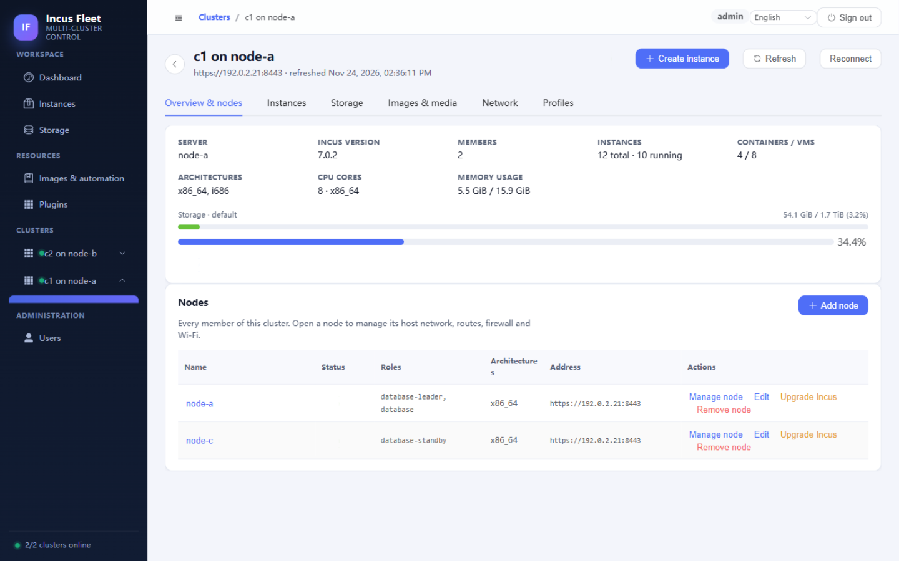

## Remote desktop

The **Remote desktop** button opens a live graphical console for running virtual machines
directly in the browser. It works without any VNC or SPICE support in the host's QEMU: the
fleet attaches a second QEMU monitor (`raw.qemu.conf`, QMP control mode) to the VM, polls
framebuffer screenshots through it, and injects keyboard and pointer events. The first
preparation restarts a running VM once; after that opening the console is immediate and
idempotent.

In the console window: click into the picture to give it keyboard focus (arrow keys, Enter,
Ctrl+Alt+Del all reach the guest), click or drag inside it to move the pointer and press
buttons, and scroll to send wheel events. The picture refreshes automatically about once a
second. The toolbar also shows the guest power state with **Start**, **Restart**, and **Stop**
buttons, so a stopped VM can be booted without leaving the console. Containers have no display
device and do not offer this button.

## Installing the incus agent

Systems installed from an arbitrary ISO (for example fnOS) do not carry Incus's in-guest agent,
which is why the exec terminal, file manager, and instance metrics stay unavailable on such VMs.
The instance drawer shows an **Install agent** button **only for agent-less virtual machines**
(detected from the missing guest network/guest-info state); containers and agent-backed VMs do
not show it. Enter the guest's SSH credentials (a guest address is optional — Fleet resolves it
from DHCP leases if left blank; sudo escalation is supported for non-root users). The
credentials are used for that one session and never stored.

The dialog reports each step inline with its own result (OK, failed, or a "reboot may be needed"
warning):

1. **Validate** the inputs;
2. **Resolve address** from the DHCP leases if none was supplied;
3. **Connect** over SSH;
4. **Check guest** for systemd and 9p support;
5. **Mount config share** (the read-only `config` share Incus mounts into every VM, which
   carries the official `install.sh`);
6. **Run install.sh** inside the guest;
7. **Cleanup** the temporary mount;
8. **Verify agent** is responding.

Manual fallback inside the guest, if you prefer:

```
mount -t 9p config /mnt
/mnt/install.sh
```

The installer only supports systemd guests with 9p support in the kernel (Debian, Ubuntu, and
derivatives qualify). Windows VMs need the virtio-win agent flow and are not covered yet.

## Tour the dashboard

The dashboard opens after sign-in and shows:

- Online status, Incus version, and instance count for every cluster;
- Total instances and the running/stopped split;
- Resource overview (CPU, memory, storage).

The status refreshes automatically every 15 seconds while the tab is visible, so a member
coming back online appears without a manual reload.

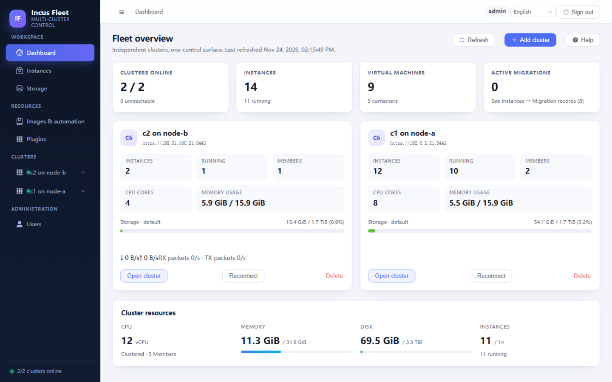

*Dashboard in the Simplified Chinese UI; switch languages from the gear menu.*

Click a cluster to open its detail page: instances, images, storage pools, networks,
profiles, and members.

## Images: import and distribute

Start at **Resources → Images & automation** in the sidebar: its **Images** tab is the
cross-cluster image inventory, while **Install media (ISO)** holds uploaded installers (see the
[ISO workflow](#iso-installers-and-os-installation)). To place an image on a specific cluster,
open that cluster's **Images & media** tab — this view is **cluster-scoped**: it shows and
manages only that cluster's images, storage volumes and ISO media. Fleet uploads a local image
file to one cluster, then distributes it to other clusters with one click: upload once, use
everywhere. Deleting an image on a cluster asks for confirmation first — it cannot be undone.

### Step 1: prepare the image files

Export the image on any machine with Incus:

```bash
# Unified file (one tar archive)
incus image export debian/13 debian13

# Split files (metadata tar archive + .root filesystem)
# Produces debian13 (metadata) and debian13.root (root filesystem)
```

ISO installers use the separate [ISO workflow](#iso-installers-and-os-installation); this
image import handles container and VM images.

### Step 2: upload to a cluster

1. Open the target cluster (for example `c2`) → **Images** → **Import**.
2. Choose the image files:
   - Unified file: select only the tar archive;
   - Split files: select the metadata tar archive, then the matching `.root` file under
     **Rootfs file**.
3. Choose the image type (container / virtual machine). Optionally set an alias (for example
   `debian/13`) so the image is easy to pick when creating instances.
4. Click **Import**. When the upload finishes, the image appears in the list by fingerprint.

The API is equivalent to the UI:

```bash
curl -H "Authorization: Bearer $INCUS_FLEET_AUTH_TOKEN" \
  -F "image=@debian13" -F "rootfs=@debian13.root" \
  "http://fleet.example:8080/api/v1/clusters/c2/images/import?type=container&alias=debian/13"
```

### Step 3: distribute to other clusters

1. In the image list of the cluster that owns the image (for example `c2`), click
   **Distribute**.
2. Choose the target cluster (for example `c1`), optionally set an alias, and confirm.
3. The same fingerprint appears in the target cluster's image list when the transfer
   completes.

## ISO installers and OS installation

Fleet can upload ISO installers (for example the official Debian, Ubuntu, or CentOS images)
and boot a blank virtual machine from the ISO to install the OS. Start from **Resources →
Images & automation → Install media (ISO)** for the fleet-wide library; launching a VM is done
from a cluster's **Images & media** tab, which is cluster-scoped.

1. Upload the ISO under **Images & automation → Install media (ISO)** (or the cluster's
   **Images & media** tab): click **Upload ISO**, choose the `.iso` file and a storage pool.
   The upload **continues in the background if you navigate away** and can be **canceled from
   the upload list**.
2. The ISO appears in the list. Click **Create VM**:
   - Enter a VM name (required);
   - Optionally choose a network (recommended when the installer needs to download packages;
     a physical NIC or a managed bridge both work);
   - Optionally set the root disk size (for example `20GiB`, enough for the OS).
3. Fleet creates a blank VM that boots from the ISO. It relaxes Secure Boot for compatibility
   with most installers and configures the SPICE graphics channel in advance.
4. Open the VM's **Remote desktop** (see below) to see the installer in the browser and
   complete the installation as if you were at a physical machine.
5. When installation finishes, shut the VM down, detach the ISO in the device panel (or
   delete and recreate the VM), then boot into the installed system.

### Unattended installation

The interactive path above needs keyboard input in the remote desktop. **Unattended install**
does the whole installation without a single keystroke: Fleet ships your answer file on the
installation media, forces the installer's default boot entry, and watches for completion.

1. In the **Create VM from ISO** dialog, fill in the VM name as usual, then enable
   **Unattended install**.
2. Pick the **installer profile** (Fleet guesses one from the ISO name):

   

   - **Debian / d-i preseed** — Debian and derivatives shipping the debian-installer;
   - **Ubuntu autoinstall (Subiquity)** — Ubuntu server 20.04+ ISOs;
   - **RHEL / Fedora kickstart** — RHEL, Rocky, Alma, CentOS Stream, Fedora;
   - **Generic cloud-init (NoCloud seed)** — custom ISOs that honor cloud-init.
3. Supply the answers in one of three ways:
   - Fill the template fields: hostname (defaults to the VM name), user account, password,
     timezone, target disk, locale, keyboard layout, and **additional packages** to install
     during the unattended install;
   - Pick a saved **Unattended install** template from the dropdown — templates are managed under
     **Images & automation → Unattended install**, can be marked as the default for their installer,
     and are applied automatically when a launch supplies no answer content;
   - Enable **Provide my own answer file** and paste a complete preseed.cfg / ks.cfg / user-data.

   **Preview answer file** renders exactly what will be shipped.
4. Click **Start unattended install**. What happens next:
   - Debian/RHEL profiles are *remastered*: the answer file is added to the ISO and the GRUB
     configuration gains the unattended kernel arguments plus a 10-second default boot. The
     original ISO stays untouched; a derived `<iso>-<profile>-auto` volume is created instead.
   - Ubuntu/generic profiles keep the installer ISO untouched and attach a generated NoCloud
     seed ISO (`cidata-<vm>`) as a second media.
5. Watch the progress on the **Remote desktop** — the installer runs from boot to finish with
   no input. The patched boot menu boots itself after 10 seconds. When the installation
   completes, the VM powers off, Fleet automatically detaches the installation media and
   deletes the derived volumes (including the answer-file copies), and you can simply start
   the VM to boot the installed system.

Notes and requirements:

- Unattended install is **fully self-contained**: everything runs inside Fleet and the cluster.
  No external downloader, artifact service, or internet access is required — it works in isolated
  cluster networks. Images only need to be present under **Images & automation** (they can be uploaded
  from a local file, so an external download helper is optional and never a prerequisite).
- **xorriso** must be installed on the fleet server (`apt install xorriso`); it remasters the
  installer ISO and builds the seed media. The scratch directory `unattended.work_dir`
  (default `data/unattended` relative to the server working directory) needs several GB free
  for large ISOs.
- The remaster runs on the cluster member that stores the ISO; the VM is created on the same
  member.
- Debian/RHEL remaster profiles carry the answer file inside the derived ISO — treat those
  volumes like any media containing credentials. They are deleted automatically after the
  install; if the watch window (6 h) expires, detach the media and delete the derived volume
  from the storage panel.
- Generic NoCloud installs (custom ISOs) have no deterministic "finished" signal; media stays
  attached until you detach it or the watch window expires.

ISO files live in the storage pool and can be deleted from the list at any time. Downloaded
installer images (for example the current Debian netinst and Arch Linux ISOs) appear under
**Images & automation → Install media (ISO)** once uploaded:

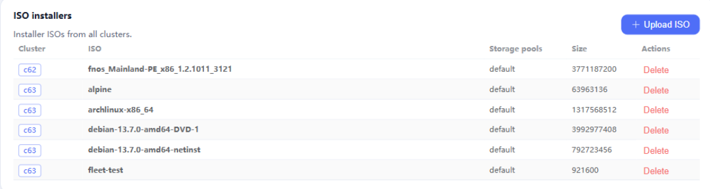

Before starting, use **Preview answer file** to inspect the exact preseed/cloud-init content
that will be shipped inside the derived ISO. The preview is available in the unattended-install
dialog; the browser remote desktop then follows the installer's framebuffer size automatically.


*Previewing the generated answer file before launching an unattended install (English UI).*

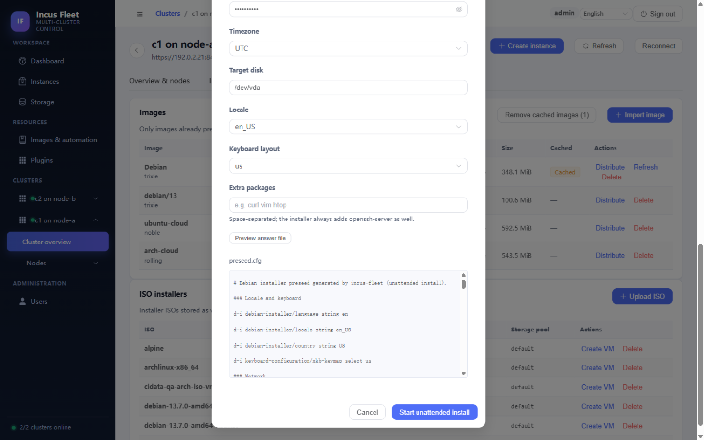

*The unattended-install options in the Create VM from ISO dialog.*

## Create an instance

Open a cluster → **Instances** → **Create instance**. Key fields:

| Field | Notes |
| --- | --- |
| Name | Unique within the cluster |
| Type | Container / virtual machine |
| Image | Pick an imported image by alias or fingerprint |
| Network | See below |
| CPU / memory / root disk size | Limits; leave blank for defaults |

### Additional disks

The create form has an **Additional disks** section (in the edit form a hint points you to the
instance's **Devices** tab instead). For each disk supply:

- **Name** — a unique device name inside the instance (for example `data0`);
- **Mount path** — an absolute path in the guest (for example `/data`; may be empty for a block
  device);
- **Size** — see [Entering sizes](#entering-sizes).

Names must be unique, paths must be absolute, and sizes must parse; errors appear inline next to
the field before you can submit. An empty **source** means Fleet creates a new empty volume in
the selected storage pool and mounts it at the given path; once created, the volume name is
back-filled into the device's `source` key. To mount an existing volume, enter its name instead.

### Entering sizes

Memory, root disk and additional disk sizes use a number plus a unit from the **MiB / GiB / TiB**
dropdown. A bare number is interpreted as **MiB** (for example `512` means `512MiB`), and
invalid values show an inline error. When a cluster is selected, the form shows its current
memory and storage capacity as hints (used / total), so you can size a new instance against what
is actually free.

### Choosing a network: same-subnet IPs

The network dropdown groups its options so heterogeneous clusters stay readable: managed
networks (usable on every member) come first, then one group of physical NICs per member;
bond member NICs are hidden from the parent candidates because a macvlan over a bond slave
cannot come up. Note that the cluster overview only lists **managed networks**; physical
NICs, addresses, routes and firewall rules are node-local and live under
**Cluster → Node → Node network**.

The instance address depends on the selected network:

- **Managed bridge** (for example `incusbr0`): the instance joins the Incus internal NAT
  subnet (for example `10.x.x.x`). Outbound traffic is NATed and the instance is not directly
  reachable from outside.
- **Physical NIC (macvlan)**: NICs without the managed marker (for example the host NIC
  `eth0`, listed under the member that owns it). The instance is bridged directly onto the
  physical LAN via macvlan and **gets a DHCP address from the same subnet as the host** (for
  example, if the host is on `198.51.100.0/24`, the instance receives `198.51.100.x`). Other
  LAN devices can reach the instance directly.

To give an instance an address on the host subnet, select the **physical NIC** (parent is the
host NIC name) when creating it. Do not enter a static IP: macvlan addresses come from the LAN
DHCP server.

After creation, confirm in the address column that the IP is in the expected subnet. If no
address appears, check the switch/router DHCP service and the NIC bridge state.

> **Bonded hosts:** if the physical NIC is a slave of a bond, it cannot be used as a macvlan
> parent (`Failed to start device "eth0": device or resource busy`). Select the bond interface
> itself instead, or attach the NIC later from the instance's **Devices** tab as a macvlan
> device with the bond as its parent. The edit form's Network field only accepts managed
> Incus networks; use the Devices tab for physical parents.

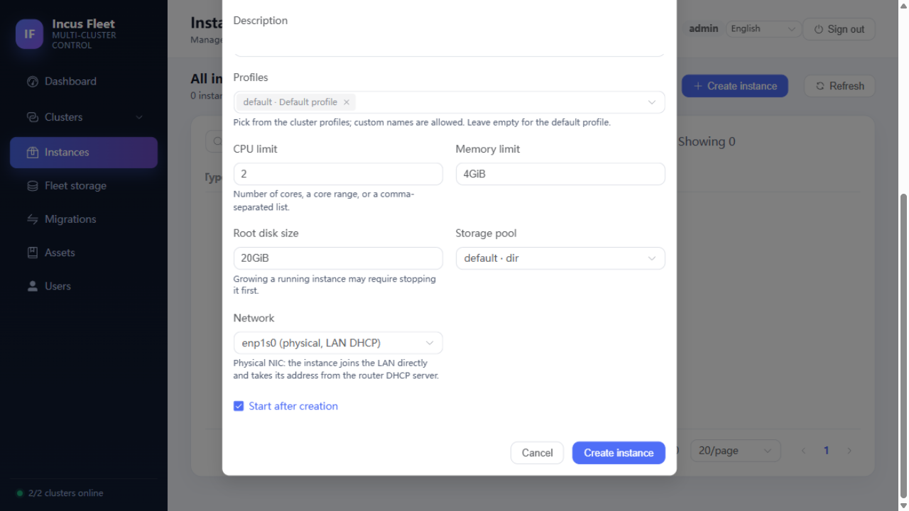

*CPU, memory, root disk and network selection in the create/edit form (English UI).*

## Day-to-day instance management

Start from **Fleet → Instances**. The **Instances** page shows a cross-cluster table: every
instance from every cluster in one place, with a **Cluster** column and a cluster filter so you
can narrow the view (selecting a cluster in the cluster detail page's **Instances** tab is the
secondary, cluster-scoped path to the same drawer and actions). Above the table, a view switcher
offers the list and the **Migration records** tab (`view=migrations`; see
[Migration records](#migration-records)). Selecting instances reveals a batch toolbar (see
[Batch operations](#batch-operations-apply-to-many-instances-at-once)).

From the instance list or the detail drawer you can:

- **Start / stop / restart**: stop and restart ask for confirmation and offer a **force**
  option.
- **Rename**: use **Rename** in the row/action menu. Stop the instance first — a running instance
  cannot be renamed. The new name must be unique within the cluster.
- **Snapshots**: create (optionally with running state), restore, delete. Restoring rolls the
  disk back; confirm before proceeding.
- **Terminal**:
  - *Exec*: an interactive shell inside the instance;
  - *Console*: the serial console (prefer Exec for containers; console close code 1006 is a
    normal shutdown).
- **File management**: browse the instance filesystem, upload, download, create directories,
  and delete files.
- **Devices**: attach a disk (storage volume or host path), a second NIC, or a port forward;
  edit any attached device. Editable fields depend on the type: a NIC exposes its network and
  IPv4/IPv6 addresses, a disk exposes pool, source, mount path and size, and a proxy exposes
  the host-side **listen** and instance-side **connect** addresses. The merge keeps keys the
  form does not manage (for example boot priority or custom `nictype`), so unrelated
  configuration survives an edit. Expand a row to see the full device configuration and copy
  it; detach devices in the same panel. Clearing a NIC address falls back to DHCP. Switching a
  NIC to a managed network rewrites legacy `nictype`/`parent` devices.
- **Delete instance**: asks for confirmation and offers a checkbox to delete the instance's
  attached storage volumes in the same step (shared ISO installer assets are kept).

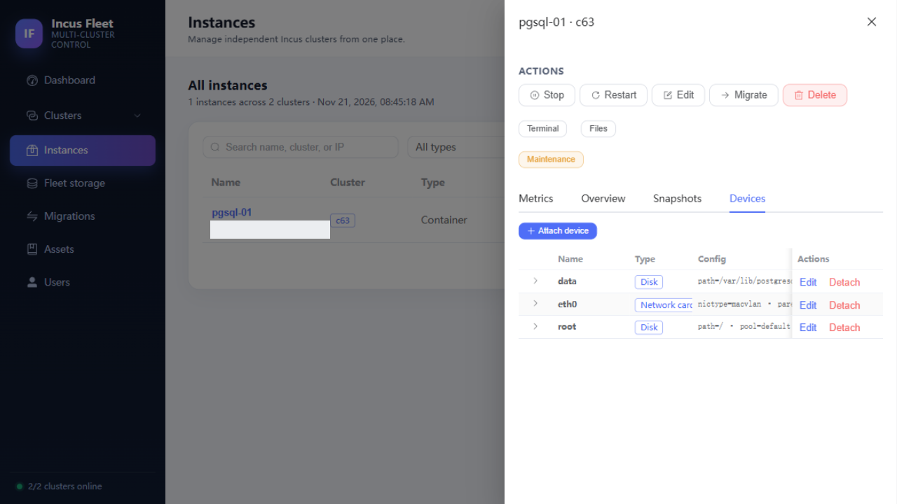

*Devices tab: root disk, a macvlan NIC and an attached custom volume (English UI).*

### Migration records

The **Migration records** tab (`Instances → Migration records`, or `/instances?view=migrations`;
`/migrations` redirects there) lists cross-cluster migrations with route, mode, status, progress,
duration, and timestamps. The list polls automatically; use the search box and the **Status**
filter (pending, preflight, stopping, transferring, starting, verifying, done, failed, canceled)
to narrow it. Click a row to open the **detail drawer** with the full task state, progress
message and timing. Terminal statuses allow **Retry** (resubmits the migration from the current
state after confirmation) and **Cancel** (requests cancellation; an in-flight migration stops at
its next safe point and is recorded as canceled). Only running migrations offer **Cancel**, and
only failed or canceled ones offer **Retry**. See
[Cross-cluster migration and guest networking](#cross-cluster-migration-and-guest-networking) for
what happens to guest networking after a move.

## Online terminals and remote desktop

Fleet provides browser sessions from the detail drawer or the list actions. The graphical
console is described once in [Remote desktop](#remote-desktop); the two text sessions are:

- **Terminal (Exec)**: works for containers and VMs. Opens an interactive root shell, supports
  window resizing and interrupt signals. In command-line mode the session runs a **persistent
  shell**: every submitted command goes to the same shell, so environment variables and the
  working directory survive across commands. If the command exits and the session closes, the
  next input reopens the session automatically and runs the pending command.
- **Serial console (Console)**: useful for boot problems and kernel output.

Open the instance drawer and click **Terminal**. Containers start in **Command** mode (Incus has
no serial console for containers) and virtual machines start in **Console** mode. Submitting a
command works with Enter or the **Start** button, and the output is written into the terminal
above.


Both sessions close with the page and leave no daemon process on the host. If a session fails
to open, the terminal shows the server's close reason (missing agent, stopped instance, or a
busy console) instead of a bare "disconnected" — see the [FAQ](#faq).

## Maintenance actions: scripts, passwords, keys

The **Maintenance** panel in the instance detail drawer offers three frequent actions, all
executed as root inside the instance:

| Action | Usage | Notes |
| --- | --- | --- |
| Run script | Paste a shell script → run | Executes via `sh -s`, streams exit code, stdout, and stderr |
| Set password | Account + new password | Piped to `chpasswd` on stdin; the password never appears in the process list |
| Inject SSH key | Account + one public key line | Appends to `~/.ssh/authorized_keys`, fixes directory and file permissions |

After injecting a key you can `ssh account@instance-ip` from the LAN without a password (with
the same-subnet IP described above).

## Image upgrades and cloning

- **Image upgrade (rebuild)**: choose the target image (alias or fingerprint) in the
  maintenance panel. Fleet rebuilds the instance root disk from the new image. The instance
  **must be stopped** and the root disk is wiped; data disks (storage volumes) are unaffected.
- **Refresh cached images**: in a cluster image list, a cached image has a **Refresh** action
  that asks Incus to pull the latest version from the source (the alias stays, the fingerprint
  changes).
- **Clone instance**: use **Clone** in the instance row, enter a new name, and copy a complete
  instance (disks and config) within the same cluster. Optionally start it after cloning. Good
  for scaling out from a template.

## Port forwarding

Instance LAN addresses may not be directly reachable (for example when only a few host ports
are exposed). Attach a **proxy port-forward** device to the instance:

1. Instance detail → **Devices** → attach device, type **Port forward**.
2. Enter the listen address (host side, for example `tcp:0.0.0.0:8080`) and the connect
   address (instance side, for example `tcp:127.0.0.1:80`).
3. Save; traffic to the host port now reaches the service inside the instance.

## Walkthrough: deploy a PostgreSQL container

This walkthrough ties the previous sections together: create a Debian container on cluster
`c2` with a LAN (same-subnet) address, install the latest PostgreSQL in the online terminal,
configure its password and listener, and verify it from another machine. Passwords are shown
as `<database password>`; replace them with your own values.

### Step 1: create the container on the LAN

On the cluster detail page click **Create instance**:

- Name `pgsql-01`, type **container**, image `debian/13` already present on the cluster;
- Set the root disk as needed (20GiB in this example; leave headroom for a database);
- Choose the **physical NIC** as the network (the LAN DHCP server assigns a same-subnet
  address), and enable **Start after creation**.

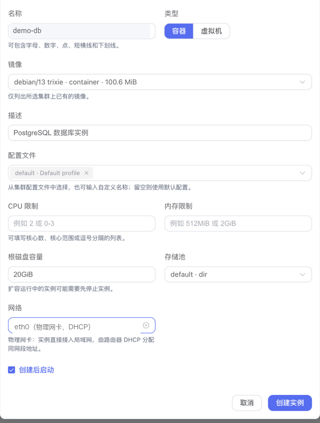

When creation finishes, `pgsql-01` is running and has an address on the host subnet (for
example `198.51.100.x` in the `198.51.100.0/24` documentation subnet):

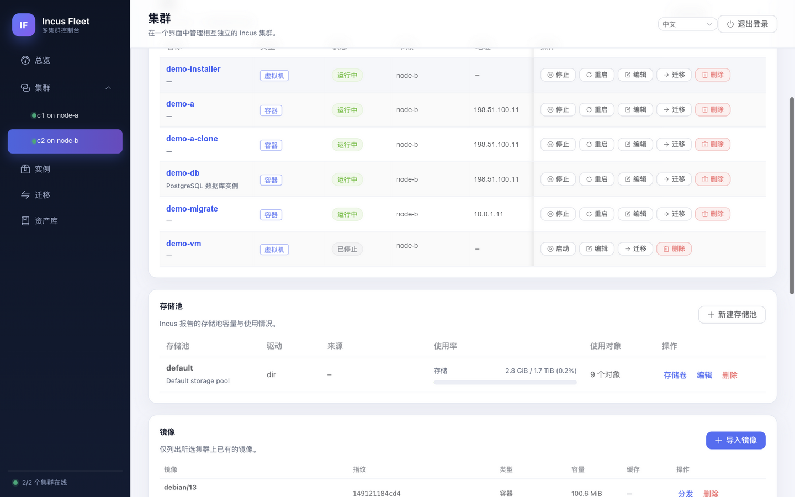

### Step 2: install the latest PostgreSQL in the online terminal

Open instance detail → **Terminal** → **Command line**, enter commands, and press Enter. The
Debian archive may lag behind; add the official [PGDG](https://www.postgresql.org/download/linux/debian/)
repository to install the current major version (PostgreSQL 18 in this example):

```sh
apt-get update
apt-get install -y curl ca-certificates gnupg
install -d /usr/share/postgresql-common/pgdg
curl -o /usr/share/postgresql-common/pgdg/apt.postgresql.org.asc \
  https://www.postgresql.org/media/keys/ACCC4CF8.asc
echo "deb [signed-by=/usr/share/postgresql-common/pgdg/apt.postgresql.org.asc] \
  https://apt.postgresql.org/pub/repos/apt trixie-pgdg main" > /etc/apt/sources.list.d/pgdg.list
apt-get update
apt-get install -y postgresql-18
```

After installation, `psql --version` reports the new version and the install script
initializes the cluster data directory:

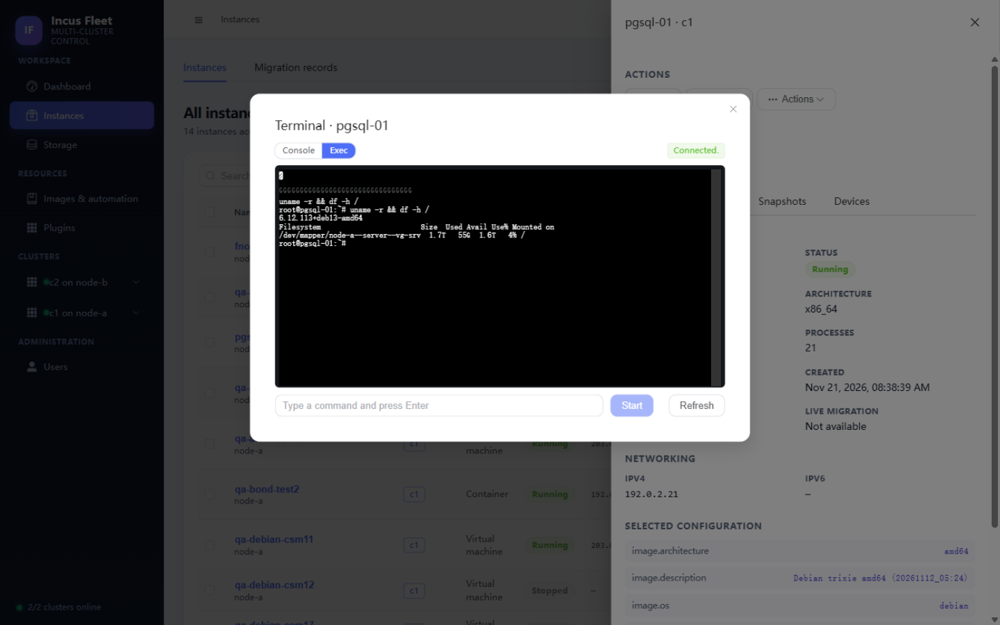

### Step 3: configure the password and listener

Make the database listen on all addresses and allow the LAN subnet (replace
`198.51.100.0/24` with your subnet), then set a password for the `postgres` account:

```sh
sed -i "s/^#\?listen_addresses.*/listen_addresses = '*'/" \
  /etc/postgresql/18/main/postgresql.conf
echo "host all all 198.51.100.0/24 scram-sha-256" >> \
  /etc/postgresql/18/main/pg_hba.conf
systemctl restart postgresql
```

```sh
su - postgres -c "psql -c \"ALTER USER postgres PASSWORD '<database password>';\""
```

### Step 4: verify password authentication across machines

Inside the terminal, connect over local TCP (`127.0.0.1`) to verify password authentication and
TLS. Debian's default `pg_hba.conf` already allows `host all all 127.0.0.1/32 scram-sha-256`:

```sh
PGPASSWORD='<database password>' psql -h 127.0.0.1 -U postgres -c '\conninfo'
```

`Password Used: true` and `SSL Connection: true` confirm that the password and encryption are
active:

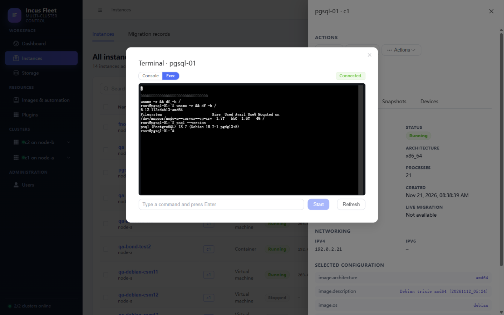

Then connect from another instance on the same subnet (or any LAN machine) to verify the LAN
listener and the subnet rule:

```sh
PGPASSWORD='<database password>' psql -h 198.51.100.x -U postgres -c 'select version();'
```

A result such as `PostgreSQL 18.x ...` means the deployment is complete. Continue using the
online terminal for `systemctl status postgresql`, logs, and database creation.

> Note: macvlan instances are isolated from their host at the kernel level. **The host
> itself** cannot reach a macvlan instance on the same parent NIC, but other LAN machines
> (including instances on other hosts) can. Verify from another machine.

## Cross-cluster migration and guest networking

Moving an instance to another cluster also moves it to that cluster's bridge subnet. After the
transfer the fleet asks the guest to release its old DHCP lease and request a new one, so the
instance comes back with an address from the target subnet, a correct default route, and
working connectivity — no manual `dhclient` needed.

If the guest uses a static address, or has no DHCP client installed, the migration still
succeeds and the fleet only logs a warning; you then need to adjust that address yourself.

## Images & automation, batch operations

Fleet organises resources by the task users are doing: images and install media for building
instances, and reusable automation content, all on the **Images & automation** page.

### Images & automation: grouped by task

Open **Images & automation** in the left menu and switch tabs:

- **Images**: local images from every cluster; import, copy between clusters, refresh cache.
- **Install media (ISO)**: upload ISOs and boot blank VMs to install an OS.
- **SSH public keys**: stores keys (name + key material; identical content is de-duplicated).
  Storing a key does not deploy it; you decide when to inject it.
- **Scripts**: stores maintenance scripts (name + description + body), ready to reuse.
- **Unattended install**: reusable unattended-install templates (hostname, account, password,
  timezone, target disk, locale, keyboard, **additional packages**, and an optional custom
  answer file), defaultable per installer. Passwords require **confirmation** and show a
  **strength** meter while you type. The **target disk** is relevant to Debian/d-i and
  kickstart profiles only — **Ubuntu autoinstall and Generic NoCloud hide the target disk
  field** because those installers pick the disk themselves — but **locale and keyboard are
  applied by every installer**.

Batch operations still start from the **Instances** page; see below.

### Batch operations: apply to many instances at once

Open **Instances** and select multiple instances (across clusters is fine). A batch toolbar
appears:

| Batch action | Notes |
| --- | --- |
| Batch inject keys | Choose one or more keys from the library and inject them into the target account on each instance; shows success/failure and exit code per instance |
| Batch run script | Choose a script and run it as root on every instance; captures output per instance |
| Batch start / stop / restart | Power operations on the selected instances |

Selections survive the automatic list refresh — ticks stay where you put them until you
clear them yourself.

Typical flow: create a batch of instances → select all → batch inject a public key → SSH in
with the matching private key → batch run the bootstrap script. Key injection and scripts run
as root inside the instance, and key/script content travels over stdin, so it never appears in
the process list.

### Other shared capabilities (roadmap)

The same pattern can be extended to instance groups/tags (batch by group), scheduled snapshot
policies, and backup export templates. These are planned.

## Resource monitoring

Fleet's core monitoring needs **no in-guest agent**: host capacity, cluster status, and
container CPU/memory/disk/network come directly from the Incus live state API. VM metrics and
guest-level maintenance actions (exec terminal, file manager, scripts, password/SSH-key actions)
**do need the Incus guest agent** running in the VM; VMs from official cloud images get it
automatically, agent-less VMs can use [Installing the incus agent](#installing-the-incus-agent).
Host telemetry (CPU, memory, load, uptime, network counters) is provided by an **optional host
agent** on each node; without it only the Incus-provided data is available.

### Cluster level: host resources

Every cluster card on the dashboard and the top of the cluster detail page shows host capacity
and live utilization:

- **CPU cores** and architecture;
- **Memory usage**: used/total with a utilization bar;
- Storage, instance counts, and more.

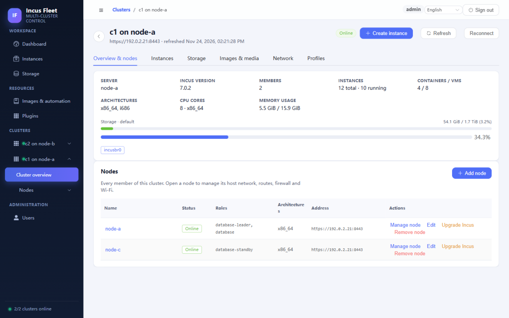

*Cluster detail: per-member capacity and live utilization.*

### Instance level: per container/VM monitoring

The instance detail drawer has a **Monitoring** tab that samples every 3 seconds:

- **CPU**: utilization relative to one core (derived from the CPU time delta between
  consecutive samples);
- **Memory**: used/total bar, with peak and swap;
- **Disk**: usage and capacity per mount point;
- **Network**: per-interface receive/transmit rates (delta between samples) and cumulative
  traffic, with rate charts.

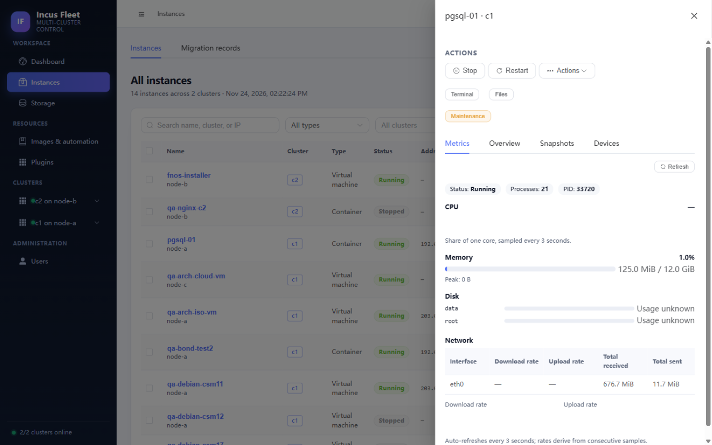

*Instance drawer: CPU, memory, disk, and network sampled every 3 seconds.*

Stopped instances only show the status row. VM metrics depend on a running Incus agent (VMs
created from official cloud images become ready a few seconds after boot).

### Host agent metrics

When the optional Rust host agent is installed, the node detail page adds a **Host metrics**
panel with CPU, memory, load, uptime, and network counters for the last hour. The center keeps
these samples in memory only (10-second interval, 360 points); restarting the center clears them.
The panel's **Source** selector can switch between **Center 1h** and **Prometheus/VM** when the
external query proxy is configured. Use the API export (`json`, `prometheus`, or `csv`) for longer
retention or external systems.

### Deeper metrics (roadmap)

For guest-internal metrics such as per-process data or custom collection, the plan is to extend
the host agent with per-instance cgroups and optional eBPF. The Incus state API already covers the
core metrics needed for routine operations.

## Storage pools and networks

The cluster detail page is organised into tabs: Overview & nodes, Instances, Storage,
Images & media, Network, and Profiles.

- **Storage**: view driver and capacity; create, edit, and delete pools; create and delete
  custom volumes under each pool (for device mounts).
- **Network**: list and manage cluster-wide managed networks. Physical NICs, addresses,
  routes, firewall and Wi-Fi are node-local and live under **Cluster → Node → Node network**.
- **Profiles**: create, update, and delete configuration templates; select them when creating
  instances.

### Fleet volumes (cross-cluster inventory)

The top-level **Fleet volumes** page (`/volumes`) shows custom storage volumes from **all
clusters** in one table — name, owning cluster, pool, content type, size, what uses it, and
location. Use the **search** box to find a volume by name and the **Cluster** filter to narrow
to one cluster; the header displays a **total count and summed used size** for the current view.
Cluster-scoped volume management (creating/deleting pools and volumes) stays on each cluster's
**Storage** tab; this page is the read-side inventory across clusters.

## Private interconnect networks

Incus requires every cluster member to share one network definition, so a managed bridge
(`incusbr0`) has the same subnet and gateway address on all members. To connect instances
across nodes without touching guest configuration and without any physical router changes,
fleet manages a private overlay per cluster:

- fleet creates its own host bridge (`fleetbr0` by default) on every member. Because fleet owns
  it, the cluster-wide network rule does not apply and each member can hold a distinct bridge
  address.
- Every pair of members is joined by a point-to-point VXLAN tunnel, so two members get one tunnel
  and N members form a full mesh. Traffic between members stays on the tunnels; only egress leaves
  through the gateway.
- One member acts as the **gateway**: it runs dnsmasq for the overlay subnet and masquerades the
  subnet towards its physical NIC.

Instances attach with a legacy `nictype=bridged, parent=fleetbr0` NIC, so a guest keeps using DHCP
and its default gateway exactly as before. Nothing inside the guest changes.

Enable it from the cluster page (**Private interconnect → Enable private network**): choose the
subnet, a VNI, the gateway member, and optionally the MTU and DHCP range. **Edit** reopens the
same form to change any of these fields — subnet, VNI, MTU, DHCP range, and the **gateway member**
— and re-applies the configuration. After adding or removing a cluster member, run **Reconcile**
to rebuild the tunnel mesh. **Disable** removes the tunnels, DHCP, NAT, and bridges from every
member.

Notes:

- The gateway member is a single egress point in this release; multi-gateway failover is planned.
- `MTU` defaults to 1450 to leave room for the VXLAN header on a 1500-byte underlay. Raise it only
  when the underlay supports jumbo frames.
- The overlay is plaintext VXLAN on the underlay, like the rest of the cluster network. Add
  WireGuard underneath if you need encryption between sites.
- OVN remains a future alternative for ACLs, forwards, and multi-tenant isolation. The overlay
  abstraction keeps that switch local to the network backend.

## Adding a node

Open the cluster's **Nodes** page and click **Add node**. Two flows are available:

- **Host agent (recommended)**: click **Create enrollment token** to issue a **single-use token**
  bound to that cluster and member name (it is shown once; the server keeps only its hash).
  Run the generated **one-command installer** as root on the target host; it downloads the
  agent binaries and CA over the agent gateway, enrolls with the token, and starts the service.
  The dialog then **waits for the agent to connect** (the token expires if you are too slow).
  Optionally enable **Install Incus through the package manager** — the repository must already
  be configured on the node, and a version prefix can be pinned. With the agent online, use
  **Bootstrap via agent**: Fleet builds a **signed install/init/join spec**, the agent's
  privileged helper verifies the signature before running it, and the node is installed and
  joined to the cluster without SSH credentials.
- **SSH fallback**: choose **Use SSH instead** when no agent is installed. Provide the member
  name, address, SSH user/port and credentials (plus sudo password if needed). Fleet installs
  Incus (optional), configures a storage source, and performs the cluster join over SSH.
  Provisioning progress and each step's result are shown in the dialog.

After a node joins, run **Reconcile** on the private interconnect to extend the tunnel mesh
(see [Private interconnect networks](#private-interconnect-networks)).

## Node network and operation history

Each cluster member has a **Node network** page (Cluster → Nodes → Manage node). The header shows
the member's display name and the **active backend name** (`local`, `ssh`, or `agent`) chosen for
this session. The page has four tabs:

- **NICs**: interface state, type, addresses and Wi-Fi association; bring a NIC up/down or open
  its address dialog.
- **Routes**: destination, gateway and device; add and delete routes.
- **Firewall**: the fleet-managed firewall rule table; add and delete rules.
- **Wi-Fi**: visible networks with signal strength and an **independent rescan** button —
  rescanning refreshes only the Wi-Fi tab without reloading the rest of the page, then you can
  connect with credentials.

**History** opens the task and audit timeline for that member, including the action, backend,
result, state transitions, and timestamps. Every mutating operation is recorded, but Wi-Fi
passwords, SSH/sudo passwords, and join tokens are never shown. When the signed-in role is
read-only, mutation controls (bring up/down, add/delete, connect, rescan) are hidden, while all
tabs and history remain viewable. The server-side `node_access.mode` and `ssh_write_fallback`
settings control which backend is allowed; see
[Deployment](deployment.md#node-network-management-optional).

## Plugins (admin)

Administrators see **Plugins** in the sidebar. The page has two top-level tabs: **Installed**
(status, version, role and wiring summary, with Disable / Uninstall actions) and **Catalog**
(built-in `vm` / `vmlogs` entries). Click **One-click install** and enter the upstream address
of an already running service to connect it; Fleet issues a plugin-bound scoped token and adds
a menu entry. Selecting a plugin opens a detail drawer with five tabs in a fixed order:
**Overview**, **Configuration**, **Wiring**, **Events**, and **Danger zone**.

Installed plugin UIs are served through the same-origin **`/plugin-ui/<id>/…`** proxy, which
never forwards the Fleet session cookie to the upstream. See
[one-click plugin connect](plugins-one-click.md) for the guided walkthrough and sanitized
screenshots, and [the plugin specification](plugins.md) for the manifest format and roadmap.

### API tokens (scoped)

Fleet issues **per-user API tokens** with explicit scopes, expiry and revocation. Administrators
can list and manage **all** tokens; other users manage **their own** through the API
(`GET/POST/DELETE /api/v1/tokens`, scope vocabulary at `/api/v1/tokens/scopes`). A token's
**secret is shown exactly once** at creation — store it immediately, since it cannot be
retrieved later. Each token carries a scope list, an optional expiry, and last-used timestamp;
revoking it takes effect immediately. There is **no dedicated UI page for token operations yet** —
use the API. See [API tokens](api.md) and the [plugin specification](plugins.md) for the token
design and how plugin-scoped tokens derive from it.

## FAQ

- **Image upload returns 413 or fails?** The per-image limit is 8 GiB; compress the root
  filesystem first for larger images.
- **Image distribution seems stuck?** Distribution transfers directly between the source and
  target clusters; cross-site transfers depend on bandwidth. Check the target cluster's image
  list for the new image.
- **Console disconnects with 1006?** The container serial console closes with that code on
  exit, which is normal. Prefer Exec for interactive work.
- **Terminal shows a connection error instead of opening?** The server now reports the websocket
  close reason in the terminal: a **missing guest agent** (install it — see
  [Installing the incus agent](#installing-the-incus-agent)), a **stopped instance** (start it
  first), or a **busy console** (another session holds it; close that one and retry). Each
  reason carries a hint about what to do next.
- **File manager cannot delete a folder?** Recursive directory deletion is not supported yet;
  empty the directory and remove it inside the instance.
- **A physical NIC is missing?** The NIC must be unmanaged on the host (not part of an Incus
  managed bridge).
- **Remote desktop will not open or says it is being configured?** Remote desktop only works
  for VMs. The first open configures the QEMU monitor and restarts the VM; wait for it to
  boot and open the session again. Later opens are immediate.
- **Which ports must be allowed for remote desktop?** None beyond the fleet API itself. The
  console drives a unix-socket QEMU monitor on the member over SSH; no extra TCP listener.
- **Maintenance actions report an agent error?** VMs need a running Incus agent to execute
  commands. VMs created from official cloud images become ready a few seconds after boot.
- **Rebuild says the instance must be stopped?** An image upgrade rewrites the root disk, and
  Incus requires the instance to be stopped. Stop it and retry.
- **Does one failed batch key injection affect the others?** No. Every instance runs
  independently and reports its own result; failed instances can be retried directly.
- **What happens when the same public key is added twice?** Identical key material is stored
  once (de-duplicated by content).
- **The host cannot ping a macvlan instance?** This is a kernel restriction of macvlan:
  the host cannot talk directly to a macvlan instance on the same parent NIC, while other LAN
  machines can. Use a bridge network if the host must reach the instance, or verify from
  another machine.
- **The monitoring tab has no data?** The instance must be running, and VMs need the Incus
  agent (ready a few seconds after boot). Rates are deltas between samples, so the first few
  seconds show —.
