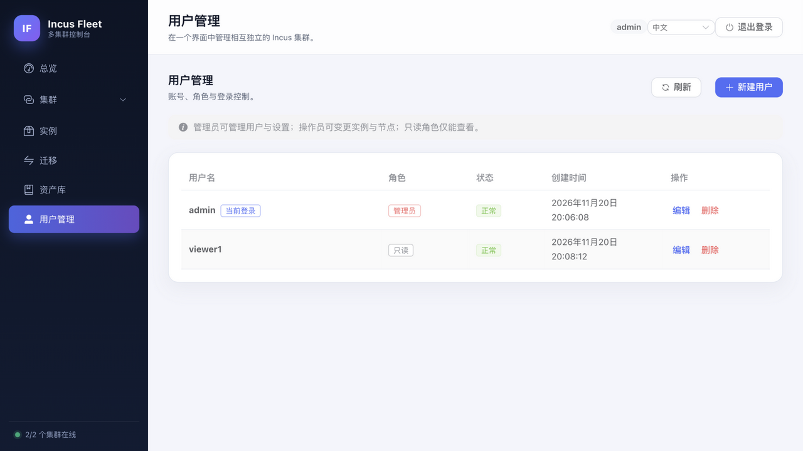
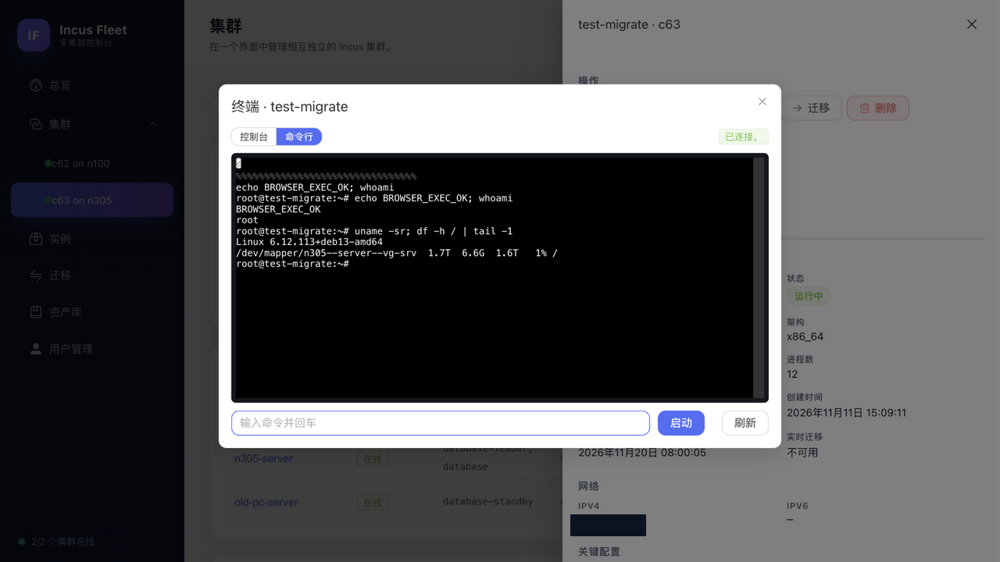
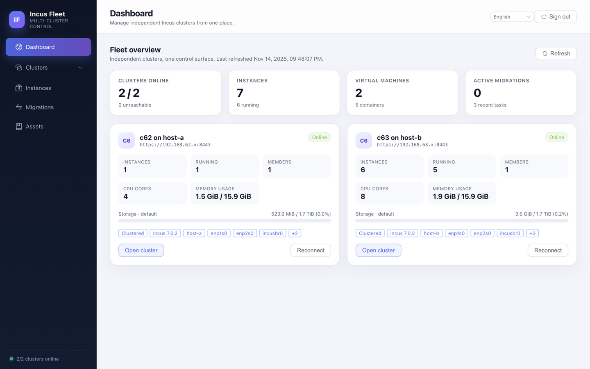
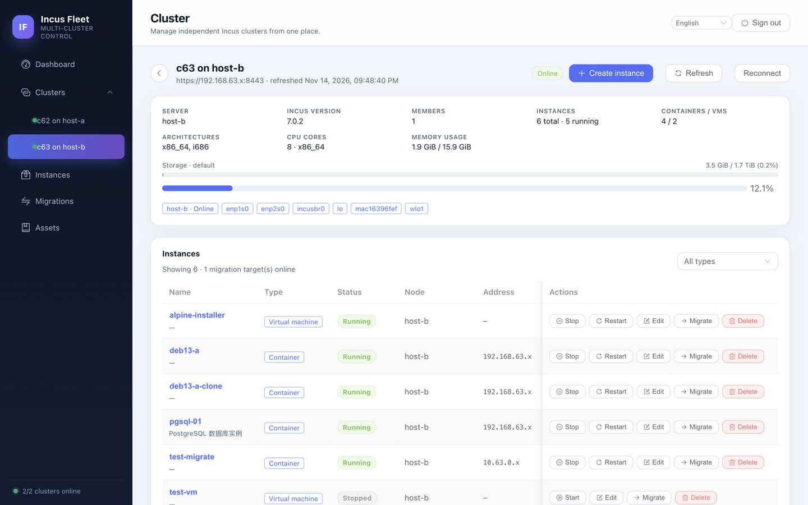
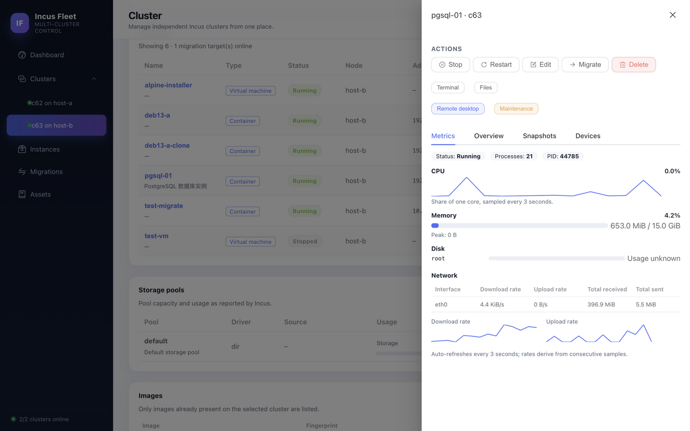

# User Guide

**English** | [简体中文](zh-CN/user-guide.md)

This guide walks through a complete two-cluster workflow, from signing in to delivering a
usable instance. Replace the example cluster names `c1` and `c2` with your own. All addresses
and subnets are documentation examples.

Prerequisites:

- Fleet is deployed as described in [deployment](deployment.md) and reachable (example:
  `http://fleet.example:8080`).
- You have the admin token (written to `INCUS_FLEET_AUTH_TOKEN` at deploy time).
- Both clusters are [configured in Fleet](deployment.md#3-configure-the-application) and online.

## Contents

1. [Sign in and choose a language](#sign-in-and-choose-a-language)
2. [Tour the dashboard](#tour-the-dashboard)
3. [Images: import and distribute](#images-import-and-distribute)
4. [ISO installers and OS installation](#iso-installers-and-os-installation)
5. [Create an instance](#create-an-instance)
6. [Day-to-day instance management](#day-to-day-instance-management)
7. [Online terminals and remote desktop](#online-terminals-and-remote-desktop)
8. [Maintenance actions: scripts, passwords, keys](#maintenance-actions-scripts-passwords-keys)
9. [Image upgrades and cloning](#image-upgrades-and-cloning)
10. [Port forwarding](#port-forwarding)
11. [Walkthrough: deploy a PostgreSQL container](#walkthrough-deploy-a-postgresql-container)
12. [Shared asset library and batch operations](#shared-asset-library-and-batch-operations)
13. [Resource monitoring](#resource-monitoring)
14. [Storage pools and networks](#storage-pools-and-networks)
15. [FAQ](#faq)

## Sign in and choose a language

1. Open the fleet URL, enter your **username and password**, and sign in. Sessions last 12
   hours; sign in again after they expire. The current account name appears in the top bar.
2. Create the first administrator in one of two ways:
   - set `INCUS_FLEET_BOOTSTRAP_ADMIN_USERNAME` and `INCUS_FLEET_BOOTSTRAP_ADMIN_PASSWORD`
     in `incus-fleet.env` and restart the service; or
   - sign in with the shared admin token and create one under **Users**.
   The shared token stops working as soon as any local account exists.
3. Use the gear icon in the top-right corner → **Language** to switch between English and
   中文. The choice applies immediately and is stored in the browser.

## Users and roles

Only administrators see **Users** in the sidebar.

- **Roles**: Administrator (everything), Operator (mutate instances and nodes, cannot manage
  users), Viewer (read-only).
- **Create**: username, password (at least 8 characters), role; optionally mark the account
  disabled or require a password change at next sign-in.
- **Edit**: change the role, reset the password, enable or disable. Leaving the password
  blank keeps the current one.
- **Delete**: confirmed before it happens. The last administrator cannot be deleted or
  demoted; the API returns a conflict.
- **Authorization is server-side**: a viewer is refused (403) even when it calls the API
  directly and bypasses the UI.



## Remote desktop

The **Remote desktop** button opens a live graphical console for running virtual machines
directly in the browser. It works without any VNC or SPICE support in the host's QEMU: the
fleet attaches a second QEMU monitor (`raw.qemu.conf`, QMP control mode) to the VM, polls
framebuffer screenshots through it, and injects keyboard and pointer events. The first
preparation restarts a running VM once; after that opening the console is immediate and
idempotent.

In the console window: click into the picture to give it keyboard focus (arrow keys, Enter,
Ctrl+Alt+Del all reach the guest), click or drag inside it to move the pointer and press
buttons, and scroll to send wheel events. The picture refreshes automatically about once a
second. The toolbar also shows the guest power state with **Start**, **Restart**, and **Stop**
buttons, so a stopped VM can be booted without leaving the console. Containers have no display
device and do not offer this button.

## Installing the incus agent

Systems installed from an arbitrary ISO (for example fnOS) do not carry Incus's in-guest agent,
which is why the exec terminal, file manager, and instance metrics stay unavailable on such VMs.
When the drawer detects a virtual machine without the agent, it shows an **Install agent**
button: enter the guest's SSH credentials and Fleet runs Incus's official `install.sh` inside the
guest (the agent ships on a read-only `config` share Incus mounts into every VM). The
credentials are used for that one session and never stored; sudo escalation is supported for
non-root users.

Manual fallback inside the guest, if you prefer:

```
mount -t 9p config /mnt
/mnt/install.sh
```

The installer only supports systemd guests with 9p support in the kernel (Debian, Ubuntu, and
derivatives qualify). Windows VMs need the virtio-win agent flow and are not covered yet.

## Online terminal

Open the instance drawer and click **Terminal**. Containers start in **Command** mode (Incus
has no serial console for containers) and virtual machines start in **Console** mode.
Submitting a command works with Enter or the **Start** button, and the output is written into
the terminal above.



## Tour the dashboard

The dashboard opens after sign-in and shows:

- Online status, Incus version, and instance count for every cluster;
- Total instances and the running/stopped split;
- Resource overview (CPU, memory, storage).



*Dashboard in the Simplified Chinese UI; switch languages from the gear menu.*

Click a cluster to open its detail page: instances, images, storage pools, networks,
profiles, and members.

## Images: import and distribute

Fleet uploads a local image file to one cluster, then distributes it to other clusters with
one click: upload once, use everywhere.

### Step 1: prepare the image files

Export the image on any machine with Incus:

```bash
# Unified file (one tar archive)
incus image export debian/13 debian13

# Split files (metadata tar archive + .root filesystem)
# Produces debian13 (metadata) and debian13.root (root filesystem)
```

ISO installers use the separate [ISO workflow](#iso-installers-and-os-installation); this
image import handles container and VM images.

### Step 2: upload to a cluster

1. Open the target cluster (for example `c2`) → **Images** → **Import**.
2. Choose the image files:
   - Unified file: select only the tar archive;
   - Split files: select the metadata tar archive, then the matching `.root` file under
     **Rootfs file**.
3. Choose the image type (container / virtual machine). Optionally set an alias (for example
   `debian/13`) so the image is easy to pick when creating instances.
4. Click **Import**. When the upload finishes, the image appears in the list by fingerprint.

The API is equivalent to the UI:

```bash
curl -H "Authorization: Bearer $INCUS_FLEET_AUTH_TOKEN" \
  -F "image=@debian13" -F "rootfs=@debian13.root" \
  "http://fleet.example:8080/api/v1/clusters/c2/images/import?type=container&alias=debian/13"
```

### Step 3: distribute to other clusters

1. In the image list of the cluster that owns the image (for example `c2`), click
   **Distribute**.
2. Choose the target cluster (for example `c1`), optionally set an alias, and confirm.
3. The same fingerprint appears in the target cluster's image list when the transfer
   completes.

## ISO installers and OS installation

Fleet can upload ISO installers (for example the official Debian, Ubuntu, or CentOS images)
and boot a blank virtual machine from the ISO to install the OS.

1. Open the cluster → **ISO installers** → **Upload ISO**, then choose the `.iso` file and a
   storage pool.
2. The ISO appears in the list. Click **Create VM**:
   - Enter a VM name (required);
   - Optionally choose a network (recommended when the installer needs to download packages;
     a physical NIC or a managed bridge both work);
   - Optionally set the root disk size (for example `20GiB`, enough for the OS).
3. Fleet creates a blank VM that boots from the ISO. It relaxes Secure Boot for compatibility
   with most installers and configures the SPICE graphics channel in advance.
4. Open the VM's **Remote desktop** (see below) to see the installer in the browser and
   complete the installation as if you were at a physical machine.
5. When installation finishes, shut the VM down, detach the ISO in the device panel (or
   delete and recreate the VM), then boot into the installed system.

ISO files live in the storage pool and can be deleted from the list at any time.

## Create an instance

Open a cluster → **Instances** → **Create instance**. Key fields:

| Field | Notes |
| --- | --- |
| Name | Unique within the cluster |
| Type | Container / virtual machine |
| Image | Pick an imported image by alias or fingerprint |
| Network | See below |
| CPU / memory / root disk size | Limits; leave blank for defaults |

### Choosing a network: same-subnet IPs

The instance address depends on the selected network:

- **Managed bridge** (for example `incusbr0`): the instance joins the Incus internal NAT
  subnet (for example `10.x.x.x`). Outbound traffic is NATed and the instance is not directly
  reachable from outside.
- **Physical NIC (macvlan)**: NICs without the managed marker (for example the host NIC
  `eth0`). The instance is bridged directly onto the physical LAN via macvlan and **gets a
  DHCP address from the same subnet as the host** (for example, if the host is on
  `198.51.100.0/24`, the instance receives `198.51.100.x`). Other LAN devices can reach the
  instance directly.

To give an instance an address on the host subnet, select the **physical NIC** (parent is the
host NIC name) when creating it. Do not enter a static IP: macvlan addresses come from the LAN
DHCP server.

After creation, confirm in the address column that the IP is in the expected subnet. If no
address appears, check the switch/router DHCP service and the NIC bridge state.

## Day-to-day instance management

From the instance list or the detail drawer you can:

- **Start / stop / restart**: stop and restart ask for confirmation and offer a **force**
  option.
- **Snapshots**: create (optionally with running state), restore, delete. Restoring rolls the
  disk back; confirm before proceeding.
- **Terminal**:
  - *Exec*: an interactive shell inside the instance;
  - *Console*: the serial console (prefer Exec for containers; console close code 1006 is a
    normal shutdown).
- **File management**: browse the instance filesystem, upload, download, create directories,
  and delete files.
- **Devices**: attach a disk (storage volume or host path) or a second NIC; edit any attached
  device (switch networks, change static addresses, resize disks — the merge keeps keys the
  form does not manage, such as boot priority); expand a row to see the full device
  configuration; detach devices in the same panel. Clearing a NIC address falls back to DHCP.
  Switching a NIC to a managed network rewrites legacy `nictype`/`parent` devices.
- **Delete instance**: asks for confirmation and can delete the instance's storage volumes at
  the same time.

## Remote desktop

The **Remote desktop** button opens a live graphical console for running virtual machines
directly in the browser. It works without any VNC or SPICE support in the host's QEMU: the
fleet attaches a second QEMU monitor (`raw.qemu.conf`, QMP control mode) to the VM, polls
framebuffer screenshots through it, and injects keyboard and pointer events. The first
preparation restarts a running VM once; after that opening the console is immediate and
idempotent.

In the console window: click into the picture to give it keyboard focus (arrow keys, Enter,
Ctrl+Alt+Del all reach the guest), click or drag inside it to move the pointer and press
buttons, and scroll to send wheel events. The picture refreshes automatically about once a
second. Containers have no display device and do not offer this button.

## Online terminals and remote desktop

Fleet provides three browser sessions, available from the detail drawer or the list actions:

- **Terminal (Exec)**: works for containers and VMs. Opens an interactive root shell, supports
  window resizing and interrupt signals. In command-line mode the session runs a **persistent
  shell**: every submitted command goes to the same shell, so environment variables and the
  working directory survive across commands. If the command exits and the session closes, the
  next input reopens the session automatically and runs the pending command.
- **Serial console (Console)**: useful for boot problems and kernel output.
- **Remote desktop (VMs)**: running VMs can open a graphical console. Fleet appends a second
  QEMU monitor to the VM through `raw.qemu.conf` (QMP control mode, unix socket under /tmp)
  and relaxes the instance's AppArmor profile for that socket and the screenshot scratch
  file. The browser polls PNG framebuffer dumps from that monitor and sends keyboard and
  absolute-pointer events back. The first configuration restarts a running VM once; later
  sessions are read-only preparations and connect immediately. Containers have no display
  device and do not offer remote desktop.

  Security note: the monitor socket lives in the member's /tmp and is reachable only by
  processes allowed by the instance's AppArmor profile; the fleet drives it over SSH with
  sudo, so no extra listening TCP port is involved.

Sessions close with the page and leave no daemon process on the host.

## Maintenance actions: scripts, passwords, keys

The **Maintenance** panel in the instance detail drawer offers three frequent actions, all
executed as root inside the instance:

| Action | Usage | Notes |
| --- | --- | --- |
| Run script | Paste a shell script → run | Executes via `sh -s`, streams exit code, stdout, and stderr |
| Set password | Account + new password | Piped to `chpasswd` on stdin; the password never appears in the process list |
| Inject SSH key | Account + one public key line | Appends to `~/.ssh/authorized_keys`, fixes directory and file permissions |

After injecting a key you can `ssh account@instance-ip` from the LAN without a password (with
the same-subnet IP described above).

## Image upgrades and cloning

- **Image upgrade (rebuild)**: choose the target image (alias or fingerprint) in the
  maintenance panel. Fleet rebuilds the instance root disk from the new image. The instance
  **must be stopped** and the root disk is wiped; data disks (storage volumes) are unaffected.
- **Refresh cached images**: in a cluster image list, a cached image has a **Refresh** action
  that asks Incus to pull the latest version from the source (the alias stays, the fingerprint
  changes).
- **Clone instance**: use **Clone** in the instance row, enter a new name, and copy a complete
  instance (disks and config) within the same cluster. Optionally start it after cloning. Good
  for scaling out from a template.

## Port forwarding

Instance LAN addresses may not be directly reachable (for example when only a few host ports
are exposed). Attach a **proxy port-forward** device to the instance:

1. Instance detail → **Devices** → attach device, type **Port forward**.
2. Enter the listen address (host side, for example `tcp:0.0.0.0:8080`) and the connect
   address (instance side, for example `tcp:127.0.0.1:80`).
3. Save; traffic to the host port now reaches the service inside the instance.

## Walkthrough: deploy a PostgreSQL container

This walkthrough ties the previous sections together: create a Debian container on cluster
`c2` with a LAN (same-subnet) address, install the latest PostgreSQL in the online terminal,
configure its password and listener, and verify it from another machine. Passwords are shown
as `<database password>`; replace them with your own values.

### Step 1: create the container on the LAN

On the cluster detail page click **Create instance**:

- Name `pgsql-01`, type **container**, image `debian/13` already present on the cluster;
- Set the root disk as needed (20GiB in this example; leave headroom for a database);
- Choose the **physical NIC** as the network (the LAN DHCP server assigns a same-subnet
  address), and enable **Start after creation**.


When creation finishes, `pgsql-01` is running and has an address on the host subnet (for
example `198.51.100.x` in the `198.51.100.0/24` documentation subnet):


### Step 2: install the latest PostgreSQL in the online terminal

Open instance detail → **Terminal** → **Command line**, enter commands, and press Enter. The
Debian archive may lag behind; add the official [PGDG](https://www.postgresql.org/download/linux/debian/)
repository to install the current major version (PostgreSQL 18 in this example):

```sh
apt-get update
apt-get install -y curl ca-certificates gnupg
install -d /usr/share/postgresql-common/pgdg
curl -o /usr/share/postgresql-common/pgdg/apt.postgresql.org.asc \
  https://www.postgresql.org/media/keys/ACCC4CF8.asc
echo "deb [signed-by=/usr/share/postgresql-common/pgdg/apt.postgresql.org.asc] \
  https://apt.postgresql.org/pub/repos/apt trixie-pgdg main" > /etc/apt/sources.list.d/pgdg.list
apt-get update
apt-get install -y postgresql-18
```

After installation, `psql --version` reports the new version and the install script
initializes the cluster data directory:


### Step 3: configure the password and listener

Make the database listen on all addresses and allow the LAN subnet (replace
`198.51.100.0/24` with your subnet), then set a password for the `postgres` account:

```sh
sed -i "s/^#\?listen_addresses.*/listen_addresses = '*'/" \
  /etc/postgresql/18/main/postgresql.conf
echo "host all all 198.51.100.0/24 scram-sha-256" >> \
  /etc/postgresql/18/main/pg_hba.conf
systemctl restart postgresql
```

```sh
su - postgres -c "psql -c \"ALTER USER postgres PASSWORD '<database password>';\""
```

### Step 4: verify password authentication across machines

Inside the terminal, connect over local TCP (`127.0.0.1`) to verify password authentication and
TLS. Debian's default `pg_hba.conf` already allows `host all all 127.0.0.1/32 scram-sha-256`:

```sh
PGPASSWORD='<database password>' psql -h 127.0.0.1 -U postgres -c '\conninfo'
```

`Password Used: true` and `SSL Connection: true` confirm that the password and encryption are
active:


Then connect from another instance on the same subnet (or any LAN machine) to verify the LAN
listener and the subnet rule:

```sh
PGPASSWORD='<database password>' psql -h 198.51.100.x -U postgres -c 'select version();'
```

A result such as `PostgreSQL 18.x ...` means the deployment is complete. Continue using the
online terminal for `systemctl status postgresql`, logs, and database creation.

> Note: macvlan instances are isolated from their host at the kernel level. **The host
> itself** cannot reach a macvlan instance on the same parent NIC, but other LAN machines
> (including instances on other hosts) can. Verify from another machine.

## Cross-cluster migration and guest networking

Moving an instance to another cluster also moves it to that cluster's bridge subnet. After the
transfer the fleet asks the guest to release its old DHCP lease and request a new one, so the
instance comes back with an address from the target subnet, a correct default route, and
working connectivity — no manual `dhclient` needed.

If the guest uses a static address, or has no DHCP client installed, the migration still
succeeds and the fleet only logs a warning; you then need to adjust that address yourself.

## Shared asset library and batch operations

Keeping common content in one place and reusing it is key to reducing repetitive operations.
Fleet provides an **Asset library** for SSH public keys and frequently used scripts, plus
one-click batch execution against many instances.

### Asset library: one place to keep shared content

Open **Asset library** in the left menu:

- **SSH public keys**: stores keys (name + key material, one or more lines; identical content
  is de-duplicated). Storing a key does not deploy it; you decide when to inject it.
- **Scripts**: stores maintenance scripts (name + description + body), such as bootstrap,
  package installation, or tuning scripts, ready to reuse.

### Batch operations: apply to many instances at once

Open **Instances** and select multiple instances (across clusters is fine). A batch toolbar
appears:

| Batch action | Notes |
| --- | --- |
| Batch inject keys | Choose one or more keys from the library and inject them into the target account on each instance; shows success/failure and exit code per instance |
| Batch run script | Choose a script and run it as root on every instance; captures output per instance |
| Batch start / stop / restart | Power operations on the selected instances |

Typical flow: create a batch of instances → select all → batch inject a public key → SSH in
with the matching private key → batch run the bootstrap script. Key injection and scripts run
as root inside the instance, and key/script content travels over stdin, so it never appears in
the process list.

### Other shared capabilities (roadmap)

The same pattern can be extended to instance groups/tags (batch by group), scheduled snapshot
policies, and backup export templates. These are planned.

## Resource monitoring

Fleet includes two layers of resource monitoring with **no agent installed inside instances**.
Data comes directly from the Incus live state API.

### Cluster level: host resources

Every cluster card on the dashboard and the top of the cluster detail page shows host capacity
and live utilization:

- **CPU cores** and architecture;
- **Memory usage**: used/total with a utilization bar;
- Storage, instance counts, and more.



*Cluster detail: per-member capacity and live utilization.*

### Instance level: per container/VM monitoring

The instance detail drawer has a **Monitoring** tab that samples every 3 seconds:

- **CPU**: utilization relative to one core (derived from the CPU time delta between
  consecutive samples);
- **Memory**: used/total bar, with peak and swap;
- **Disk**: usage and capacity per mount point;
- **Network**: per-interface receive/transmit rates (delta between samples) and cumulative
  traffic, with rate charts.



*Instance drawer: CPU, memory, disk, and network sampled every 3 seconds.*

Stopped instances only show the status row. VM metrics depend on a running Incus agent (VMs
created from official cloud images become ready a few seconds after boot).

### Host agent metrics

When the optional Rust host agent is installed, the node detail page adds a **Host metrics**
panel with CPU, memory, load, uptime, and network counters for the last hour. The center keeps
these samples in memory only (10-second interval, 360 points); restarting the center clears them.
The panel's **Source** selector can switch between **Center 1h** and **Prometheus/VM** when the
external query proxy is configured. Use the API export (`json`, `prometheus`, or `csv`) for longer
retention or external systems.

### Deeper metrics (roadmap)

For guest-internal metrics such as per-process data or custom collection, the plan is to extend
the host agent with per-instance cgroups and optional eBPF. The Incus state API already covers the
core metrics needed for routine operations.

## Storage pools and networks

The cluster detail page provides:

- **Storage pools**: view driver and capacity; create, edit, and delete pools; create and
  delete custom volumes under each pool (for device mounts).
- **Networks**: list networks; managed networks can be created, edited, and deleted, while
  physical NICs are read-only (macvlan is defined by the instance device, not as a separate
  network).
- **Profiles**: create, update, and delete configuration templates; select them when creating
  instances.

## Node network and operation history

Each cluster member has a **Node network** page (Cluster → Nodes → Manage node). The page shows
the selected `backend` (`local` or `ssh`; the agent backend is added in a later release) and lets
you manage NIC state, addresses, routes, the fleet-managed firewall table, and Wi-Fi.

Every mutating operation is recorded. **History** opens the task and audit timeline for that
member, including the action, backend, result, state transitions, and timestamps. Wi-Fi passwords,
SSH/sudo passwords, and join tokens are never shown in history. The server-side `node_access.mode`
and `ssh_write_fallback` settings control which backend is allowed; see
[Deployment](deployment.md#node-network-management-optional).

## FAQ

- **Image upload returns 413 or fails?** The per-image limit is 8 GiB; compress the root
  filesystem first for larger images.
- **Image distribution seems stuck?** Distribution transfers directly between the source and
  target clusters; cross-site transfers depend on bandwidth. Check the target cluster's image
  list for the new image.
- **Console disconnects with 1006?** The container serial console closes with that code on
  exit, which is normal. Prefer Exec for interactive work.
- **File manager cannot delete a folder?** Recursive directory deletion is not supported yet;
  empty the directory and remove it inside the instance.
- **A physical NIC is missing?** The NIC must be unmanaged on the host (not part of an Incus
  managed bridge).
- **Remote desktop will not open or says it is being configured?** Remote desktop only works
  for VMs. The first open configures the QEMU monitor and restarts the VM; wait for it to
  boot and open the session again. Later opens are immediate.
- **Which ports must be allowed for remote desktop?** None beyond the fleet API itself. The
  console drives a unix-socket QEMU monitor on the member over SSH; no extra TCP listener.
- **Maintenance actions report an agent error?** VMs need a running Incus agent to execute
  commands. VMs created from official cloud images become ready a few seconds after boot.
- **Rebuild says the instance must be stopped?** An image upgrade rewrites the root disk, and
  Incus requires the instance to be stopped. Stop it and retry.
- **Does one failed batch key injection affect the others?** No. Every instance runs
  independently and reports its own result; failed instances can be retried directly.
- **What happens when the same public key is added twice?** Identical key material is stored
  once (de-duplicated by content).
- **The host cannot ping a macvlan instance?** This is a kernel restriction of macvlan:
  the host cannot talk directly to a macvlan instance on the same parent NIC, while other LAN
  machines can. Use a bridge network if the host must reach the instance, or verify from
  another machine.
- **The monitoring tab has no data?** The instance must be running, and VMs need the Incus
  agent (ready a few seconds after boot). Rates are deltas between samples, so the first few
  seconds show —.
