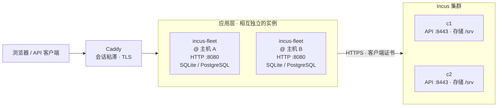
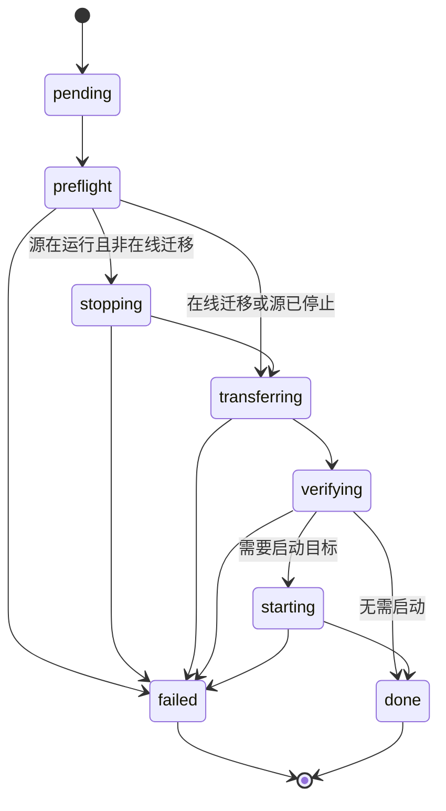

# 架构

[English](../architecture.md) | **简体中文**

Incus Fleet 是一个近乎无状态的控制平面，位于两个或更多相互独立的 Incus 集群之前。它通过单一的 UI 和 API 提供清单、健康状态、生命周期操作、共享运维资产、资源监控以及一键跨集群迁移。

## 目标

- 在不把多个集群合并为一个 Incus 集群的前提下，管理相互独立的 Incus 集群。
- 为运维人员提供统一的 UI/API，用于清单、健康状态、生命周期操作和迁移。
- 跨集群管理镜像与 ISO 安装镜像，包括一键分发。
- 将可复用的 SSH 密钥与脚本集中存放，并支持批量应用。
- 在集群之间移动或复制容器与虚拟机，失败时回滚。
- 每次部署只需一个 Go 二进制文件加一个小型 SQLite 数据库。
- 允许随时间推移新增集群，而无需重新设计控制平面。

## 非目标

- 跨站点的 Incus 集群成员关系。
- 集群之间的复制、互为备份或自动故障转移。
- 容器在线迁移。容器在复制文件系统期间会被停止。
- 跨应用实例共享控制平面数据库。每个应用实例都是独立的。

## 运行时拓扑



每个应用实例都会连接到**两个** Incus 集群。应用实例之间互不通信。Caddy 对浏览器做负载均衡，并把每个浏览器固定到同一个应用实例（参见[粘性会话](#粘性会话)）。

## 组件

| 包 | 职责 |
| --- | --- |
| `cmd/incus-fleet` | 参数解析、配置加载、结构化日志、信号处理 |
| `internal/config` | YAML 解析、环境变量覆盖、默认值、校验、证书文件检查 |
| `internal/clusters` | 连接 Incus 端点、维护使用固定证书的客户端、构建健康摘要、重新连接 |
| `internal/bootstrap` | 签名的 Incus bootstrap spec 与签名校验 |
| `internal/incusbootstrap` | join/init Incus preseed 渲染 |
| `internal/hostops` | 类型化的主机操作接口与后端选择 |
| `internal/nodeaccess` | 为集群成员解析本地或 SSH 主机操作器 |
| `internal/nodejoin` | 通过 SSH 为新成员安装 Incus 并加入集群 |
| `internal/instances` | 清单、生命周期、镜像、ISO、SPICE、文件、快照以及客户机操作 |
| `internal/assets` | 共享的 SSH 密钥/脚本库，以及按实例批量执行 |
| `internal/migrations` | 校验迁移请求、持久化任务、执行复制/移动、回滚 |
| `internal/store` | 迁移、密钥和脚本的 SQLite/PostgreSQL schema |
| `internal/auth` | 恒定时间的管理员 token 校验与内存会话表 |
| `internal/httpapi` | REST 路由、认证中间件、错误映射、安全响应头、SPA 回退 |
| `internal/app` | 依赖装配、HTTP 服务器超时、优雅关闭 |
| `web` | 内嵌的 Vue 3 SPA |

## 启动顺序

1. 解析 CLI 参数（`-config`、`-version`、`-check`）。
2. 加载 YAML，应用 `INCUS_FLEET_*` 环境变量覆盖与默认值，并执行校验。
3. 确认引用的证书文件存在。
4. 打开数据库，按需创建 `migrations`、`keystones` 和 `scripts` 的 schema/索引。
5. 把遗留在非终态的任务标记为失败（`MarkInterrupted`）。上一个进程可能在传输过程中被终止。
6. 使用各自的固定客户端证书连接每一个已配置的 Incus 端点。
7. 构建 HTTP handler，提供内嵌的 SPA 与 API。
8. 收到 `SIGINT`/`SIGTERM` 时，停止接收请求，关闭 HTTP 服务器，并关闭数据库。正在执行的迁移 goroutine 允许完成或超时。

## 集群连接

- 每个集群都有自己的 `tls_cert` + `tls_key` 客户端证书，以及可选的 `tls_server_cert` 用于校验服务端。
- 运行中的服务从不使用信任令牌。证书需提前加入 Incus 信任库（`incus config trust add-certificate`）。
- 端点必须是 `https://` URL；结尾斜杠会被规范化。
- 连接失败不会导致进程退出。该集群会被标记为离线并附带错误信息，`POST /api/v1/clusters/{name}/reconnect` 可重新连接。
- 管理器只向调用方暴露一个精简的客户端接口，内部保留完整的 Incus 客户端供需要它的操作使用（尤其是 `CopyInstance`）。

## 清单

`instances.List` 针对单个集群调用 `GetInstancesFull`，并把每条记录转换为摘要。`ListAll` 遍历已配置的集群，因此目前只要有一个集群离线，整个请求就会失败（集群仪表盘仍会显示各集群的健康状态）。

摘要包含状态、类型、节点、项目、地址、内存、进程数、时间戳、存储池，以及该实例是否支持有状态/在线迁移。详情请求会额外返回客户机操作系统信息、选定的配置、设备和实时状态，同时避免返回无界或敏感的配置映射。

## 生命周期操作

从 HTTP 调用方的角度看，所有生命周期操作都是同步的，并受超时约束：

- **状态变更**：通过 Incus 状态 API 执行启动、停止和重启。停止/重启支持强制标志。
- **创建/克隆/重建**：从本地镜像创建，可选指定 CPU、内存、根磁盘、网络和静态地址；在集群内克隆；用另一个镜像重建已停止实例的根磁盘。重建不会改动数据卷。
- **快照**：创建（可选带状态）、恢复和删除。
- **设备**：挂载磁盘（自定义卷或宿主机路径）与网卡；按设备名卸载。
- **文件**：在客户机内列出、下载、上传、创建目录和删除文件。
- **客户机操作**：运行脚本、设置密码或注入 SSH 密钥。负载通过 stdin 传输，绝不作为进程参数。
- **镜像**：导入本地 tar 包，通过直接的 Incus 传输分发到另一个集群，刷新缓存的镜像，以及删除镜像。
- **ISO 安装镜像**：将 ISO 文件作为自定义卷上传，用它启动空白虚拟机，以及删除该卷。
- **控制台**：exec 与串行终端、Incus VGA 控制台，以及按通道划分的 SPICE websocket 桥接。SPICE 在集群成员上使用无认证的 TCP 监听，因此必须对该端口范围设置防火墙。

## 资源监控

宿主机 CPU、内存、存储和实例数量来自 Incus 集群资源 API。单实例指标来自实时实例状态 API：CPU 时间、内存使用量与峰值、各挂载点的磁盘占用，以及各网卡的流量计数。前端每 3 秒采样一次，并通过计数器差值推算速率。

可选主机 agent 每 10 秒上报主机遥测。中心把它保存在有界内存环形缓冲（360 个点，1 小时），并注入 `cluster`、`member`、`agent_id` 标签。`GET /api/v1/metrics/query|snapshot|export` 提供 JSON、Prometheus text 和 CSV；指标不写入控制面数据库。

agent 无需额外权限即可采集 cgroup v2 容器指标（VM 只做宿主侧 cgroup 指标）。可选 eBPF 增加
主机 TCP 重传和 OOM kill 计数；对象、BTF 或权限缺失时记录原因并回退 procfs/cgroup。agent 内置
有界直方图原语，供后续 eBPF 延迟指标使用。

启用外部指标后，中心还会通过有界重试队列把标准化后的 series 转发到 Prometheus 或
VictoriaMetrics remote write 端点，并代理 PromQL range 查询供 UI 使用。
`GET /api/v1/sd/agents` 使用独立 token 提供 HTTP 服务发现；本版本中 Prometheus 抓取的是中心为
每个在线 agent 提供的代理端点。agent 直连监听在后续阶段。

## 主机操作

主机网络和节点准备操作通过类型化的 `hostops.Operator` 执行，由 resolver 选择后端。
`node_access.mode` 可选 `auto`（默认）、`agent`、`ssh` 或 `local`。fleet 所在主机始终走本地；
远程成员优先使用在线 agent，否则在配置了 SSH 时走 SSH。读操作可以回退 SSH；变更操作只有在
`node_access.ssh_write_fallback=true` 时才回退（对于尚未部署 agent 的旧部署，默认是 true）。

Linux 上 helper 通过原生 netlink 应用链路状态、静态地址和 fleet 路由；非 Linux 开发/测试仍用命令
后端，持久化仍交给检测到的管理器。resolver 对远程成员优先使用在线 agent，因此节点网络页面会
自动走 agent，只有配置允许时才回退 SSH。

每个变更都会持久化为 `host_task`（含状态事件）和一条 `host_audit`，记录 actor、来源 IP、
backend、action、plan hash、result 和时间戳。`unknown` 表示执行器失联，但操作可能已经完成，
不会被当作失败。Wi-Fi 密码、SSH/sudo 密码、Incus join token 和私钥永远不会存储。当前实现
同步执行并记录任务；agent 阶段会加入 queued、dispatched 和带 lease 的任务。

`GET /api/v1/tasks`、`GET /api/v1/tasks/{id}` 和 `GET /api/v1/audit` 用于查询这些记录。

## 主机 agent

可选的 Rust agent 是类型化的主机执行器，不是 Incus 代理。它用一次性 token 注册，从中心 CA
获取客户端证书，并向独立的 agent gateway（`agent.listen`，默认 `:8444`）建立出站 mTLS
WebSocket。浏览器 API 负责创建注册 token，并通过 `GET /api/v1/agents/{id}/snapshot` 派发只读
`nodenet.snapshot` 任务。

协议是 protobuf `incusfleet.agent.v1`（`api/agent/v1/agent.proto`），同时生成 Go 和 Rust 类型。
agent 发送 Hello、Facts 和 Heartbeat；中心发送任务和心跳确认。agent 上报 facts 和基于
`ip -j` 的网络快照，并可经短生命周期特权 helper 执行允许列表内的链路/地址/路由/防火墙/Wi-Fi
变更。helper 校验 JSON 契约，按 task ID 记录回滚快照，并通过检测到的管理器（ifupdown、
systemd-networkd、netplan、wicked 或 NetworkManager）持久化地址。Incus 准备是签名的声明式
spec：中心构建 join 或 init preseed，并用 agent CA 私钥签名；helper 验证签名，按需通过发行版
包管理器安装，执行 `incus admin init --preseed`，等待本地 API，并把幂等步骤记录在
`/var/lib/incus-fleet-helper`。指标和 eBPF 仍在后续阶段。

## 高可用与生命周期

主机任务带有 `lease_owner`/`lease_until`，可由 worker 通过 PostgreSQL 的
`FOR UPDATE SKIP LOCKED` 或 SQLite 事务领取。这是多中心实例协调的基础原语；当前同步 HTTP 路径
还没有后台 dispatcher。

agent 证书由中心 CA 签发。管理员可以为 agent 现有公钥签发替换证书，或吊销 agent；gateway 在
连接时检查吊销状态并校验存储的证书指纹。agent 升级使用 detached Ed25519 签名、`.prev`
备份和 `--version` 健康检查，失败时恢复旧二进制。审计记录可导出为 JSONL 或 CSV。

## 共享资产与批量操作

资产库把 SSH 公钥和脚本存放在控制平面数据库中。密钥按内容去重。批量操作复用与单实例维护操作相同的 `instances.RunOps` 路径，因此密钥注入、脚本执行和电源操作在单个或多个实例上表现一致。目标按顺序独立执行；一个失败不会中止其余目标。

## 迁移流程

迁移请求指定源集群、目标集群、实例、模式（`move` 或 `copy`）、是否包含快照，以及是否启动目标（`auto_start`，默认 `true`）。

### 预检（同步）

`Submit` 会在创建任务之前拒绝无效请求：

- 源与目标必须不同，且已知/已连接；
- 实例必须存在于源集群，且不存在于目标集群；
- 模式必须是 `move` 或 `copy`；
- `live` 要求 `mode=move`；
- 在线模式要求虚拟机正在运行且 `migration.stateful=true`；
- 源根磁盘所在的存储池必须存在于目标集群。

按实例的锁（`source/instance`）可防止同一实例被同时发起两次迁移。

### 执行（异步，默认超时 6 小时）

1. `preflight` —— 状态持久化为已校验。
2. 若源正在运行且迁移不是在线迁移：`stopping` —— 停止源，超时 300 秒。
3. `transferring` —— 目标使用源的完整 Incus 客户端以 `pull` 模式调用 `CopyInstance`，然后等待远程操作完成。在线虚拟机在运行状态下传输内存与状态。
4. `verifying` —— 在线迁移会在启动目标之前停止源。
5. `starting` —— 当迁移为在线迁移，或源原本在运行且 `auto_start` 为 true 时，启动目标。

在线迁移会保留客户机的网络状态。如果源与目标集群使用不同子网，客户机可能继续保留源端的 DHCP 租约，在续约之前不可达（例如 `dhclient -r <if>` 之后再执行 `dhclient <if>`，或 `networkctl reconfigure <if>`）。控制平面不在客户机内执行命令；请使用相同子网，或在迁移后安排客户机续约 DHCP。
6. 对于 `move`，删除源实例（`verifying` / "removing source"）。对于 `copy`，若源原本已停止，则重新启动它。
7. `done` —— 进度为 "complete"。



`stopping` 与 `starting` 是条件阶段；`progress` 保存人类可读的阶段名，成功 `move` 后的源删除也包含在内。

### 回滚规则

- 若源原本已停止且复制失败，则重新启动源。
- 若 `move` 在复制完成之后、删除源之前失败，则不会重启源（目标端副本已存在；保留哪一份由运维人员决定）。
- 若复制成功但删除源失败，迁移会被标记为失败，但两份副本都会保留；源不会被重启。
- 进程崩溃会使任务停留在非终态；下次启动时会将其标记为失败。系统不会尝试自动清理。

### 状态值

`pending`、`preflight`、`stopping`、`transferring`、`starting`、`verifying`、`done`、`failed`。进度文本是一个简短的阶段标签；当 Incus 提供时还会附带传输元数据。

## 持久化

迁移任务、共享 SSH 密钥和共享脚本会被持久化。会话、集群摘要和实例清单保存在内存中。

```
migrations(
  id, source_cluster, target_cluster, instance, instance_type,
  mode, live, status, progress, error, created_at, updated_at
)

keystones(id, name, public_key, comment, created_at)

scripts(id, name, description, body, created_at, updated_at)
```

- SQLite 使用 WAL 和单连接，使内存测试数据库保持一致。
- PostgreSQL 使用 `pgx`，并把 `?` 占位符重绑为 `$n`。
- 时间戳以 Unix 纳秒存储。
- 相同的公钥使用由内容派生的 id，因此重复存储同一个密钥是空操作。

迁移历史属于运维数据，而不是集群状态的权威来源。丢失它不会丢失实例。密钥与脚本库属于用户内容，应纳入数据库备份。

## 认证与会话

- 服务器只有一个共享的管理员 token（`server.auth_token` 或 `INCUS_FLEET_AUTH_TOKEN`）。
- `POST /auth/login` 以恒定时间比较 token，并创建一个随机的 32 字节会话 ID，保存在内存中，TTL 为 12 小时。
- 浏览器会收到名为 `incus_fleet_session` 的 cookie，属性为 `HttpOnly`、`SameSite=Lax`，路径 `/`。当请求使用 TLS 或带有 `X-Forwarded-Proto: https` 时，该 cookie 会标记为 `Secure`，因此可以识别 Caddy 终止 TLS 的情况，同时纯 HTTP 的内网测试仍然可用。
- 受保护的 API 路由接受该 cookie 或 `Authorization: Bearer <admin token>`。
- 登出会删除会话并使 cookie 过期。
- 会话 ID 不会被持久化，也不会在应用实例之间共享。

### 粘性会话

由于会话只存在于单个进程内，Caddy 必须把浏览器固定到一个上游。示例 Caddyfile 使用 `lb_policy cookie`，而不是轮询。使用 bearer token 的 API 客户端不需要粘性。如果某个应用实例重启或不可用，其会话会丢失，用户需要重新登录。

## 前端

- Vue 3 composition API、TypeScript strict mode、Vite、Pinia、Element Plus。
- `createFleetRouter(history)` 是一个工厂函数，便于测试使用 memory history；默认导出使用 `createWebHistory`。
- 路由在初始化时建立一次会话，并守护受保护的路由，同时把请求的路径保留在 `?redirect=` 中。
- API 客户端是 `fetch` 的类型化封装，带有 `ApiError` 信封解析器，以及用于清除认证状态的未授权钩子。
- 视图仅在任务处于活动状态时轮询迁移状态。实例监控标签页在打开期间每 3 秒采样一次实时指标。
- UI 通过 `vue-i18n` 支持双语（英语与简体中文）；选择保存在浏览器中并立即生效。
- 生产资源通过 `//go:embed all:dist` 内嵌；handler 从 `dist` 提供文件，对带哈希的资源使用不可变缓存，并对 SPA 路由回退到 `index.html`。

## 安全响应头

HTTP handler 设置 `X-Content-Type-Options: nosniff`、`X-Frame-Options: DENY`、`Referrer-Policy: same-origin` 以及严格的 CSP。JSON 错误响应绝不包含堆栈信息。对于 5xx 响应，底层错误文本会返回给调用方，同时完整错误与请求上下文也会记录在服务端日志中。

## 扩展与横向扩容

- 要新增集群，添加一条包含端点与证书的配置项，在该集群上信任该证书，然后重启或重新连接。无需让应用加入集群成员。
- 要向 Incus 集群新增节点，使用常规的 Incus 集群加入流程；本应用无需改动。
- 要新增应用实例，在另一台主机上部署相同的二进制/配置形态，并将其加入 Caddy 上游池。它不会与现有实例共享任何状态；这是有意为之。
- 集中的迁移锁是按进程的。两个应用实例可能同时对同一实例发起迁移。Incus 自身会拒绝冲突的操作，目标存在性检查也能限制损害，但系统不提供多实例协调。

## 可观测性

- 通过 `log/slog` 向 stdout 输出结构化 JSON 日志。
- 请求日志包含方法、路径、状态码、字节数和耗时；非 GET 或失败的请求以 info 级别记录，成功的 GET 以 debug 级别记录。
- `GET /api/v1/healthz`（无需认证）返回状态、版本和时间，供负载均衡器使用。
- `GET /api/v1/version` 返回构建版本。
