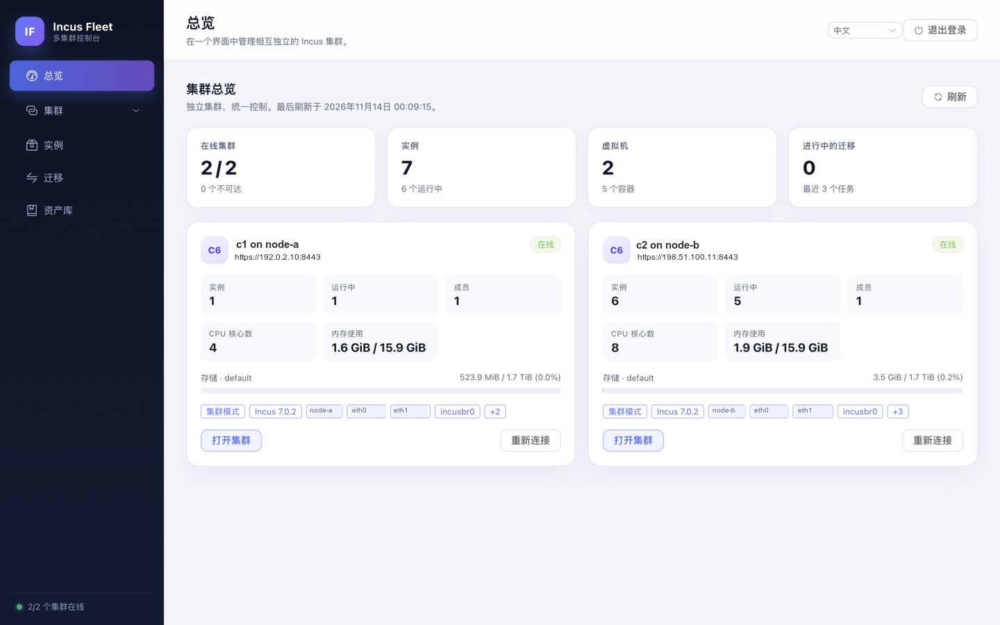
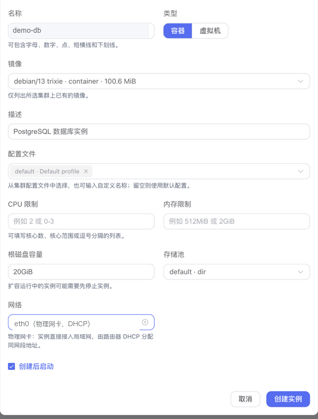
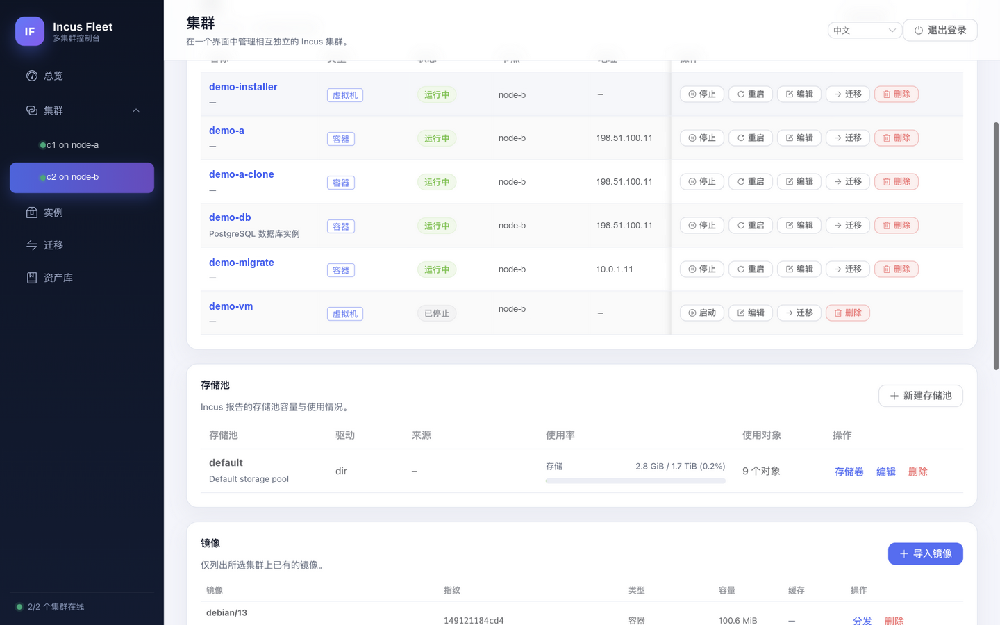
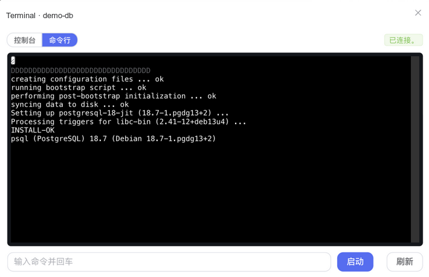
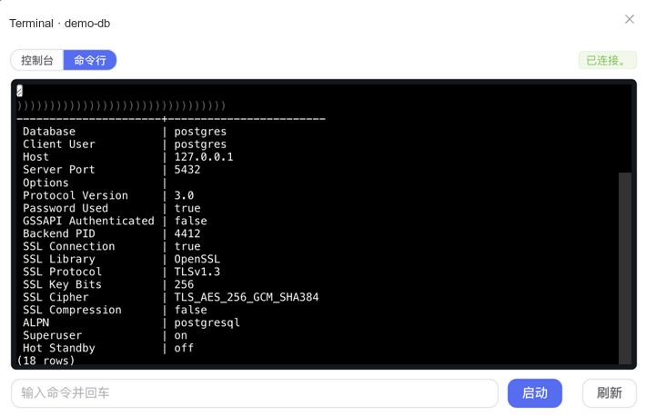
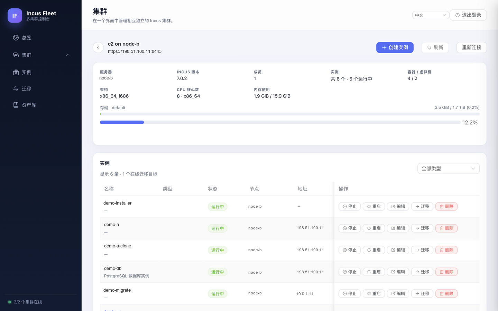
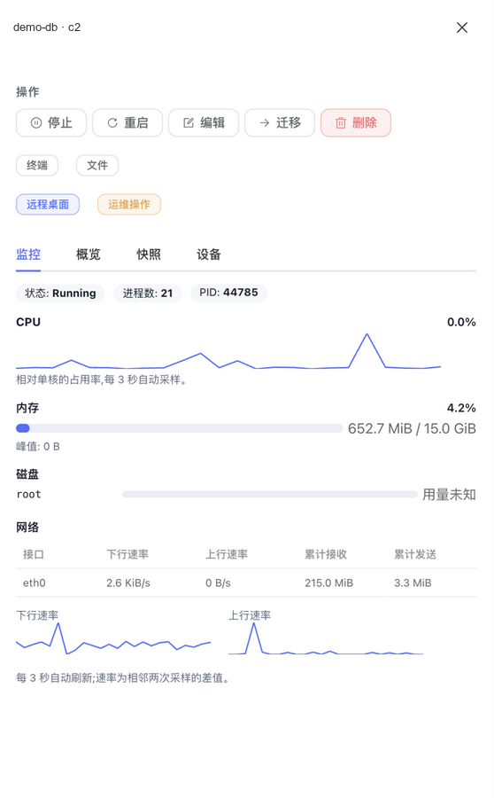

# 用户操作手册

[English](../user-guide.md) | **简体中文**

本手册以两集群场景为例,演示从登录到交付一台可用实例的完整操作。示例中的集群名
`c1`、`c2` 请替换为你自己的集群名;地址、网段均为说明性示例。

前置条件:

- fleet 已按 [deployment](../deployment.md) 部署并可访问(示例:`http://192.0.2.10:8080`)。
- 你持有管理员 token(部署时写入 `INCUS_FLEET_AUTH_TOKEN`)。
- 两个集群均已[在 Fleet 中配置](../deployment.md#3-配置应用)且在线。

## 目录

1. [登录与语言](#登录与语言)
2. [认识仪表盘](#认识仪表盘)
3. [镜像:导入与分发](#镜像导入与分发)
4. [ISO 安装镜像与系统安装](#iso-安装镜像与系统安装)
5. [创建实例(含同网段 IP)](#创建实例)
6. [实例日常管理](#实例日常管理)
7. [在线终端与远程桌面](#在线终端与远程桌面)
8. [运维操作:脚本、密码、密钥](#运维操作脚本密码密钥)
9. [镜像升级与实例克隆](#镜像升级与实例克隆)
10. [端口转发](#端口转发)
11. [实战案例:部署 PostgreSQL 数据库容器](#实战案例部署-postgresql-数据库容器)
12. [共享资产库与批量操作](#共享资产库与批量操作)
13. [资源监控](#资源监控)
14. [存储池与网络](#存储池与网络)
15. [常见问题](#常见问题)

## 登录与语言

1. 打开 fleet 地址,输入**用户名和密码**,点击登录。会话有效期 12 小时,过期后
   重新登录即可。右上角会显示当前账号名。
2. 首次部署可用两种方式建立第一个管理员:
   - 在 `incus-fleet.env` 中设置 `INCUS_FLEET_BOOTSTRAP_ADMIN_USERNAME` 与
     `INCUS_FLEET_BOOTSTRAP_ADMIN_PASSWORD`,重启服务即自动创建;
   - 或用共享 admin token 登录后,在「用户管理」里创建。
   一旦存在任何本地账号,共享 token 立即失效。
3. 右上角齿轮 → **语言 / Language** 可在 中文 与 English 之间切换,选择即时生效
   并保存在浏览器中。

## 用户与角色

只有管理员能看到侧边栏的「用户管理」。

- **角色**:`管理员`(全部权限)、`操作员`(可变更实例与节点,不能管理用户)、
  `只读`(只能查看)。
- **新建用户**:填写用户名、密码(至少 8 位)、选择角色;可勾选「已禁用」与
  「下次登录要求修改密码」。
- **编辑**:可改角色、重置密码、启用/禁用。留空密码表示保持不变。
- **删除**:二次确认后删除。最后一个管理员不能被删除或降级,接口会返回冲突。
- **权限是服务端强制的**:只读账号即使绕过界面直接调用 API,写操作也会被拒绝(403)。


## 远程桌面：当前限制

「远程桌面」按钮连接的是虚拟机图形控制台,但在当前 Incus 版本上**不可用**,会显示
`Unexpected protocol mismatch.`。

原因:浏览器端 `spice-client` 使用 SPICE 协议 2.2,而当前 QEMU 服务端协商的是更新的方言。
评估过两条替代路径,都被平台本身阻塞:

- **WebVNC**(QEMU `-vnc` + noVNC)。Incus 打包的 QEMU 与 Debian 13 自带的
  `qemu-system-x86` 都**未编译 VNC 显示后端**:执行 `-vnc` 报
  `qemu-system-x86_64: -vnc: invalid option`,而 `-display help` 只列出
  `none`、`gtk`、`sdl`、`egl-headless`、`curses`、`spice-app`、`dbus`。
- **Incus VGA 通道**。转发 Incus 的 `vga` websocket 无效:该端点对标准 SPICE RedLink
  握手没有任何响应。

要获得可用的图形控制台,需要本仓库之外的平台改动:自行编译带 `--enable-vnc` 的 QEMU、
部署绑定 VM 显示的独立 VNC 服务端,或换用维护中的现代 SPICE 客户端。在此之前请使用
**在线终端**,它可真实执行命令且已完整验证。

## 在线终端

在实例详情抽屉中点击「终端」。容器默认进入「命令行」模式(Incus 容器没有串口控制台),
虚拟机默认进入「控制台」模式。命令行的输入框支持回车提交,也可点击「启动」;
执行结果直接写入上方的终端区域。


## 认识仪表盘

登录后默认进入仪表盘,展示:

- 每个集群的在线状态、Incus 版本、实例数量;
- 实例总数、运行/停止分布;
- 资源概览(CPU、内存、存储)。



*截图为简体中文界面;可在右上角齿轮菜单切换语言。*

集群列表点击任意集群进入该集群的详情页(实例、镜像、存储池、网络、Profile、成员)。

## 镜像导入与分发

fleet 支持把本地镜像文件上传到某一个集群,再一键分发到其他集群,实现
"上传一次、集群共用"。

### 第一步:准备镜像文件

在任意装有 Incus 的机器上导出镜像:

```bash
# 统一文件(单 tar 包)
incus image export debian/13 debian13

# 拆分文件(元数据 tar 包 + .root 根文件系统)
# 导出结果为 debian13(元数据)与 debian13.root(根文件系统)两个文件
```

注意:ISO 安装镜像暂不支持导入;容器镜像与虚拟机镜像均可。

### 第二步:上传到集群

1. 进入目标集群(如 `c2`)→ **镜像** 区块 → **导入**。
2. 点击上传区选择镜像文件:
   - 统一文件:只选 tar 包即可;
   - 拆分文件:先选元数据 tar 包,再在 **Rootfs 文件** 处选择配套的 `.root` 文件。
3. 选择镜像类型(容器 / 虚拟机),可选填别名(如 `debian/13`,便于创建实例时挑选)。
4. 点击 **导入**。上传完成后镜像会以指纹出现在列表中。

也可以用 API 上传(与界面等价):

```bash
curl -H "Authorization: Bearer $INCUS_FLEET_AUTH_TOKEN" \
  -F "image=@debian13" -F "rootfs=@debian13.root" \
  "http://192.0.2.10:8080/api/v1/clusters/c2/images/import?type=container&alias=debian/13"
```

### 第三步:分发到其他集群

1. 在持有镜像的集群(如 `c2`)镜像列表中,点击该镜像的 **分发**。
2. 选择目标集群(如 `c1`),可选填别名,点击 **分发**。
3. 完成后目标集群的镜像列表即可看到同一指纹的镜像。

## ISO 安装镜像与系统安装

fleet 支持上传 ISO 安装镜像(如 Debian/Ubuntu/CentOS 官方安装盘),并从 ISO
启动一台空白虚拟机完成系统安装。

1. 进入集群 → **ISO 安装镜像** 区块 → **上传 ISO**,选择 `.iso` 文件与存储池。
2. 上传完成后列表会出现该 ISO。点击 **创建虚拟机**:
   - 填写虚拟机名称(必填);
   - 可选选择网络(安装过程需要联网拉取软件包时建议选择,物理网卡或托管网桥均可);
   - 可选填写根磁盘容量(如 `20GiB`,给系统盘留足空间)。
3. 提交后 fleet 会创建一台空白虚拟机并自动从 ISO 引导(自动放宽 Secure Boot
   以兼容多数发行版安装器,并预先配好 SPICE 图形通道)。
4. 打开该虚拟机的 **远程桌面**(见下文),即可在浏览器里看到安装程序界面,
   像操作物理机一样完成安装。
5. 安装完成后建议关机、在设备面板卸载 ISO 设备(或直接删除重装),再开机进入新系统。

ISO 镜像保存在存储池中,可随时在列表中删除。

## 创建实例

进入集群 → **实例** → **创建实例**。关键字段:

| 字段 | 说明 |
| --- | --- |
| 名称 | 集群内唯一 |
| 类型 | 容器 / 虚拟机 |
| 镜像 | 按别名或指纹选择已导入的镜像 |
| 网络 | 见下方说明 |
| CPU / 内存 / 根盘大小 | 限制值,留空使用默认 |

### 网络怎么选:同网段 IP 是关键

实例的网络地址取决于所选网络:

- **托管网桥**(如 `incusbr0`):实例接入 Incus 内部 NAT 网段(如 `10.x.x.x`),
  出网经 NAT,外部无法直接访问。
- **物理网卡(macvlan)**:列表中不带托管标记的网卡(如宿主机的 `eth0`)。
  实例通过 macvlan 直接桥接到物理局域网,**从所在网段的 DHCP 获取与宿主机同
  网段的 IP**(例如宿主机在 `198.51.100.0/24`,实例会拿到 `198.51.100.x`)。
  局域网内其他设备可以直接访问该实例。

要让实例拿到与宿主机同网段的 IP:创建实例时,网络选择**物理网卡**(parent 为
宿主机网卡名)即可,不要手动填静态 IP——macvlan 模式下地址由局域网 DHCP 分配。

创建完成后,在实例列表的地址列确认 IP 已落在预期网段;若长时间未获取地址,
检查交换机/路由器的 DHCP 与该网卡的桥接状态。

## 实例日常管理

实例列表或详情抽屉中可执行:

- **启动 / 停止 / 重启**:停止与重启需二次确认,可勾选"强制"。
- **快照**:创建(可含运行状态)、恢复、删除。恢复会回滚磁盘,请先确认。
- **终端**:
  - *Exec*:在实例内执行命令的交互式 shell;
  - *Console*:串行控制台(容器推荐用 Exec;Console 断开码 1006 属正常关闭)。
- **文件管理**:浏览实例文件系统、上传、下载、新建目录、删除文件。
- **设备挂载**:为实例追加磁盘(挂载存储卷或宿主路径)或第二块网卡,卸载同样在此操作。
- **删除实例**:需二次确认,勾选可同时删除其存储卷。

## 远程桌面：当前限制

「远程桌面」按钮连接的是虚拟机图形控制台,但在当前 Incus 版本上**不可用**,会显示
`Unexpected protocol mismatch.`。

原因:浏览器端 `spice-client` 使用 SPICE 协议 2.2,而当前 QEMU 服务端协商的是更新的方言。
评估过两条替代路径,都被平台本身阻塞:

- **WebVNC**(QEMU `-vnc` + noVNC)。Incus 打包的 QEMU 与 Debian 13 自带的
  `qemu-system-x86` 都**未编译 VNC 显示后端**:执行 `-vnc` 报
  `qemu-system-x86_64: -vnc: invalid option`,而 `-display help` 只列出
  `none`、`gtk`、`sdl`、`egl-headless`、`curses`、`spice-app`、`dbus`。
- **Incus VGA 通道**。转发 Incus 的 `vga` websocket 无效:该端点对标准 SPICE RedLink
  握手没有任何响应。

要获得可用的图形控制台,需要本仓库之外的平台改动:自行编译带 `--enable-vnc` 的 QEMU、
部署绑定 VM 显示的独立 VNC 服务端,或换用维护中的现代 SPICE 客户端。在此之前请使用
**在线终端**,它可真实执行命令且已完整验证。

## 在线终端与远程桌面

fleet 为实例提供两类在线会话,均从实例详情抽屉或列表操作进入:

- **终端(Exec)**:容器与虚拟机通用。在实例内以 root 打开交互式 shell,
  支持窗口自适应与中断信号;适合命令行运维。命令行模式下,会话启动一个
  **持久 shell**,每条提交的命令都进入同一个 shell——环境变量、当前目录等
  状态跨命令保留。若命令已结束、会话已关闭,继续输入会自动重开会话并执行,
  无需手动重连。
- **串行控制台(Console)**:排查启动问题、查看内核输出时使用。
- **远程桌面(虚拟机)**:运行中的虚拟机可打开图形控制台。fleet 会为虚拟机
  自动配置 qemu SPICE 通道(管理 raw.qemu 中的 `-spice` TCP 监听,按实例名
  分配端口),浏览器经 fleet 的 websocket-TCP 桥接逐通道连接 SPICE 服务,
  实时显示安装器/桌面画面。首次配置时运行中的虚拟机会重启一次以生效;之后
  每次打开即连。容器没有显示设备,不提供远程桌面。
  安全提示:SPICE TCP 监听无票据认证,监听在集群成员主机的所有网卡上;
  请用防火墙限制该端口段的访问来源。

会话随页面关闭自动断开,不会在主机上留下常驻进程。

## 运维操作脚本密码密钥

实例详情抽屉的 **运维操作** 面板提供三个高频动作,全部以实例内 root 身份执行:

| 动作 | 用法 | 说明 |
| --- | --- | --- |
| 运行脚本 | 粘贴 shell 脚本 → 执行 | 通过 `sh -s` 执行,实时显示退出码与标准输出/错误 |
| 修改密码 | 账号 + 新密码 | 通过 stdin 交给 `chpasswd`,密码不会出现在进程列表 |
| 注入 SSH 密钥 | 账号 + 一行公钥 | 追加到该账号 `~/.ssh/authorized_keys`,自动修正目录与权限 |

注入密钥后即可在局域网内 `ssh 账号@实例IP` 免密登录(配合上文同网段 IP)。

## 镜像升级与实例克隆

- **镜像升级(重建实例)**:在实例详情的运维面板中选择目标镜像(别名或指纹),
  fleet 会把实例根盘重建为新镜像。注意:**必须先停止实例**,重建会清空根盘数据;
  数据盘(存储卷)不受影响。
- **刷新缓存镜像**:集群镜像列表中,缓存镜像可点击 **刷新**,让 Incus 从源
  重新拉取最新版本(别名不变、指纹更新)。
- **克隆实例**:实例列表行操作 **克隆**,输入新名称即可在同一集群内复制一台
  完整实例(含磁盘与配置),可选复制后立即启动。适合用模板快速扩量。

## 端口转发

实例的局域网 IP 可能不方便直连(例如宿主机只有部分端口对外开放),此时给实例
挂载 **proxy 端口转发** 设备:

1. 实例详情 → **设备** → 挂载设备,类型选 **端口转发**;
2. 填写监听地址(宿主机侧,如 `tcp:0.0.0.0:8080`)与连接地址(实例侧,
   如 `tcp:127.0.0.1:80`);
3. 保存后访问宿主机对应端口即直达实例内服务。

## 实战案例:部署 PostgreSQL 数据库容器

本案例把前面各节串起来:在集群 `c2` 上创建一台接入局域网(同网段 IP)的
Debian 容器,用在线终端安装最新版 PostgreSQL,配置密码与监听,并从另一台
机器跨机验证。示例中密码一律以 `<数据库密码>` 占位,请替换为你自己的值。

### 第一步:创建容器并接入同网段

在集群详情页点击 **创建实例**:

- 名称 `pgsql-01`,类型 **容器**,镜像选择集群上已有的 `debian/13`;
- 根磁盘按需设置(示例 20GiB,数据库容器建议留足余量);
- **网络**选择物理网卡(由局域网 DHCP 分配同网段地址),勾选 **创建后启动**。



创建完成后,实例列表即可看到 `pgsql-01` 处于运行中,并获得与宿主机同网段
的 IP(示例网段 `198.51.100.0/24` 中的 `198.51.100.x`):



### 第二步:在线终端安装最新版 PostgreSQL

打开实例详情 → **终端** → **命令行**,输入命令并回车执行。Debian 仓库内的
版本可能落后,接入 [PGDG](https://www.postgresql.org/download/linux/debian/)
官方仓库即可安装当前最新大版本(示例安装到 PostgreSQL 18):

```sh
apt-get update
apt-get install -y curl ca-certificates gnupg
install -d /usr/share/postgresql-common/pgdg
curl -o /usr/share/postgresql-common/pgdg/apt.postgresql.org.asc \
  https://www.postgresql.org/media/keys/ACCC4CF8.asc
echo "deb [signed-by=/usr/share/postgresql-common/pgdg/apt.postgresql.org.asc] \
  https://apt.postgresql.org/pub/repos/apt trixie-pgdg main" > /etc/apt/sources.list.d/pgdg.list
apt-get update
apt-get install -y postgresql-18
```

安装完成后 `psql --version` 显示新版本,安装脚本会自动初始化集群数据目录:



### 第三步:配置密码与监听

让数据库监听所有地址并放行局域网网段(把 `198.51.100.0/24` 换成你的实际
网段),再为 `postgres` 账号设置密码:

```sh
sed -i "s/^#\?listen_addresses.*/listen_addresses = '*'/" \
  /etc/postgresql/18/main/postgresql.conf
echo "host all all 198.51.100.0/24 scram-sha-256" >> \
  /etc/postgresql/18/main/pg_hba.conf
systemctl restart postgresql
```

```sh
su - postgres -c "psql -c \"ALTER USER postgres PASSWORD '<数据库密码>';\""
```

### 第四步:验证(密码 + 跨机)

在终端里通过本机 TCP(`127.0.0.1`)连接,验证密码认证与 TLS。Debian 默认的
`pg_hba.conf` 已放行 `host all all 127.0.0.1/32 scram-sha-256`:

```sh
PGPASSWORD='<数据库密码>' psql -h 127.0.0.1 -U postgres -c '\conninfo'
```

`Password Used: true`、`SSL Connection: true` 说明密码与加密均生效:



再从同网段的另一台实例(或任意局域网机器)连接,验证监听地址与网段规则:

```sh
PGPASSWORD='<数据库密码>' psql -h 198.51.100.x -U postgres -c 'select version();'
```

返回 `PostgreSQL 18.x ...` 即部署完成。日常运维可继续用在线终端执行
`systemctl status postgresql`、查看日志、创建数据库等操作。

> 提示:macvlan 实例与宿主机之间存在内核层面的隔离——**宿主机本身**无法
> 直接访问同父网卡的 macvlan 实例地址,但局域网内其他机器(含其他宿主机上
> 的实例)访问不受影响。验证时请从另一台机器发起连接。

## 共享资产库与批量操作

共性内容统一保管、重复使用,是减少重复运维的核心。fleet 提供 **资产库**
集中保管 SSH 公钥与常用脚本,并支持对多台实例一键批量执行。

### 资产库:统一保管

左侧菜单进入 **资产库**:

- **SSH 公钥库**:保管公钥(名称 + 公钥内容,支持一行或多行,相同内容自动
  去重)。这里只是保管,不会自动下发——注入时机由你决定。
- **常用脚本库**:保管运维脚本(名称 + 描述 + 内容),例如初始化、装软件、
  调优脚本,随取随用。

### 批量操作:一键应用到多台实例

进入 **实例** 页面,勾选多台实例(可跨集群),顶部出现批量工具栏:

| 批量动作 | 说明 |
| --- | --- |
| 批量注入密钥 | 从公钥库选一把或多把,一键注入每台实例的目标账号;逐台显示成功/失败与退出码 |
| 批量执行脚本 | 从脚本库选一个脚本,以 root 在每台实例内执行;逐台捕获输出 |
| 批量启动 / 停止 / 重启 | 对选中实例执行电源操作 |

典型用法:新装一批实例 → 勾选全部 → 批量注入公钥 → 用保管私钥直接 SSH 免密
登录 → 批量执行初始化脚本。注入与脚本均走实例内 root 执行,密钥与脚本内容
通过 stdin 传递,不会出现在进程列表。

### 其他共性能力(roadmap)

按同一模式可持续补充的共性能力:实例分组/标签(按组批量)、定时快照计划、
备份导出模板等,已在规划中。

## 资源监控

fleet 内置两层资源监控,**无需在实例内安装任何 agent**,数据直接来自 Incus
的实时状态接口。

### 集群级:宿主机资源

仪表盘的每个集群卡片与集群详情页顶部都会展示宿主机的容量与实时水位:

- **CPU 核心数**与架构;
- **内存使用**:已用/总量,附水位进度条;
- 存储、实例数量等信息。



*集群详情:各成员容量与实时水位。*

### 实例级:每个容器/虚拟机的监控

实例详情抽屉新增 **监控** 标签页,每 3 秒自动采样:

- **CPU**:相对单核的占用率曲线(由相邻两次采样的 CPU 时间差计算);
- **内存**:用量/总量进度条,附峰值与 Swap;
- **磁盘**:每个挂载点的用量与容量;
- **网络**:每个接口的下行/上行速率(两次采样差值)与累计流量,附速率曲线。



*实例抽屉:每 3 秒采样 CPU、内存、磁盘与网络。*

停止的实例只有状态行;虚拟机的指标依赖运行中的 Incus agent(用官方云镜像
创建的虚拟机开机后数秒内自动就绪)。

### 主机 agent 指标

安装可选 Rust 主机 agent 后，节点详情页会增加 **Host metrics** 面板，显示最近一小时的 CPU、
内存、负载、运行时间和网络计数器。中心只在内存保存这些样本（10 秒间隔，360 个点）；重启中心
会清空。需要更长保留或外部系统时，使用 API 导出（`json`、`prometheus` 或 `csv`）。

### 更深入的指标(roadmap)

进程级、自定义采集等客户机内部指标，规划通过扩展主机 agent 的 per-instance cgroup 和可选
eBPF 实现；当前 Incus 状态接口已覆盖常规运维所需的核心指标。

## 存储池与网络

集群详情页提供:

- **存储池**:查看驱动与容量,创建/编辑/删除存储池;每个池下可创建与删除
  custom 卷(供设备挂载使用)。
- **网络**:查看网络列表;托管网络可创建/编辑/删除,物理网卡只读(macvlan 由
  实例创建时的设备定义,不单独建网络)。
- **Profile**:配置模板的增删改,创建实例时可选择应用。

## 节点网络与操作历史

每个集群成员都有 **Node network** 页面（Cluster → Nodes → Manage node）。页面会显示当前
`backend`（`local` 或 `ssh`；agent 后端在后续版本加入），并可管理网卡状态、地址、路由、
fleet 管理的防火墙表和 Wi-Fi。

每个变更操作都会被记录。点击 **History** 可以查看该成员的任务与审计时间线，包括操作、
后端、结果、状态变化和时间戳。Wi-Fi 密码、SSH/sudo 密码和 join token 不会出现在历史记录中。
服务端的 `node_access.mode` 和 `ssh_write_fallback` 控制允许使用哪些后端；参见
[部署文档](deployment.md#节点网络管理可选)。

## 常见问题

- **上传镜像 413/失败?** 单镜像上限 8 GiB;超大镜像建议先压缩根文件系统。
- **分发镜像卡住?** 分发经源/目标集群之间直连传输,跨站点时耗时取决于带宽,
  可在目标集群镜像列表确认是否已出现。
- **Console 终端断开(1006)?** 容器串行控制台在退出时以此码关闭属正常现象;
  交互执行请优先使用 Exec。
- **文件管理不能删除文件夹?** 暂不支持递归删除目录,可先删空后在实例内清理。
- **物理网卡不出现?** 该网卡必须是宿主机的 unmanaged 状态(未加入 Incus 托管网桥)。
- **远程桌面打不开或提示配置中?** 远程桌面仅支持虚拟机;首次打开会自动配置
  SPICE 监听并重启该虚拟机,等待其启动完成后再重开一次会话即可。
- **远程桌面需要放行哪些端口?** 每台虚拟机占用一个 TCP 端口(按名称自动
  分配在 5910-5989 区间),建议用防火墙限制来源网段。
- **运维操作报 agent 相关错误?** 虚拟机需要运行中的 Incus agent 才能执行命令,
  用官方云镜像创建的虚拟机开机后数秒内 agent 会自动就绪。
- **重建实例提示必须停止?** 镜像升级会重写根盘,Incus 要求实例处于停止状态;
  先停止再重建。
- **批量注入密钥失败一台会影响其他吗?** 不会,逐台独立执行并独立报告结果,
  失败实例可直接重试。
- **公钥重复添加会怎样?** 相同内容的公钥只保留一条记录(自动按内容去重)。
- **宿主机 ping 不通 macvlan 实例?** 这是 macvlan 的内核限制:宿主机与同父
  网卡的 macvlan 实例之间不能直接通信,局域网其他机器之间互访正常。需要
  宿主机直达实例时改用 bridge 网络,或从其他机器验证。
- **监控标签页没有数据?** 实例必须处于运行状态;虚拟机需 Incus agent 就绪
  (开机数秒内自动就绪)。速率为两次采样差值,刚打开时前几秒显示为 —。
