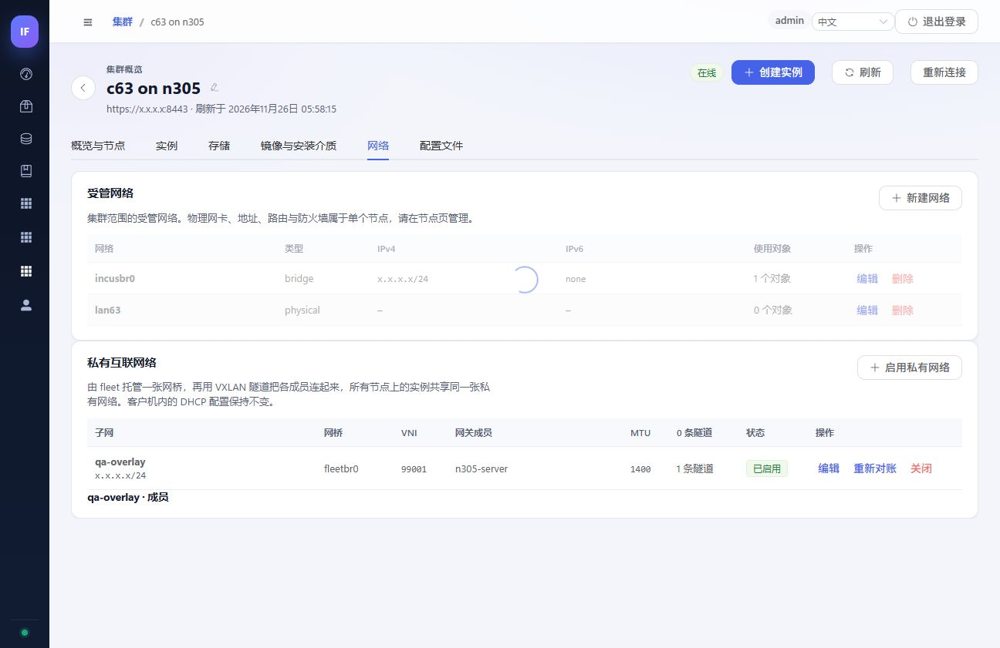
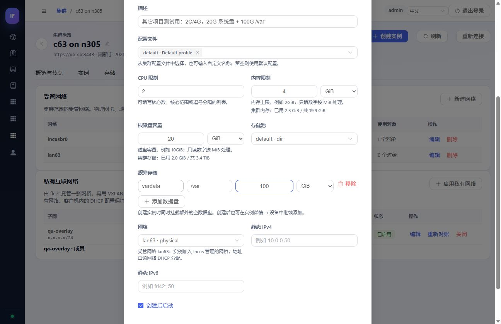
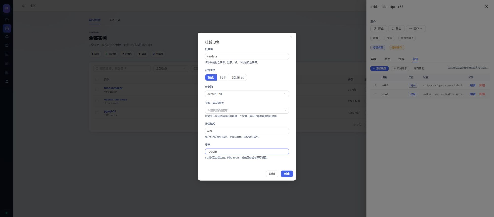
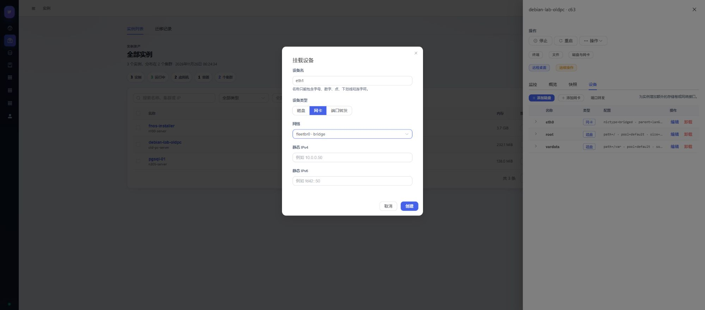
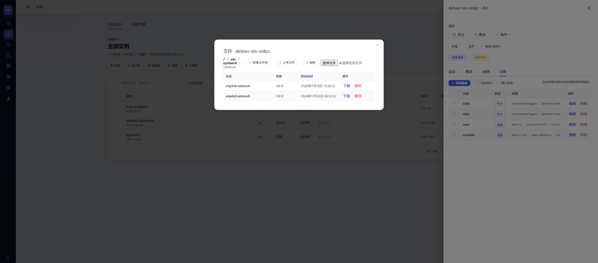
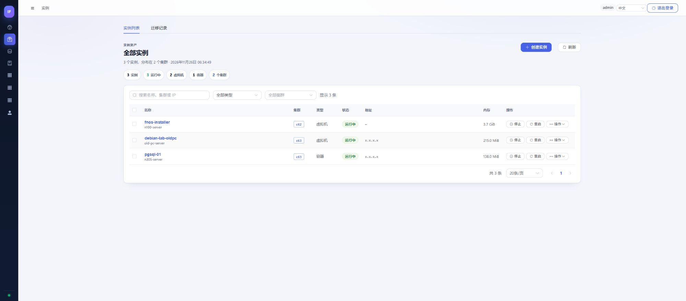
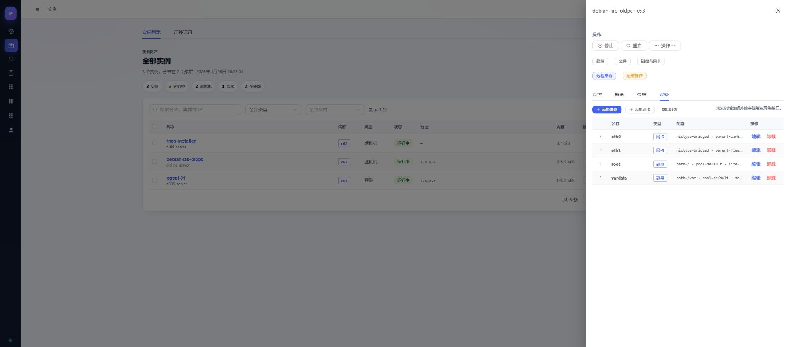

# 在 old-pc-server 上部署测试用 Debian 虚拟机

[English](../en/debian-vm-oldpc.md) | **中文**

本文记录如何通过 Incus Fleet Web 界面，在集群 `c63` 的成员 `old-pc-server` 上创建一台
Debian 测试虚拟机，并配置 2C/4G、20GiB 系统盘、100GiB `/var` 数据盘，以及同时接入
站点局域网网段（63 网段）与私有互联网络网段（10.99 网段）两个网段。

> **脱敏说明**：所有截图中的主机地址、网关地址均已统一替换为 `x.x.x.x`，MAC 地址替换为
> `xx:xx:...`；密码、令牌、SSH 密钥等材料未在截图中出现。文中的网段保留为网段表示，
> 不暴露具体主机地址。

## 最终配置

| 项 | 值 |
| --- | --- |
| 实例名 | `debian-lab-oldpc` |
| 集群 / 节点 | `c63` / `old-pc-server` |
| 类型 | 虚拟机（Debian trixie） |
| CPU / 内存 | 2 vCPU / 4 GiB |
| 系统盘 | `root`，20 GiB，挂载 `/` |
| 数据盘 | `vardata`，100 GiB，挂载 `/var` |
| 63 网段网卡 | `eth0`，bridged → 宿主机网桥 `lan63br2`（上联 `enp4s0`） |
| 10.99 网段网卡 | `eth1`，bridged → `fleetbr0`（Fleet 私有互联网络） |
| 客机地址 | 63 网段 DHCP 自动获取；10.99 网段 DHCP 自动获取 |

## 前置条件（命令行一次性准备）

Web 界面目前只能上传镜像文件（且单文件有大小上限），并且无法为物理网络设置成员级
`parent`。因此以下三步通过 CLI 完成，之后的所有实例操作都在 Web 界面进行。

### 1. 导入 Debian 虚拟机镜像

```bash
incus image copy images:debian/13 local: --alias debian-13-vm --vm
```

在 Web 的「集群 → 镜像与安装介质」中应能看到 `debian-13-vm`。

### 2. 准备 63 网段宿主机网桥

`old-pc-server` 的 `enp4s0` 本身带有宿主管理地址，Incus 不允许直接把它作为 macvlan
父接口。做法是把管理地址迁移到一张网桥上，再把 `enp4s0` 作为网桥上联：

```bash
# 在 old-pc-server 上，以 root 执行
ip link add lan63br2 type bridge
ip -4 addr flush dev enp4s0
ip link set enp4s0 master lan63br2
ip link set enp4s0 up
ip link set lan63br2 up
ip addr add <宿主地址>/24 dev lan63br2
ip route replace default via <网关地址> dev lan63br2
```

为使配置在重启后生效，把上面的命令固化为 `/usr/local/sbin/setup-lan63-bridge.sh`，
并用 `lan63-bridge.service`（`Type=oneshot`, `WantedBy=multi-user.target`）在开机时执行。
同时需要在 `/etc/dhcpcd.conf` 中加入 `denyinterfaces enp4s0 lan63br2`，避免 dhcpcd 与
静态地址冲突。

重启该节点的 Incus 守护进程，让它识别这张宿主网桥：

```bash
sudo systemctl restart incus
```

### 3. 说明

- 集群版 Incus 创建网络是两步流程：先在成员上 `incus network create lan63 --type
  physical parent=enp4s0 --target old-pc-server` 定义，再执行
  `incus network create lan63 --type physical` 实例化。仅定义不实例化时状态为
  `Pending`，Web 创建实例会报「Specified network is not fully created」。
- 本例最终没有使用该物理网络，而是直接使用宿主网桥 `lan63br2`。

## Web 操作步骤

### 步骤 1：进入集群页面

打开「集群 → c63 → 网络」查看网络清单（见 `01-physical-network.jpg`）。截图中的
`lan63` 是排查过程中创建的物理网络；最终方案改为直接使用宿主网桥，因此该网络已在
完成后删除，当前清单中不再出现。



### 步骤 2：创建实例

点击「创建实例」，填写：

- 名称：`debian-lab-oldpc`
- 类型：虚拟机
- 镜像：`debian-13-vm`
- CPU 限制：`2`
- 内存限制：`4 GiB`
- 根磁盘容量：`20 GiB`
- 存储池：`default`
- 网络：`lan63`（稍后在设备页改为宿主网桥）

> **已知缺陷 BUG-01**：创建表单里的「额外存储」会生成缺少 `source` 的磁盘设备，
> 后端报 `Disk entry is missing the required "source" or "path" property`。
> 请留空该项，创建完成后到「设备」页添加数据盘（见步骤 3）。



创建后实例可能处于「已停止」。打开实例详情，点击「启动」。

### 步骤 3：添加 100 GiB `/var` 数据盘

实例详情 →「磁盘与网卡」→「添加磁盘」：

- 设备名：`vardata`
- 设备类型：磁盘
- 存储池：`default`
- 来源：留空（新建空卷）
- 挂载路径：`/var`
- 容量：`100GiB`



后端会创建名为 `dev-debian-lab-oldpc-vardata` 的自定义卷并挂载到 `/var`。
`dir` 存储池不会强制硬配额，但卷配置中已记录 `size: 100GiB`；如需强制限额，
应改用支持配额的存储驱动（btrfs/ZFS/LVM）或在客户机内配置文件系统配额。

### 步骤 4：添加 10.99 网段网卡

「添加网卡」→ 设备名 `eth1` → 网络 `fleetbr0` → 静态 IPv4/IPv6 留空（使用 DHCP）。



> **已知缺陷 BUG-02**：Fleet 把所有非受管网络都按 `macvlan` 处理。
> `fleetbr0` 是带宿主地址的网桥，按 macvlan 添加后接口无法获得链路。
> 需要把该设备改成桥接：
>
> ```bash
> incus config device remove debian-lab-oldpc eth1
> incus config device add debian-lab-oldpc eth1 nic nictype=bridged parent=fleetbr0
> ```
>
> 同理 63 网段网卡也用桥接方式接入宿主网桥：
>
> ```bash
> incus config device remove debian-lab-oldpc eth0
> incus config device add debian-lab-oldpc eth0 nic nictype=bridged parent=lan63br2
> ```

### 步骤 5：在客机内配置第二个网卡持久化

Debian 镜像用 `systemd-networkd` 管理网络，已有一份 `enp5s0.network`。
通过实例详情 →「文件」，进入 `/etc/systemd/network`，上传下面这份配置
（可直接下载仓库中的 `enp6s0.network.example`）：

```ini
[Match]
Name=enp6s0

[Network]
DHCP=true

[DHCPv4]
UseDomains=true
UseMTU=true

[DHCP]
ClientIdentifier=mac
```



在客机内执行 `systemctl restart systemd-networkd`（或通过「终端」执行）使其生效。

### 步骤 6：重启并验证

在实例详情页点击「重启」。重启后两个网卡都应通过 DHCP 拿到地址。





## 验证结果

在客机内检查：

```bash
$ ip -brief addr
lo      UNKNOWN  <loopback>
enp5s0  UP       <63 网段地址>/24 ...
enp6s0  UP       <10.99 网段地址>/24 ...

$ df -h /var
Filesystem      Size  Used Avail Use% Mounted on
incus_vardata   ...   ...   ...       1% /var

$ nproc
2

$ free -h | head -2
               total   used   free
Mem:           3.8Gi   ...    ...
```

- 2 vCPU / 3.8 GiB 可用内存，符合 2C/4G 配置。
- `/var` 已挂在独立卷上。
- 两个网段均可达；重启后地址保持稳定。

## 发现的 Web 缺陷（待修复）

| 编号 | 现象 | 影响 | 临时规避 |
| --- | --- | --- | --- |
| BUG-01 | 创建实例表单的「额外存储」生成的磁盘设备没有 `source` | 创建实例直接失败 | 创建后到「设备」页添加磁盘 |
| BUG-02 | 非受管网桥（如 `fleetbr0`）被当作 macvlan 处理，接口无链路 | 第二网卡不可用 | CLI 改成 `nictype=bridged, parent=fleetbr0` |
| BUG-03 | 「新建网络」对话框无法设置成员级 `parent`，集群级创建报 `parent is cluster member specific` | 无法通过 Web 添加物理网络 | CLI 两步定义 + 实例化 |
| BUG-04 | `dir` 池下 100GiB 卷没有硬配额，客户机看到的是宿主池容量 | 空间可能超用 | 换用支持配额的存储驱动 |

## 相关文档

- [用户手册](user-guide.md)
- [QA 测试记录](qa-test-report.md)
