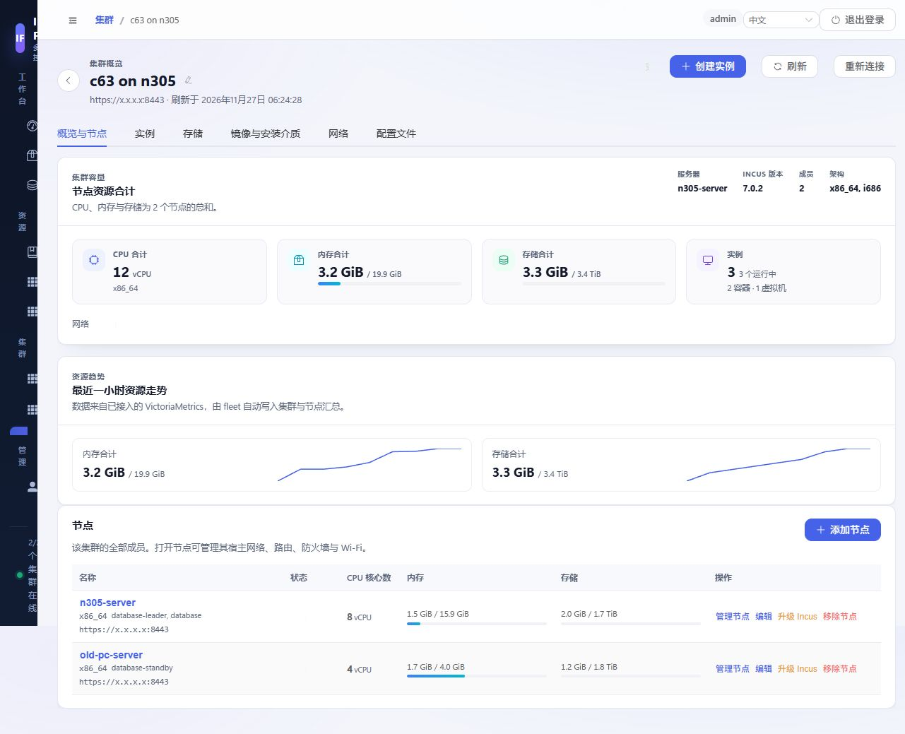
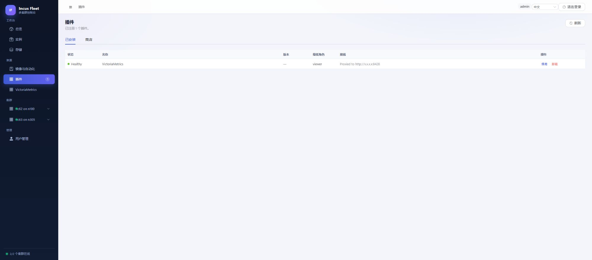

# 插件一键安装（官方定制服务）

[English](../en/plugins-one-click.md) | **中文**

插件商店里的 `vm`（VictoriaMetrics）和 `vmlogs`（VictoriaLogs）是**官方定制的服务
插件**。点击一键安装后，Fleet 会真正创建服务实例、执行安装脚本并自动接线，而不是只
登记一个已有地址。自定义插件的清单规范与打包方式见 [插件规范](plugin-spec.md)。

> **脱敏说明**：截图中的主机地址替换为 `x.x.x.x`，账户名替换为 `<user>`，口令类信息
> 一律以 `<redacted>` 表示。仓库和文档中不包含任何口令明文。

## 前置条件：导入官方 OCI 镜像

`vm` / `vmlogs` 使用官方 OCI 镜像，需先在集群中导入一次：

```bash
incus remote add quay https://quay.io --protocol=oci --public
incus image copy quay:victoriametrics/victoria-metrics:latest local: --alias vm-oci
incus image copy quay:victoriametrics/victoria-logs:latest local: --alias vmlogs-oci
```

镜像本身不含数据目录卷；当前版本把数据写在实例根盘内（20GiB 默认值）。生产环境可再
挂载独立数据卷。

## 安装时发生了什么

1. 选择集群；节点留空时按“内存/存储压力取较大值，最小者胜出”的轻量调度算法自动选择；
2. 用清单默认值创建容器：`2 vCPU / 2GiB / 20GiB`，网卡 `incusbr0`；
3. 等待实例拿到 IPv4；
4. 官方 OCI 镜像自带入口，VictoriaMetrics / VictoriaLogs 自动在 8428 / 9428 启动；
5. 生成上游地址 `http://<实例IP>:8428`（日志为 `:9428`），签发插件作用域令牌；
6. 侧边栏出现插件菜单，指标查询自动改走该实例。

任何一步失败都会删除实例并撤销令牌，不会留下半成品。

## 指标接管与 Web 图表

`vm` 安装成功后：

- Fleet 每 30 秒把集群与成员汇总写入该 VictoriaMetrics（`fleet_cluster_*`、
  `fleet_member_*`、`fleet_host_memory_bytes`），无需 agent 或手写 remote write；
- 节点详情的“主机指标”在中心遥测为空时自动改用 VictoriaMetrics，不再要求手动切换；
- 集群概览新增“最近一小时资源走势”，直接展示内存与存储曲线。



> CPU 使用率与负载仍依赖 `incus-fleet-agent` 的实际采样；当前内置推送只包含 Fleet 能
> 直接读取的容量与用量汇总。

## 操作步骤

1. 打开「插件 → 商店」，选择 `VictoriaMetrics` 或 `VictoriaLogs`。

   

2. 点击「一键安装」。对话框会预填资源、网卡与实例名；可以直接改，也可以全部保留默认值
   （节点选“自动”）。

3. 安装完成后在「已安装」页看到状态，侧边栏出现对应菜单。点击菜单仍在 Fleet 内，
   插件页面嵌在同源 iframe 中。

   

   

## 官方 vm 插件的额外能力

- 安装完成后，Fleet 的 PromQL 查询代理自动指向该 VictoriaMetrics，无需再写
  `metrics.query` 配置、无需重启；
- 节点详情页在中心遥测没有数据时，会自动切换到 VictoriaMetrics 查询，不再要求用户手动
  点“使用 Prometheus/VM”；
- 后续可基于该数据源在集群/节点页面直接画资源趋势图（当前先复用现有指标面板）。

## 卸载与停用

- 「停用」只关闭代理和菜单，不删除实例；
- 「卸载」删除服务实例、撤销令牌并移除条目；
- 外部服务模式下卸载不影响原服务（官方定制插件会删除由 Fleet 创建的实例）。

## 相关文档

- [插件规范与打包](plugin-spec.md)
- [插件系统设计](plugins.md)
- [用户手册](user-guide.md)
