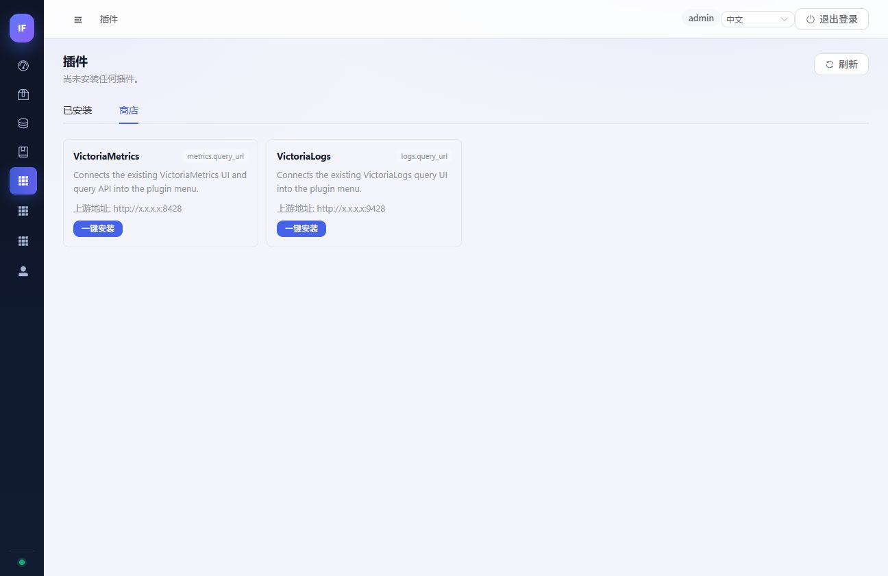
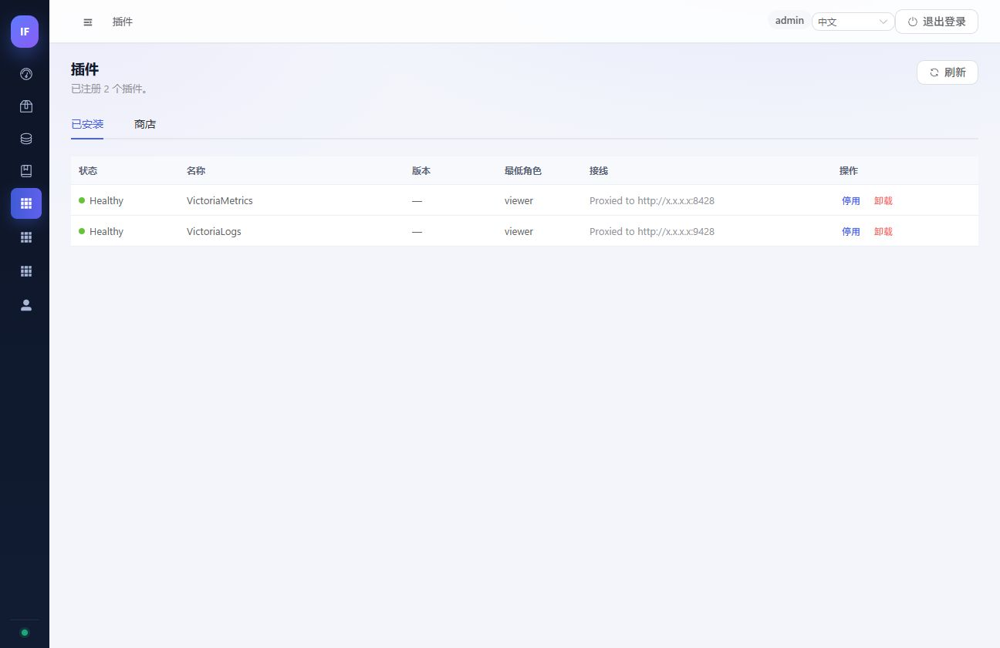
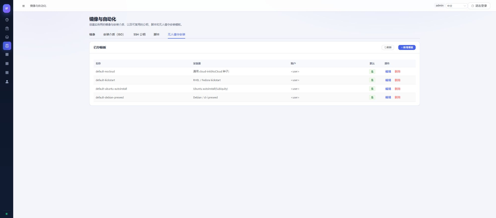

# 插件一键接入与默认无人值守模板

[English](../en/plugins-one-click.md) | **中文**

本文记录两件事：

1. 在插件系统中一键接入 VictoriaMetrics（`vm`）与 VictoriaLogs（`vmlogs`）；
2. 预置四种安装器的默认无人值守安装模板。

> **脱敏说明**：所有截图中的主机地址均替换为 `x.x.x.x`，账户名替换为 `<user>`，口令类
> 信息一律以 `<redacted>` 表示。本文不包含任何口令明文；预置模板的凭据只保存在 Fleet
> 运行数据库中，不进入代码仓库、文档或截图。

## 一、前置条件

插件管理器需要显式开启。在 Fleet 配置文件中加入：

```yaml
plugins:
  enabled: true
  entries: []
```

修改后重启 `incus-fleet`。已安装的插件保存在 Fleet 数据库（`installed_plugins` 表），
重启不会丢失。

## 二、一键接入 vm / vmlogs

### 能力边界

“一键安装”指的是**把已经运行的服务接入 Fleet**，而不是自动部署服务：

- 只登记上游地址、签发一个只含 `read:plugins` 作用域且绑定插件 ID 的 API 令牌；
- 生成菜单入口与 `/plugin-ui/<id>/` 同源代理；代理不会把 Fleet 会话 Cookie 传给上游；
- 停用、卸载均可在 Web 完成；卸载会撤销令牌，但不会影响外部服务本身；
- 不会创建 VM/容器，不会下载或运行 VictoriaMetrics / VictoriaLogs 二进制，也不会改
  Rust agent 的日志采集（当前 agent 只上报指标）。

因此使用前需要先自行运行 VictoriaMetrics（默认 8428 端口）和 VictoriaLogs（默认 9428
端口），或使用任意反向代理地址。

### 操作步骤

1. 打开「插件 → 商店」，可看到两个内置目录项：`vm`（接线 `metrics.query_url`）与
   `vmlogs`（接线 `logs.query_url`）。

   

2. 点击对应卡片的「一键安装」，填写实际的上游地址（如 `http://<主机>:8428`），确认。

3. 切到「已安装」页，可见状态、角色、接线和「停用 / 卸载」操作。

   

4. 安装后侧边栏「插件」下方会出现对应菜单项。点击后仍停留在 Fleet 界面，插件页面以
   同源 iframe 嵌在 `/plugin/<id>` 中，左侧导航始终可用；如果上游不可达，只会看到 iframe
   内的错误提示，不会把整个 Fleet 页面替换掉。

   

### 验证

- 安装后侧边栏出现插件菜单，点击后通过同源代理打开上游页面。
- 重启 `incus-fleet` 后列表仍保留两个插件。
- 「停用」后代理返回 404；「卸载」后令牌被撤销、条目消失。

## 三、默认无人值守安装模板

已在 Fleet 数据库中预置四种安装器模板，每种都设为该安装器的默认：

| 模板名 | 安装器 | 备注 |
| --- | --- | --- |
| `default-debian-preseed` | Debian / d-i preseed | 目标磁盘 `/dev/vda` |
| `default-ubuntu-autoinstall` | Ubuntu autoinstall (Subiquity) | 磁盘由安装器选择 |
| `default-kickstart` | RHEL / Fedora kickstart | 目标磁盘 `/dev/vda` |
| `default-nocloud` | 通用 cloud-init (NoCloud) | 磁盘由安装器选择 |

统一配置：时区 `Asia/Shanghai`、语言 `zh_CN`、键盘 `us`、附加包 `openssh-server`；
账户与口令按运维约定设置，**此处及截图中均不展示**。



### 使用方式

创建实例并选择安装介质后，开启无人值守安装，在应答模板下拉框中选择对应默认模板；
主机名留空时会自动使用虚拟机名称。也可以在「镜像与自动化 → 无人值守安装」中复制或
编辑这些模板。

### 凭据安全

- 模板口令使用运维约定的统一值，**仅限内部测试环境使用**；
- 需要轮换时，在「无人值守安装」页逐条编辑并更新口令，或在部署脚本中通过环境变量注入；
- 不要把口令写入代码、文档、截图、日志或工单；对外分享的截图必须使用脱敏版本；
- 卸载/删除模板不会撤销已安装系统内的账户，请按操作系统常规方式修改。

## 相关文档

- [插件系统设计](plugins.md)
- [用户手册](user-guide.md)
