# 用户操作手册

[English](../en/user-guide.md) | **简体中文**

本手册以两集群场景为例,演示从登录到交付一台可用实例的完整操作。示例中的集群名
`c1`、`c2` 请替换为你自己的集群名;地址、网段均为说明性示例。

前置条件:

- fleet 已按 [deployment(deployment.md) 部署并可访问(示例:`http://192.0.2.10:8080`)。
- 你持有管理员 token(部署时写入 `INCUS_FLEET_AUTH_TOKEN`)。
- 两个集群均已[在 Fleet 中配置(deployment.md#3-配置应用)且在线。

## 目录

1. [登录与语言](#登录与语言)
2. [导航与页面地图](#导航与页面地图)
3. [用户与角色](#用户与角色)
4. [远程桌面](#远程桌面)
5. [安装 incus agent](#安装-incus-agent)
6. [认识仪表盘](#认识仪表盘)
7. [镜像:导入与分发](#镜像导入与分发)
8. [ISO 安装镜像与系统安装](#iso-安装镜像与系统安装)
9. [创建实例(含同网段 IP)](#创建实例)
10. [实例日常管理](#实例日常管理)
11. [在线终端与远程桌面](#在线终端与远程桌面)
12. [运维操作:脚本、密码、密钥](#运维操作脚本密码密钥)
13. [镜像升级与实例克隆](#镜像升级与实例克隆)
14. [端口转发](#端口转发)
15. [实战案例:部署 PostgreSQL 数据库容器](#实战案例部署-postgresql-数据库容器)
16. [跨集群迁移与 guest 网络](#跨集群迁移与-guest-网络)
17. [镜像与自动化、批量操作](#镜像与自动化批量操作)
18. [资源监控](#资源监控)
19. [存储池与网络](#存储池与网络)
20. [私有互联网络](#私有互联网络)
21. [添加节点](#添加节点)
22. [节点网络与操作历史](#节点网络与操作历史)
23. [插件(管理员)](#插件管理员)
24. [常见问题](#常见问题)

## 登录与语言

1. 打开 fleet 地址,输入**用户名和密码**,点击登录。会话有效期 12 小时,过期后
   重新登录即可;若在操作中途会话失效,会自动跳到登录页,登录后可回到原页面。
   右上角会显示当前账号名。
2. 首次部署可用两种方式建立第一个管理员:
   - 在 `incus-fleet.env` 中设置 `INCUS_FLEET_BOOTSTRAP_ADMIN_USERNAME` 与
     `INCUS_FLEET_BOOTSTRAP_ADMIN_PASSWORD`,重启服务即自动创建;
   - 或用共享 admin token 登录后,在「用户管理」里创建。
   一旦存在任何本地账号,共享 token 立即失效。
3. 使用**右上角工具栏中的语言选择器**可在 中文 与 English 之间切换,选择即时生效
   并保存在浏览器中。

## 导航与页面地图

侧边栏按作用域分组,顶栏会显示当前页面的面包屑,方便随时确认所处的集群或资源。

- **Fleet** —— **总览**(集群健康与汇总)与 **实例**(跨集群实例表格)。
- **资源** —— **镜像与自动化**(镜像、安装介质、密钥、脚本、无人值守安装模板)、**Assets**,
  以及管理员可见的 **插件**。
- **集群 → 节点** —— 每个集群一个可展开分组:其 **概览** 页面与 **节点** 子菜单列出所有
  成员,点开即可进入节点详情与 **节点网络** 页面。
- **管理** —— **用户管理**(仅管理员可见)。

除分组入口外,顶层页面还有 **实例**、**存储**(Fleet volumes,跨集群存储清单,见
[存储池与网络](#存储池与网络))、**Assets**、**插件** 与 **用户管理**。顶栏面包屑显示
到达当前页面的路径(如 *集群 → 节点 → 节点网络*),点击任一级即可返回。

侧边栏可用左上工具栏的切换按钮收起为**纯图标栏**:分组标题与文字隐藏,保留图标,
悬停图标显示名称。

## 用户与角色

只有管理员能在侧边栏的 **管理** 分组下看到「用户管理」。

- **角色**:`管理员`(全部权限)、`操作员`(可变更实例与节点,不能管理用户)、
  `只读`(只能查看)。
- **新建用户**:填写用户名、密码(至少 8 位)、选择角色;可勾选「已禁用」与
  「下次登录要求修改密码」。
- **编辑**:可改角色、重置密码、启用/禁用。留空密码表示保持不变。
- **删除**:二次确认后删除。最后一个管理员不能被删除或降级,接口会返回冲突。
- **会话**:行操作 **会话** 会列出该账号的活动会话(登录时间、最近活动、来源)。
  **撤销所有会话** 会一次性结束该用户的所有会话,包括当前会话;若撤销自己的会话,
  你会被登出。
- **权限是服务端强制的**:只读账号即使绕过界面直接调用 API,写操作也会被拒绝(403)。

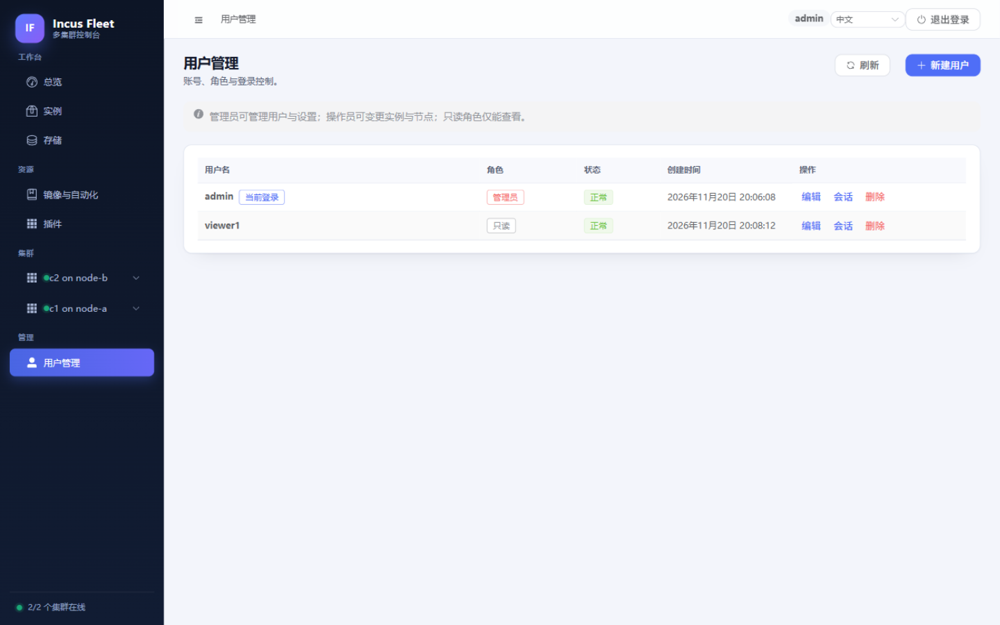

## 远程桌面

「远程桌面」按钮直接在浏览器里打开运行中虚拟机的实时图形控制台。它不依赖宿主 QEMU 的
VNC/SPICE 能力:fleet 通过 `raw.qemu.conf` 为虚拟机追加第二个 QEMU 监视器(QMP control
模式),经其轮询帧缓冲截图并注入键盘、指针事件。首次准备会让运行中的虚拟机重启一次;
之后每次打开都是即时、幂等的。

控制台窗口内:点击画面获得键盘焦点(方向键、回车、Ctrl+Alt+Del 均直达虚拟机),在画面内
点击或拖动即移动指针、按下按键,滚轮对应滚轮事件。画面约每秒自动刷新一次。工具栏同时
显示虚拟机电源状态,并提供 **开机**、**重启**、**关机** 按钮,停机的虚拟机可以直接在控制台
里启动。容器没有显示设备,不提供该按钮。

## 安装 incus agent

从任意 ISO 安装的系统(例如 fnOS)不自带 Incus 的客户机内 agent,因此这类虚拟机的命令行终端、
文件管理与实例指标都不可用。实例抽屉**仅对没有 agent 的虚拟机**(根据缺失的客户机网络/
客户机信息状态判断)显示 **安装 Agent** 按钮;容器与已有 agent 的虚拟机不会显示。填入客户机
的 SSH 凭据(客户机地址可留空——留空时 fleet 从 DHCP 租约解析;非 root 用户支持 sudo 提权)。
凭据仅本次会话使用,不会保存。

对话框会逐步显示每步的即时结果(成功、失败,或"可能需要重启"警告):

1. **校验**输入;
2. **解析地址**(未填时从 DHCP 租约获取);
3. 通过 SSH **连接**;
4. **检查客户机**是否支持 systemd 与 9p;
5. **挂载 config 共享盘**(Incus 自动挂进每台虚拟机的只读 `config` 共享盘,内有官方
   `install.sh`);
6. 在客户机内**执行 install.sh**;
7. **清理**临时挂载;
8. **验证 agent** 已响应。

如需手动操作,可在客户机内执行:

```
mount -t 9p config /mnt
/mnt/install.sh
```

安装器仅支持带 systemd 与 9p 内核支持的客户机(Debian、Ubuntu 及其衍生系统均可)。Windows
虚拟机需要 virtio-win 的安装流程,暂未覆盖。

## 认识仪表盘

登录后默认进入仪表盘,展示:

- 每个集群的在线状态、Incus 版本、实例数量;
- 实例总数、运行/停止分布;
- 资源概览(CPU、内存、存储)。

页面可见期间状态每 15 秒自动刷新,节点恢复在线无需手动刷新页面。

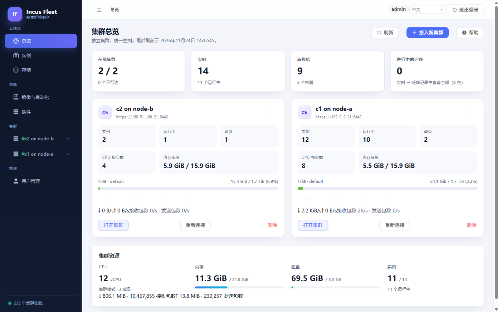

*截图为简体中文界面;可在右上角工具栏的语言选择器中切换语言。*

集群列表点击任意集群进入该集群的详情页(实例、镜像、存储池、网络、Profile、成员)。

## 镜像导入与分发

从侧边栏 **资源 → 镜像与自动化** 开始:**镜像** 标签是跨集群镜像清单,
**安装介质(ISO)** 保存已上传的安装盘(见 [ISO 安装镜像与系统安装](#iso-安装镜像与系统安装))。
要把镜像放到某个集群,请打开该集群的 **镜像与安装介质** 标签——此视图是**集群级**的,
只显示与管理该集群的镜像、存储卷与 ISO 介质。fleet 支持把本地镜像文件上传到某一个集群,
再一键分发到其他集群,实现"上传一次、集群共用"。在集群上删除镜像前会弹出二次确认——
删除不可恢复。

### 第一步:准备镜像文件

在任意装有 Incus 的机器上导出镜像:

```bash
# 统一文件(单 tar 包)
incus image export debian/13 debian13

# 拆分文件(元数据 tar 包 + .root 根文件系统)
# 导出结果为 debian13(元数据)与 debian13.root(根文件系统)两个文件
```

ISO 安装盘走单独的 [ISO 工作流](#iso-安装镜像与系统安装);此处导入的是容器镜像与
虚拟机镜像。

### 第二步:上传到集群

1. 进入目标集群(如 `c2`)→ **镜像** 区块 → **导入**。
2. 点击上传区选择镜像文件:
   - 统一文件:只选 tar 包即可;
   - 拆分文件:先选元数据 tar 包,再在 **Rootfs 文件** 处选择配套的 `.root` 文件。
3. 选择镜像类型(容器 / 虚拟机),可选填别名(如 `debian/13`,便于创建实例时挑选)。
4. 点击 **导入**。上传完成后镜像会以指纹出现在列表中。

也可以用 API 上传(与界面等价):

```bash
curl -H "Authorization: Bearer $INCUS_FLEET_AUTH_TOKEN" \
  -F "image=@debian13" -F "rootfs=@debian13.root" \
  "http://192.0.2.10:8080/api/v1/clusters/c2/images/import?type=container&alias=debian/13"
```

### 第三步:分发到其他集群

1. 在持有镜像的集群(如 `c2`)镜像列表中,点击该镜像的 **分发**。
2. 选择目标集群(如 `c1`),可选填别名,点击 **分发**。
3. 完成后目标集群的镜像列表即可看到同一指纹的镜像。

## ISO 安装镜像与系统安装

fleet 支持上传 ISO 安装镜像(如 Debian/Ubuntu/CentOS 官方安装盘),并从 ISO
启动一台空白虚拟机完成系统安装。从 **资源 → 镜像与自动化 → 安装介质(ISO)** 进入
fleet 全局介质库;启动虚拟机在集群的 **镜像与安装介质** 标签中完成,该视图为集群级。

1. 在 **镜像与自动化 → 安装介质(ISO)**(或集群的 **镜像与安装介质** 标签)上传 ISO:
   点击 **上传 ISO**,选择 `.iso` 文件与存储池。导航离开页面后上传会**在后台继续**,
   并可在上传列表中**取消**。
2. 上传完成后列表会出现该 ISO。点击 **创建虚拟机**:
   - 填写虚拟机名称(必填);
   - 可选选择网络(安装过程需要联网拉取软件包时建议选择,物理网卡或托管网桥均可);
   - 可选填写根磁盘容量(如 `20GiB`,给系统盘留足空间)。
3. 提交后 fleet 会创建一台空白虚拟机并自动从 ISO 引导(自动放宽 Secure Boot
   以兼容多数发行版安装器,并预先配好 SPICE 图形通道)。
4. 打开该虚拟机的 **远程桌面**(见下文),即可在浏览器里看到安装程序界面,
   像操作物理机一样完成安装。
5. 安装完成后建议关机、在设备面板卸载 ISO 设备(或直接删除重装),再开机进入新系统。

### 无人值守安装

上面的交互式路径需要在远程桌面里敲键盘。**无人值守安装**全程零按键:fleet 把应答文件
放进安装介质、强制引导默认安装项,并在装完后自动清理介质。

1. 在 **从 ISO 创建虚拟机** 对话框里照常填写虚拟机名称,然后打开 **无人值守安装** 开关。
2. 选择 **安装器类型**(fleet 会按 ISO 名自动预选):

   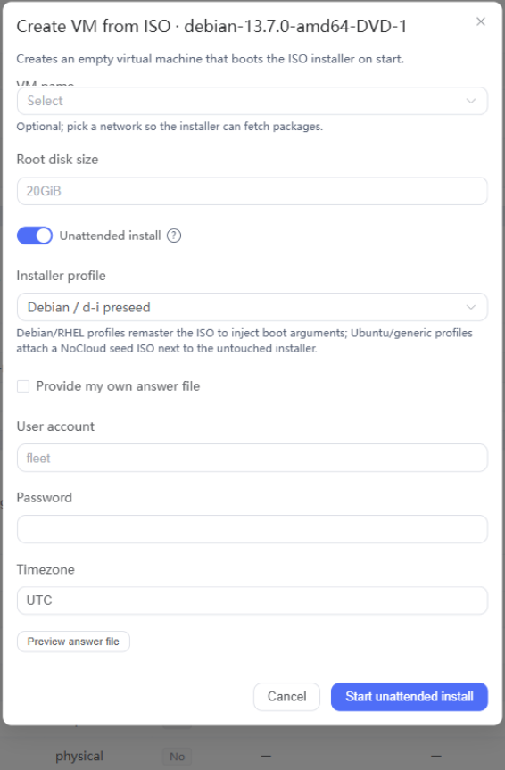

   - **Debian / d-i preseed** —— Debian 及使用 debian-installer 的衍生版;
   - **Ubuntu autoinstall(Subiquity)** —— Ubuntu Server 20.04+ 镜像;
   - **RHEL / Fedora kickstart** —— RHEL、Rocky、Alma、CentOS Stream、Fedora;
   - **通用 cloud-init(NoCloud 种子)** —— 支持 cloud-init 的自定义 ISO。
3. 通过三种方式之一提供应答:
   - 填写模板字段:主机名(默认取虚拟机名)、用户账户、密码、时区、目标磁盘、语言区域、
     键盘布局,以及无人值守安装时要装的**附加软件包**;
   - 从下拉框选择已存的 **无人值守安装** 模板 —— 模板在 **镜像与自动化 → 无人值守安装** 中管理,可按安装器类型设为默认,
     启动安装时若未提供应答内容会自动套用默认配置;
   - 勾选 **使用自定义应答文件** 粘贴完整的 preseed.cfg / ks.cfg / user-data。
   **预览应答文件** 会渲染出实际下发的内容。
4. 点击 **开始无人值守安装**。接下来会发生:
   - Debian/RHEL 类型会**重制** ISO:应答文件写入 ISO 根目录,GRUB 配置注入无人值守
     内核参数与 10 秒自动引导。原 ISO 不动,派生出 `<iso>-<profile>-auto` 卷。
   - Ubuntu/通用类型不修改安装盘,在旁边挂一张生成的 NoCloud 种子盘
     (`cidata-<vm>`)。
5. 通过 **远程桌面** 观察进度——安装从引导到结束零输入。补丁后的引导菜单 10 秒后自动
   启动默认安装项。完成后虚拟机自动关机,fleet 自动卸载安装介质并删除派生卷(含应答文件
   副本),之后直接开机进入新系统即可。

注意事项:

- 无人值守安装是**完全自包含**的:全部逻辑都在 fleet 与集群内完成,不需要任何外部下载器、
  制品服务或互联网访问——隔离内网同样可用。镜像只需出现在 **镜像与自动化** 中(从本地文件上传即可,
  外部下载助手只是可选的便利手段,从来不是前置条件)。
- fleet 服务器需要安装 **xorriso**(`apt install xorriso`),用于重制安装盘和生成
  种子介质。重制工作目录 `unattended.work_dir`(默认为服务运行目录下的
  `data/unattended`)需要数 GB 空闲空间。
- 重制发生在 ISO 所在的集群成员上,虚拟机也会创建在同一成员上。
- Debian/RHEL 重制类型的应答文件存放在派生 ISO 内——含凭据的介质请按安全惯例对待。
  安装完成后会自动删除;若 6 小时看护窗口过期,请在存储面板手动卸载并删除派生卷。
- 通用 NoCloud(自定义 ISO)没有确定的"安装完成"信号;介质会一直挂着,直到手动卸载
  或看护窗口过期。

ISO 镜像保存在存储池中,可随时在列表中删除。下载好的安装镜像(例如当前 Debian netinst 与
Arch Linux ISO)上传后会出现在 **镜像与自动化 → 安装介质(ISO)** 中:

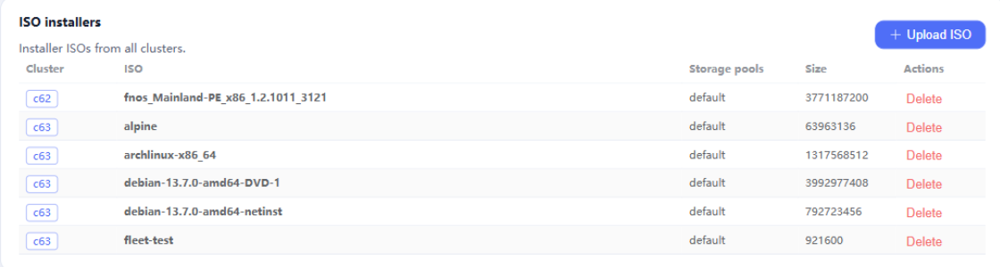

启动前可用 **预览应答文件** 查看将写入派生 ISO 的 preseed/cloud-init 内容。预览位于
无人值守安装对话框中；启动后浏览器远程桌面会自动跟随安装画面的分辨率变化。

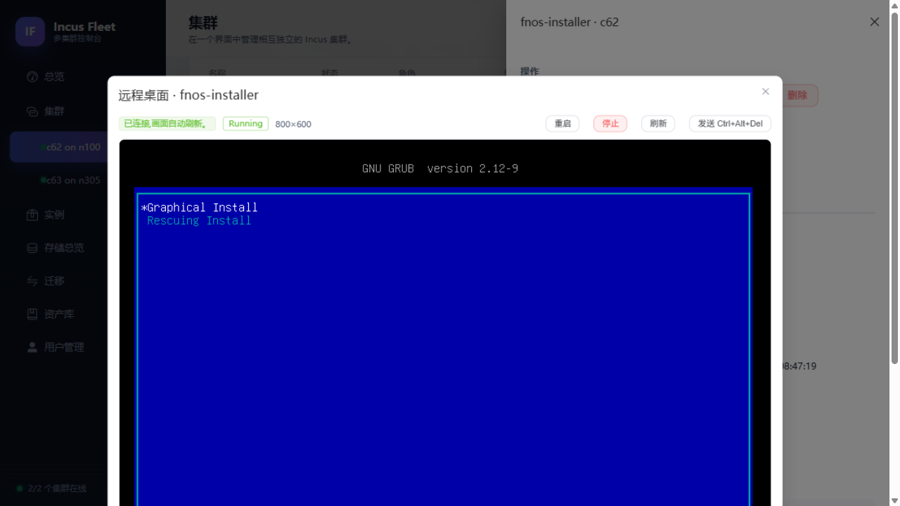

*启动无人值守安装前预览生成的应答文件。*

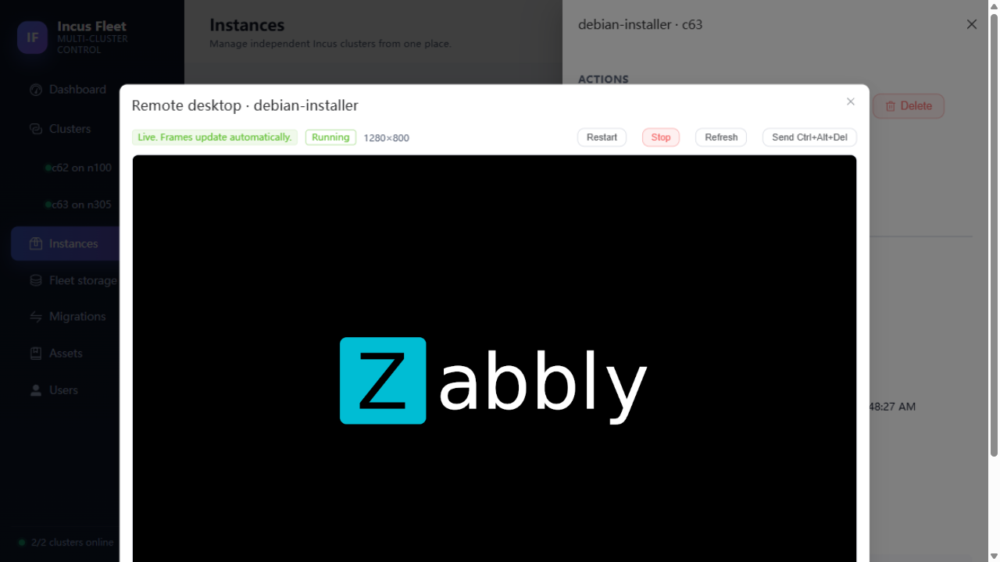

*从 ISO 创建虚拟机对话框中的无人值守安装选项。*

## 创建实例

进入集群 → **实例** → **创建实例**。关键字段:

| 字段 | 说明 |
| --- | --- |
| 名称 | 集群内唯一 |
| 类型 | 容器 / 虚拟机 |
| 镜像 | 按别名或指纹选择已导入的镜像 |
| 网络 | 见下方说明 |
| CPU / 内存 / 根盘大小 | 限制值,留空使用默认 |

### 附加磁盘

创建表单提供 **附加磁盘** 区域(编辑表单中则提示到实例的 **设备** 标签页添加)。每块磁盘需填写:

- **名称** —— 实例内唯一设备名(如 `data0`);
- **挂载路径** —— 客户机内的绝对路径(如 `/data`;块设备可留空);
- **容量** —— 见 [容量输入](#容量输入)。

名称必须唯一、路径必须是绝对路径、容量必须可解析,否则字段旁会即时显示错误,阻止提交。
**来源** 留空表示 fleet 在所选存储池中新建一块空卷并挂载到指定路径;创建后卷名会回填到
设备的 `source` 键。若要挂载已有卷,填写其名称即可。

### 容量输入

内存、根盘与附加磁盘容量由数字加 **MiB / GiB / TiB** 下拉单位组成。纯数字按 **MiB** 解释
(如 `512` 即 `512MiB`),非法值会即时报错。选中集群后,表单会显示该集群当前的内存与存储
容量提示(已用 / 总量),便于按实际余量规划新实例。

### 网络怎么选:同网段 IP 是关键

网络下拉按分组展示,异构集群也能一眼看清:排前面的是**托管网络**(每个节点都可用),
其后是**按节点分组的物理网卡**;bond 成员网卡不会出现在父接口候选里(macvlan 桥不到
bond slave 上)。注意:集群概览页只列**受管网络**,物理网卡、地址、路由与防火墙属于
单个节点,统一在 **集群 → 节点 → 节点网络** 中管理。

实例的网络地址取决于所选网络:

- **托管网桥**(如 `incusbr0`):实例接入 Incus 内部 NAT 网段(如 `10.x.x.x`),
  出网经 NAT,外部无法直接访问。
- **物理网卡(macvlan)**:列表中不带托管标记的网卡(如宿主机的 `eth0`,按其所属节点
  分组显示)。实例通过 macvlan 直接桥接到物理局域网,**从所在网段的 DHCP 获取与宿主机同
  网段的 IP**(例如宿主机在 `198.51.100.0/24`,实例会拿到 `198.51.100.x`)。
  局域网内其他设备可以直接访问该实例。

要让实例拿到与宿主机同网段的 IP:创建实例时,网络选择**物理网卡**(parent 为
宿主机网卡名)即可,不要手动填静态 IP——macvlan 模式下地址由局域网 DHCP 分配。

创建完成后,在实例列表的地址列确认 IP 已落在预期网段;若长时间未获取地址,
检查交换机/路由器的 DHCP 与该网卡的桥接状态。

> ** bond 环境注意**:若物理网卡是某个 bond 的从属接口,它不能作为 macvlan 的
> 父接口(会报 `Failed to start device "eth0": device or resource busy`)。此时应选择
> bond 接口本身,或在实例 **设备** 标签页中以 bond 为 parent 手动添加 macvlan 网卡。
> 编辑表单的"网络"字段只接受 Incus 托管网络;物理父接口请到设备面板添加。

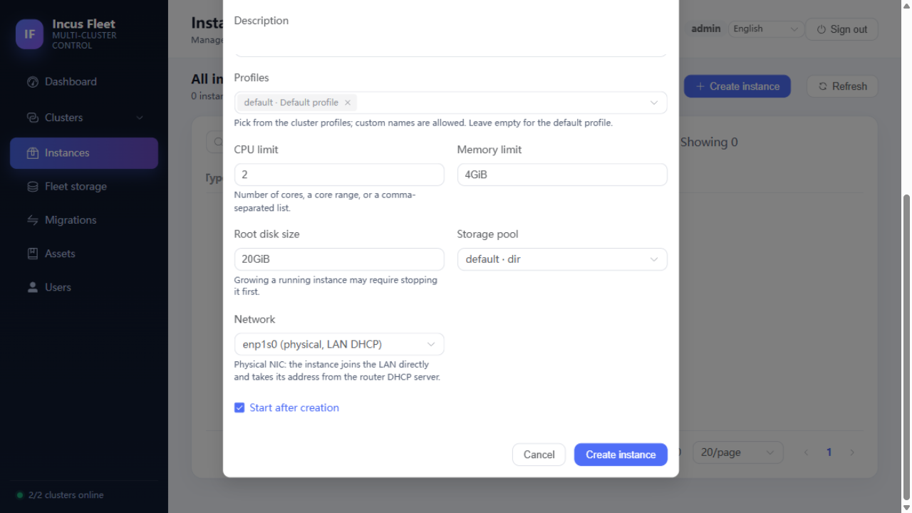

*创建与编辑表单中的 CPU、内存、根盘与网络选择(英文界面)。*

## 实例日常管理

从 **Fleet → 实例** 开始。**实例** 页面是跨集群表格:所有集群的实例集中展示,包含
**集群** 列与集群筛选器,可缩小查看范围(在集群详情页的 **实例** 标签页操作是通往同一
抽屉与动作的集群级次要入口)。表格上方的视图切换提供列表与 **迁移记录** 标签
(`view=migrations`,见 [迁移记录](#迁移记录));勾选实例后出现批量工具栏(见
[批量操作:一键应用到多台实例](#批量操作一键应用到多台实例))。

实例列表或详情抽屉中可执行:

- **启动 / 停止 / 重启**:停止与重启需二次确认,可勾选"强制"。
- **改名**:使用行/操作菜单中的 **改名**。必须先停止实例——运行中的实例不能改名。
  新名称在集群内必须唯一。
- **快照**:创建(可含运行状态)、恢复、删除。恢复会回滚磁盘,请先确认。
- **终端**:
  - *Exec*:在实例内执行命令的交互式 shell;
  - *Console*:串行控制台(容器推荐用 Exec;Console 断开码 1006 属正常关闭)。
- **文件管理**:浏览实例文件系统、上传、下载、新建目录、删除文件。
- **设备管理**:为实例追加磁盘(挂载存储卷或宿主路径)、第二块网卡或端口转发;编辑任意
  已挂载设备。可编辑字段随类型变化:网卡可改网络与 IPv4/IPv6 地址,磁盘可改存储池、
  来源、挂载路径与容量,proxy 可改宿主机侧 **监听(listen)** 与实例侧 **连接(connect)**
  地址。合并配置时会保留表单未管理的键(如启动顺序或自定义 `nictype`),因此无关配置
  不会丢失。展开某行可查看设备完整配置并复制;卸载同样在此面板。网卡地址清空即回退
  DHCP;把网卡切换到托管网络会自动重写旧的 `nictype`/`parent` 设备。
- **删除实例**:需二次确认,对话框中可勾选**同时删除已挂载的存储卷**(共享的 ISO 安装
  镜像资产会保留)。

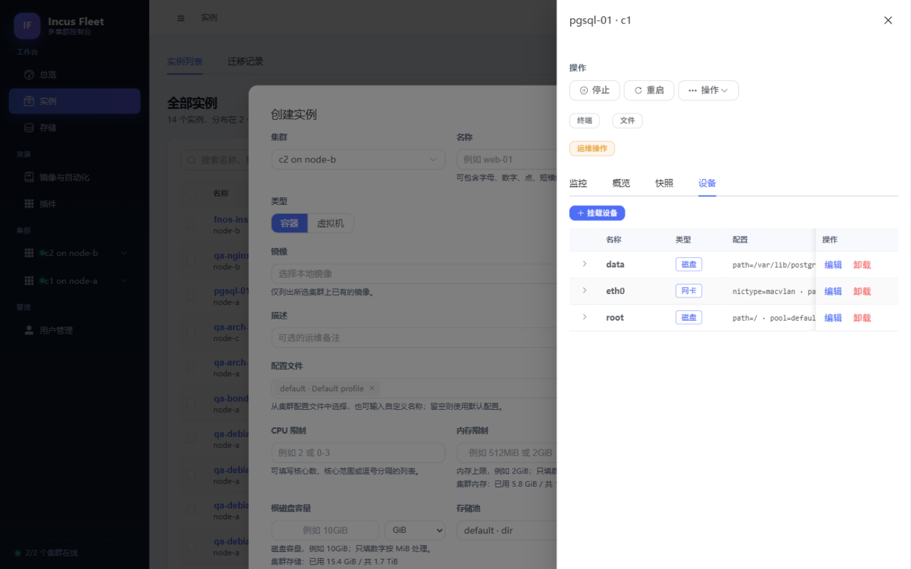

*设备标签页:根盘、macvlan 网卡与已挂载的自定义卷(英文界面)。*

### 迁移记录

**迁移记录** 标签(`实例 → 迁移记录`,或 `/instances?view=migrations`;`/migrations` 会重定向到
此处)列出跨集群迁移,含路由、模式、状态、进度、时长与时间戳。列表自动轮询;可用搜索框与
**状态** 筛选器(pending、preflight、stopping、transferring、starting、verifying、done、
failed、canceled)缩小范围。点击某行打开 **详情抽屉**,查看完整任务状态、进度消息与时间。
终态记录可执行 **重试**(确认后从当前状态重新提交迁移)与 **取消**(请求取消,进行中的
迁移在下一个安全点停下并记录为 canceled);仅运行中的迁移提供 **取消**,仅失败/已取消的
迁移提供 **重试**。迁移后的 guest 网络处理见
[跨集群迁移与 guest 网络](#跨集群迁移与-guest-网络)。

## 在线终端与远程桌面

fleet 提供两类文本在线会话,图形控制台统一见 [远程桌面](#远程桌面):

- **终端(Exec)**:容器与虚拟机通用。在实例内以 root 打开交互式 shell,
  支持窗口自适应与中断信号;适合命令行运维。命令行模式下,会话启动一个
  **持久 shell**,每条提交的命令都进入同一个 shell——环境变量、当前目录等
  状态跨命令保留。若命令已结束、会话已关闭,继续输入会自动重开会话并执行,
  无需手动重连。
- **串行控制台(Console)**:排查启动问题、查看内核输出时使用。

在实例详情抽屉中点击 **终端**。容器默认进入 **命令行** 模式(Incus 容器没有串口控制台),
虚拟机默认进入 **控制台** 模式。命令输入框支持回车提交,也可点击 **启动**;执行结果写入
上方终端区域。

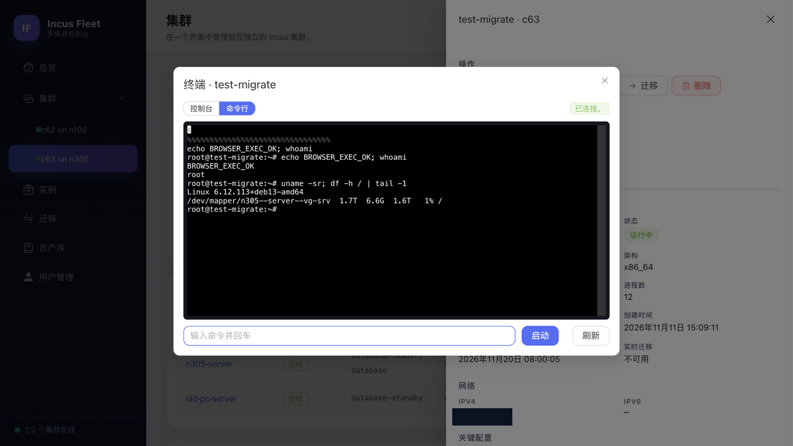

会话随页面关闭自动断开,不会在主机上留下常驻进程。若会话无法打开,终端现在会显示服务端
返回的 websocket 关闭原因(**缺少 guest agent**、**实例已停止** 或 **控制台被占用**),
而不是笼统的"已断开",并附带处理提示——见 [常见问题](#常见问题)。

## 运维操作脚本密码密钥

实例详情抽屉的 **运维操作** 面板提供三个高频动作,全部以实例内 root 身份执行:

| 动作 | 用法 | 说明 |
| --- | --- | --- |
| 运行脚本 | 粘贴 shell 脚本 → 执行 | 通过 `sh -s` 执行,实时显示退出码与标准输出/错误 |
| 修改密码 | 账号 + 新密码 | 通过 stdin 交给 `chpasswd`,密码不会出现在进程列表 |
| 注入 SSH 密钥 | 账号 + 一行公钥 | 追加到该账号 `~/.ssh/authorized_keys`,自动修正目录与权限 |

注入密钥后即可在局域网内 `ssh 账号@实例IP` 免密登录(配合上文同网段 IP)。

## 镜像升级与实例克隆

- **镜像升级(重建实例)**:在实例详情的运维面板中选择目标镜像(别名或指纹),
  fleet 会把实例根盘重建为新镜像。注意:**必须先停止实例**,重建会清空根盘数据;
  数据盘(存储卷)不受影响。
- **刷新缓存镜像**:集群镜像列表中,缓存镜像可点击 **刷新**,让 Incus 从源
  重新拉取最新版本(别名不变、指纹更新)。
- **克隆实例**:实例列表行操作 **克隆**,输入新名称即可在同一集群内复制一台
  完整实例(含磁盘与配置),可选复制后立即启动。适合用模板快速扩量。

## 端口转发

实例的局域网 IP 可能不方便直连(例如宿主机只有部分端口对外开放),此时给实例
挂载 **proxy 端口转发** 设备:

1. 实例详情 → **设备** → 挂载设备,类型选 **端口转发**;
2. 填写监听地址(宿主机侧,如 `tcp:0.0.0.0:8080`)与连接地址(实例侧,
   如 `tcp:127.0.0.1:80`);
3. 保存后访问宿主机对应端口即直达实例内服务。

## 实战案例:部署 PostgreSQL 数据库容器

本案例把前面各节串起来:在集群 `c2` 上创建一台接入局域网(同网段 IP)的
Debian 容器,用在线终端安装最新版 PostgreSQL,配置密码与监听,并从另一台
机器跨机验证。示例中密码一律以 `<数据库密码>` 占位,请替换为你自己的值。

### 第一步:创建容器并接入同网段

在集群详情页点击 **创建实例**:

- 名称 `pgsql-01`,类型 **容器**,镜像选择集群上已有的 `debian/13`;
- 根磁盘按需设置(示例 20GiB,数据库容器建议留足余量);
- **网络**选择物理网卡(由局域网 DHCP 分配同网段地址),勾选 **创建后启动**。

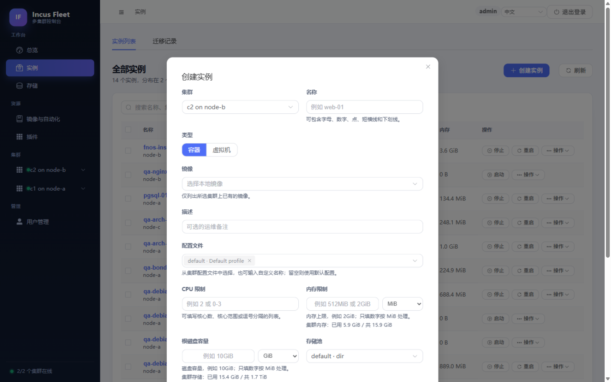

创建完成后,实例列表即可看到 `pgsql-01` 处于运行中,并获得与宿主机同网段
的 IP(示例网段 `198.51.100.0/24` 中的 `198.51.100.x`):

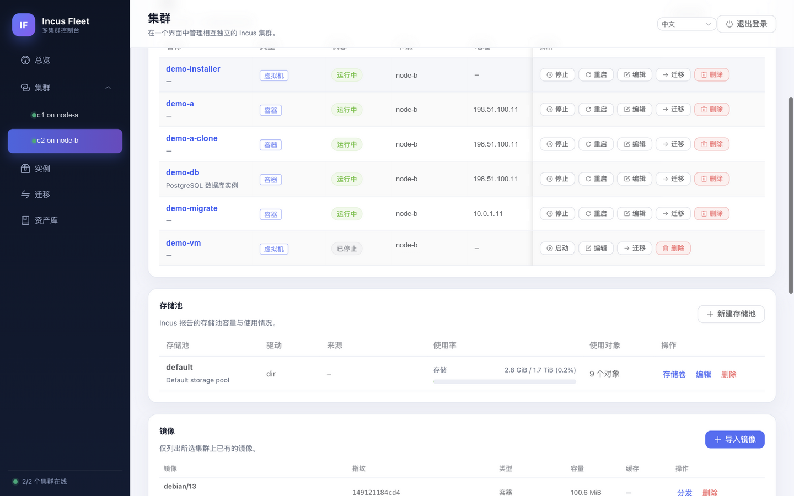

### 第二步:在线终端安装最新版 PostgreSQL

打开实例详情 → **终端** → **命令行**,输入命令并回车执行。Debian 仓库内的
版本可能落后,接入 [PGDG](https://www.postgresql.org/download/linux/debian/)
官方仓库即可安装当前最新大版本(示例安装到 PostgreSQL 18):

```sh
apt-get update
apt-get install -y curl ca-certificates gnupg
install -d /usr/share/postgresql-common/pgdg
curl -o /usr/share/postgresql-common/pgdg/apt.postgresql.org.asc \
  https://www.postgresql.org/media/keys/ACCC4CF8.asc
echo "deb [signed-by=/usr/share/postgresql-common/pgdg/apt.postgresql.org.asc] \
  https://apt.postgresql.org/pub/repos/apt trixie-pgdg main" > /etc/apt/sources.list.d/pgdg.list
apt-get update
apt-get install -y postgresql-18
```

安装完成后 `psql --version` 显示新版本,安装脚本会自动初始化集群数据目录:

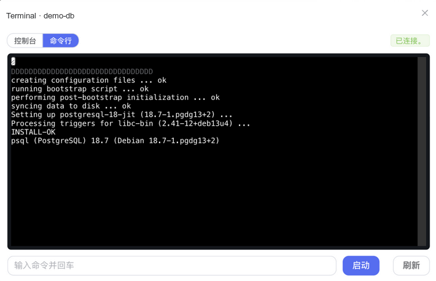

### 第三步:配置密码与监听

让数据库监听所有地址并放行局域网网段(把 `198.51.100.0/24` 换成你的实际
网段),再为 `postgres` 账号设置密码:

```sh
sed -i "s/^#\?listen_addresses.*/listen_addresses = '*'/" \
  /etc/postgresql/18/main/postgresql.conf
echo "host all all 198.51.100.0/24 scram-sha-256" >> \
  /etc/postgresql/18/main/pg_hba.conf
systemctl restart postgresql
```

```sh
su - postgres -c "psql -c \"ALTER USER postgres PASSWORD '<数据库密码>';\""
```

### 第四步:验证(密码 + 跨机)

在终端里通过本机 TCP(`127.0.0.1`)连接,验证密码认证与 TLS。Debian 默认的
`pg_hba.conf` 已放行 `host all all 127.0.0.1/32 scram-sha-256`:

```sh
PGPASSWORD='<数据库密码>' psql -h 127.0.0.1 -U postgres -c '\conninfo'
```

`Password Used: true`、`SSL Connection: true` 说明密码与加密均生效:

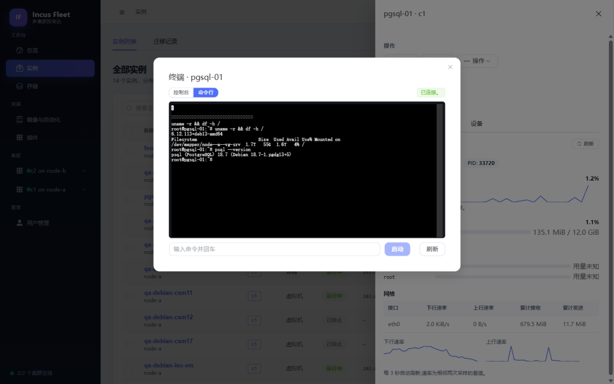

再从同网段的另一台实例(或任意局域网机器)连接,验证监听地址与网段规则:

```sh
PGPASSWORD='<数据库密码>' psql -h 198.51.100.x -U postgres -c 'select version();'
```

返回 `PostgreSQL 18.x ...` 即部署完成。日常运维可继续用在线终端执行
`systemctl status postgresql`、查看日志、创建数据库等操作。

> 提示:macvlan 实例与宿主机之间存在内核层面的隔离——**宿主机本身**无法
> 直接访问同父网卡的 macvlan 实例地址,但局域网内其他机器(含其他宿主机上
> 的实例)访问不受影响。验证时请从另一台机器发起连接。

## 跨集群迁移与 guest 网络

把实例迁移到另一个集群,也会把它搬到该集群的网桥子网。传输完成后,fleet 会要求 guest
释放旧 DHCP 租约并重新获取,因此实例会带着目标子网的地址、正确的默认路由和可用连通性
恢复回来 —— 无需手工执行 `dhclient`。

如果 guest 使用静态地址,或没有安装 DHCP 客户端,迁移仍然成功,fleet 只记录警告;
此时需要你自行调整该地址。

## 镜像与自动化、批量操作

fleet 按“用户要完成的任务”组织资源:创建实例需要的镜像与安装介质,以及
可重复使用的运维自动化内容,集中在左侧 **镜像与自动化** 页面。

### 镜像与自动化:按任务分组

左侧菜单进入 **镜像与自动化**,页面内按标签切换:

- **镜像**:所有集群的本地镜像,可导入、跨集群复制与刷新缓存。
- **安装介质(ISO)**:上传 ISO、从 ISO 启动虚拟机安装系统。
- **SSH 公钥**:保管公钥(名称 + 公钥内容,相同内容自动去重)。这里只是
  保管,不会自动下发——注入时机由你决定。
- **脚本**:保管运维脚本(名称 + 描述 + 内容),例如初始化、装软件、调优脚本。
- **无人值守安装**:可复用的无人值守安装模板(主机名、账户、密码、时区、目标磁盘、
  语言区域、键盘、**附加软件包** 及可选的自定义应答文件),可按安装器设为默认。密码需
  **二次确认**并在输入时显示**强度**指示。**目标磁盘** 仅对 Debian/d-i 与 kickstart 类型
  有意义——**Ubuntu autoinstall 与通用 NoCloud 会隐藏目标磁盘字段**,由安装器自行选择磁盘;
  但**语言区域与键盘布局对所有安装器都会生效**。

批量操作入口仍位于 **实例** 页面,见下一节。

### 批量操作:一键应用到多台实例

进入 **实例** 页面,勾选多台实例(可跨集群),顶部出现批量工具栏:

| 批量动作 | 说明 |
| --- | --- |
| 批量注入密钥 | 从公钥库选一把或多把,一键注入每台实例的目标账号;逐台显示成功/失败与退出码 |
| 批量执行脚本 | 从脚本库选一个脚本,以 root 在每台实例内执行;逐台捕获输出 |
| 批量启动 / 停止 / 重启 | 对选中实例执行电源操作 |

勾选会跨自动刷新保留——列表每 15 秒刷新也不会清掉你已勾选的实例,直到自己清除为止。

典型用法:新装一批实例 → 勾选全部 → 批量注入公钥 → 用保管私钥直接 SSH 免密
登录 → 批量执行初始化脚本。注入与脚本均走实例内 root 执行,密钥与脚本内容
通过 stdin 传递,不会出现在进程列表。

### 其他共性能力(roadmap)

按同一模式可持续补充的共性能力:实例分组/标签(按组批量)、定时快照计划、
备份导出模板等,已在规划中。

## 资源监控

fleet 的**核心监控无需在客户机内安装 agent**:宿主机容量、集群状态以及容器的
CPU/内存/磁盘/网络数据直接来自 Incus 实时状态接口。虚拟机的指标与客户机级运维动作
(命令行终端、文件管理、脚本、密码/SSH 密钥操作)**需要虚拟机内运行 Incus guest agent**;
官方云镜像创建的虚拟机自带 agent,无 agent 的虚拟机可使用
[安装 incus agent](#安装-incus-agent)。主机遥测(CPU、内存、负载、运行时间、网络计数器)
由节点上**可选的主机 agent** 提供;不安装时只有 Incus 提供的数据可用。

### 集群级:宿主机资源

仪表盘的每个集群卡片与集群详情页顶部都会展示宿主机的容量与实时水位:

- **CPU 核心数**与架构;
- **内存使用**:已用/总量,附水位进度条;
- 存储、实例数量等信息。

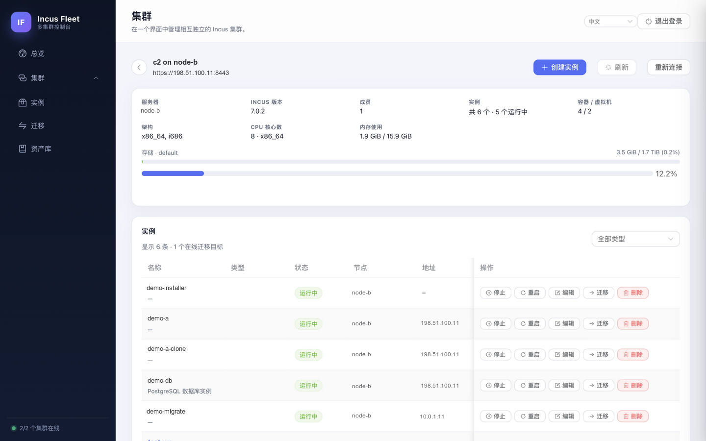

*集群详情:各成员容量与实时水位。*

### 实例级:每个容器/虚拟机的监控

实例详情抽屉新增 **监控** 标签页,每 3 秒自动采样:

- **CPU**:相对单核的占用率曲线(由相邻两次采样的 CPU 时间差计算);
- **内存**:用量/总量进度条,附峰值与 Swap;
- **磁盘**:每个挂载点的用量与容量;
- **网络**:每个接口的下行/上行速率(两次采样差值)与累计流量,附速率曲线。

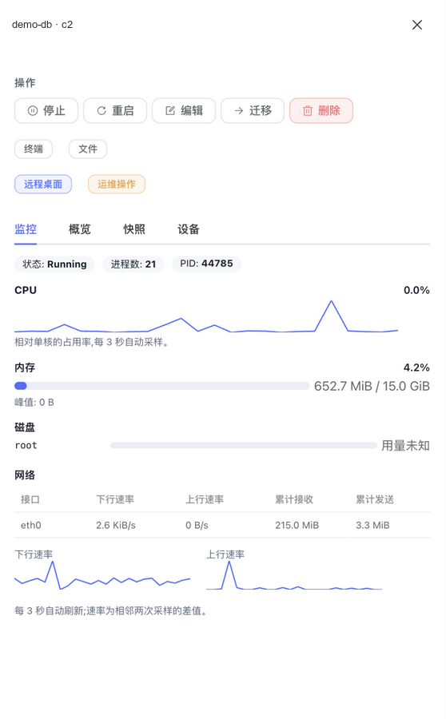

*实例抽屉:每 3 秒采样 CPU、内存、磁盘与网络。*

停止的实例只有状态行;虚拟机的指标依赖运行中的 Incus agent(用官方云镜像
创建的虚拟机开机后数秒内自动就绪)。

### 主机 agent 指标

安装可选 Rust 主机 agent 后，节点详情页会增加 **Host metrics** 面板，显示最近一小时的 CPU、
内存、负载、运行时间和网络计数器。中心只在内存保存这些样本（10 秒间隔，360 个点）；重启中心
会清空。需要更长保留或外部系统时，使用 API 导出（`json`、`prometheus` 或 `csv`）。

### 更深入的指标(roadmap)

进程级、自定义采集等客户机内部指标，规划通过扩展主机 agent 的 per-instance cgroup 和可选
eBPF 实现；当前 Incus 状态接口已覆盖常规运维所需的核心指标。

## 存储池与网络

集群详情页按标签组织:概览与节点、实例、存储、镜像与安装介质、网络、配置文件。

- **存储**:查看驱动与容量,创建/编辑/删除存储池;每个池下可创建与删除
  custom 卷(供设备挂载使用)。
- **网络**:查看并管理集群范围的受管网络。物理网卡、地址、路由、防火墙与 Wi-Fi
  是节点本地信息,在 **集群 → 节点 → 节点网络** 中管理。
- **配置文件**:配置模板的增删改,创建实例时可选择应用。

### Fleet volumes(跨集群存储清单)

顶层 **存储** 页面(`/volumes`)在单一表格中展示**所有集群**的 custom 卷:名称、所属
集群、存储池、内容类型、容量、使用方与位置。可用 **搜索** 框按名称查找,用 **集群** 筛选器
缩小范围;表头显示当前视图的**总数与已用容量合计**。存储池与卷的创建/删除仍在各集群的
**存储** 标签中完成,此页面只提供跨集群的只读清单。

## 私有互联网络

Incus 要求同一集群所有成员共享一份网络定义，因此托管网桥（`incusbr0`）在每个成员上都是相同的
子网和网关地址。为了在不改动客户机配置、也不依赖物理路由器的前提下让跨节点实例互通，fleet 为每个
集群管理一张私有互联网络：

- fleet 在每个成员上创建自己的宿主网桥（默认 `fleetbr0`）。因为它归 fleet 管理，集群网络一致性
  规则不适用，每个成员可以持有不同的网桥地址。
- 任意两个成员之间建立点对点 VXLAN 隧道：两个成员一条隧道，N 个成员构成全互联。成员之间的流量
  走隧道直连，只有出网流量经过网关。
- 其中一个成员作为**网关成员**：为互联子网运行 dnsmasq，并把该子网 MASQUERADE 到自己的物理网卡。

实例通过 legacy `nictype=bridged, parent=fleetbr0` 网卡接入，客户机继续使用原有的 DHCP 和默认
网关，内部配置完全不变。

在集群详情页启用（**私有互联网络 → 启用私有网络**）：选择子网、VNI、网关成员，可选填 MTU 和
DHCP 地址池。启用后点 **编辑** 可再次修改上述字段——包括子网、VNI、MTU、DHCP 地址池以及
**网关成员**——保存后重新下发配置。集群成员增减后点 **重新对账** 重建隧道全互联。
**关闭** 会移除每个成员上的隧道、DHCP、NAT 和网桥。

说明：

- 本期网关成员是单一出网点；多网关故障切换在计划中。
- `MTU` 默认 1450，为 1500 字节 underlay 上的 VXLAN 头预留空间；只有 underlay 支持 jumbo frame
  时才需要调高。
- 与集群其余网络一样，overlay 在 underlay 上是明文 VXLAN。跨站点需要加密时，可在其下叠加
  WireGuard。
- OVN 仍是 ACL、forward 和多租户隔离的未来选项；网络后端的抽象让这次切换只影响后端实现。

## 添加节点

打开集群的 **节点** 页面,点击 **添加节点**。有两种流程:

- **主机 agent(推荐)**:点击 **创建注册 token** 生成与该集群和成员名绑定的**一次性 token**
  (只显示一次,服务端只保存哈希)。在目标主机上以 root 执行生成的 **一键安装命令**:它会
  经 agent 网关下载 agent 二进制与 CA、用 token 注册并启动服务。之后对话框会**等待 agent
  连接**(太慢 token 会过期)。可选勾选 **通过包管理器安装 Incus**——节点上须预先配好软件源,
  并可固定版本前缀。agent 上线后点 **通过 agent 引导**:fleet 生成**签名的 安装/init/join
  spec**,agent 的特权 helper 在执行前校验签名,节点无需 SSH 凭据即可安装并加入集群。
- **SSH 回退**:未安装 agent 时选择 **改用 SSH**。填写成员名、地址、SSH 用户/端口与凭据
  (需要时含 sudo 密码)。fleet 通过 SSH 安装 Incus(可选)、配置存储目录并完成集群加入。
  对话框会展示配置进度与每步结果。

节点加入后,在私有互联网络上执行 **重新对账** 以扩展隧道全互联
(见 [私有互联网络](#私有互联网络))。

## 节点网络与操作历史

每个集群成员都有 **Node network** 页面（Cluster → Nodes → Manage node）。页头显示该成员的
显示名与本次会话选用的**后端名称**(`local`、`ssh` 或 `agent`)。页面分为四个标签:

- **网卡(NICs)**:接口状态、类型、地址和 Wi-Fi 关联;可启停网卡、打开地址对话框。
- **路由(Routes)**:目标网段、网关与设备;可新增、删除路由。
- **防火墙(Firewall)**:fleet 管理的防火墙规则表;可新增、删除规则。
- **Wi-Fi**:可见网络与信号强度,提供**独立重新扫描**按钮——重扫只刷新 Wi-Fi 标签,
  不重新加载页面其他部分,随后可凭凭据连接。

点击 **History** 可查看该成员的任务与审计时间线,包括操作、后端、结果、状态变化和时间戳。
每个变更操作都会被记录,但 Wi-Fi 密码、SSH/sudo 密码和 join token 绝不会出现在历史中。
当登录角色为只读时,变更控件(启停、增删、连接、重扫)会隐藏,而所有标签与历史仍可查看。
服务端的 `node_access.mode` 和 `ssh_write_fallback` 控制允许使用哪些后端;参见
[部署文档](deployment.md#节点网络管理可选)。

## 插件(管理员)

管理员可在侧边栏看到 **插件**。页面有两个顶层标签:**已安装**(状态、版本、角色与
wiring 摘要,并提供「停用 / 卸载」)与 **商店**(内置 `vm` / `vmlogs` 目录项)。点击
「一键安装」并填写已运行服务的上游地址,即可完成接入;安装会签发绑定插件 ID 的
作用域令牌,入口出现在侧边栏。选中插件可打开详情抽屉,固定五个标签依次是 **概览**、
**配置**、**连接(Wiring)**、**事件**、**危险区**。

已安装插件的界面通过同源 **`/plugin-ui/<id>/…`** 代理提供;代理不会把 Fleet 会话
Cookie 传给上游。接入现有服务、默认模板与脱敏截图见
[插件一键接入与默认模板](plugins-one-click.md);清单格式与路线见 [插件规范](plugins.md)。

### API token(带作用域)

fleet 签发带明确作用域、有效期与撤销能力的**按用户 API token**。管理员可列出并管理
**所有** token;普通用户通过 API 管理**自己的** token(`GET/POST/DELETE /api/v1/tokens`,
作用域词汇表在 `/api/v1/tokens/scopes`)。token 的**密钥仅在创建时显示一次**——请立即保存,
之后无法再取回。每个 token 带有作用域列表、可选有效期与最近使用时间;撤销立即生效。
目前**还没有专门的 token 管理 UI 页面**——请使用 API。token 设计及插件 token 的派生方式
见 [API token](api.md) 与 [插件规范](plugins.md)。

## 常见问题

- **上传镜像 413/失败?** 单镜像上限 8 GiB;超大镜像建议先压缩根文件系统。
- **分发镜像卡住?** 分发经源/目标集群之间直连传输,跨站点时耗时取决于带宽,
  可在目标集群镜像列表确认是否已出现。
- **Console 终端断开(1006)?** 容器串行控制台在退出时以此码关闭属正常现象;
  交互执行请优先使用 Exec。
- **终端报错打不开?** 服务端现在会在终端中显示 websocket 关闭原因:**缺少 guest agent**
  (请先安装,见 [安装 incus agent](#安装-incus-agent))、**实例已停止**(先启动实例)或
  **控制台被占用**(关闭占用它的会话后重试),每条原因都带有处理提示。
- **文件管理不能删除文件夹?** 暂不支持递归删除目录,可先删空后在实例内清理。
- **物理网卡不出现?** 该网卡必须是宿主机的 unmanaged 状态(未加入 Incus 托管网桥)。
- **远程桌面打不开或提示配置中?** 远程桌面仅支持虚拟机;首次打开会自动配置
  QEMU 监视器并重启该虚拟机,等待其启动完成后再重开一次会话即可,之后的打开
  都是即时的。
- **远程桌面需要放行哪些端口?** 无需额外端口。控制台经 SSH 驱动成员主机上的
  unix socket QEMU 监视器,不新增 TCP 监听。
- **运维操作报 agent 相关错误?** 虚拟机需要运行中的 Incus agent 才能执行命令,
  用官方云镜像创建的虚拟机开机后数秒内 agent 会自动就绪。
- **重建实例提示必须停止?** 镜像升级会重写根盘,Incus 要求实例处于停止状态;
  先停止再重建。
- **批量注入密钥失败一台会影响其他吗?** 不会,逐台独立执行并独立报告结果,
  失败实例可直接重试。
- **公钥重复添加会怎样?** 相同内容的公钥只保留一条记录(自动按内容去重)。
- **宿主机 ping 不通 macvlan 实例?** 这是 macvlan 的内核限制:宿主机与同父
  网卡的 macvlan 实例之间不能直接通信,局域网其他机器之间互访正常。需要
  宿主机直达实例时改用 bridge 网络,或从其他机器验证。
- **监控标签页没有数据?** 实例必须处于运行状态;虚拟机需 Incus agent 就绪
  (开机数秒内自动就绪)。速率为两次采样差值,刚打开时前几秒显示为 —。
